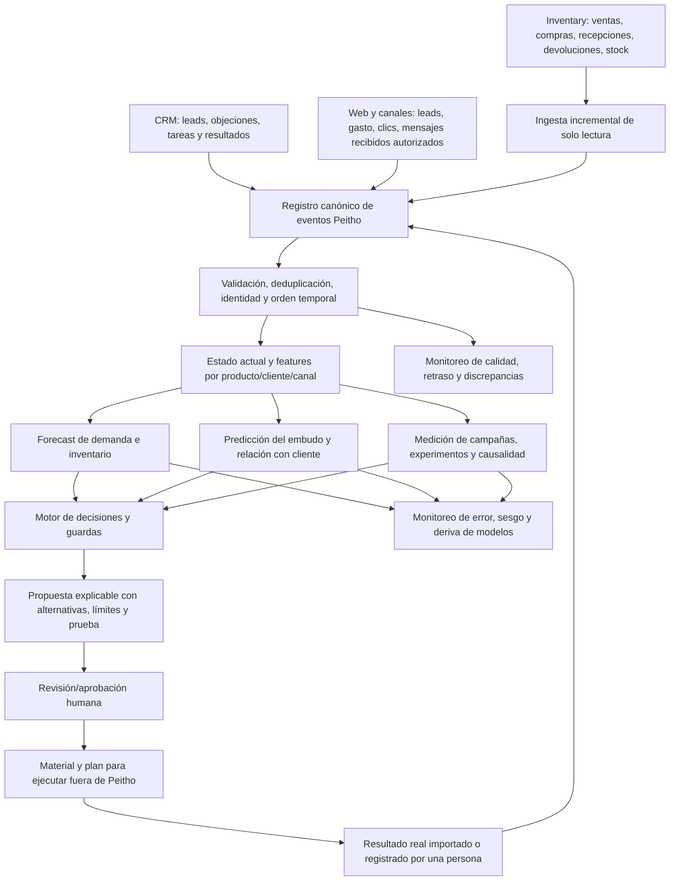
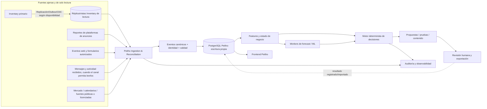

# Project Context

Description: Peitho es una plataforma prescriptiva de optimización comercial y marketing asistido por inteligencia artificial que integra analíticamente el ERP existente Inventary con un CRM propio, sin duplicar la autoridad transaccional del ERP. Analiza inventario, compras, ventas, logística, productos y clientes; aplica estadística y machine learning para estudiar preventa, venta y postventa; y prepara recomendaciones, escenarios, calendarios, segmentos autorizados y borradores omnicanal (redes sociales, WhatsApp, SMS, llamadas y correo electrónico) con trazabilidad, límites de stock/margen y revisión humana. Conforme a la propuesta enterprise aceptada, Peitho no envía ni publica campañas ni inicia comunicaciones: la ejecución externa corresponde a personas o sistemas autorizados fuera de Peitho, y sus resultados reales se importan para evaluación y aprendizaje.
Development type: both
Application type: web
Environments in scope: development, local, production
Database: new (postgresql); the agent designs and creates it
Database notes: El layout objetivo en la raíz incluye app-peitho-ecuapp para el frontend Angular + TypeScript y microservices-peitho-ecuapp para el backend modular Python/FastAPI, sus workers de analítica y los servicios de IA; esos nombres describen la estructura objetivo y no prueban que los directorios ya existan. La UX debe ser clara, accesible y responsive: no usar alert nativo; mostrar skeletons en carga, estados vacíos/error, formularios validados, selectores modernos, modales para tareas breves y stepper para formularios extensos o con varias secciones, con transiciones discretas y prevención de errores. El backend define contratos JSON request/response, cifrado de aplicación cuando corresponda como capa adicional a TLS, trazabilidad, auditoría, escalabilidad, health/readiness probes, webhooks de integración controlados y SSE cuando aporte valor. Las capacidades analíticas objetivo incluyen pronósticos y predicción, clasificación no supervisada, estimación de abandono, optimización de rutas cuando existan datos logísticos suficientes, evaluación de preventa/venta/postventa y análisis continuo de productos y clientes. El procesamiento continuo debe ser event-driven y programado, no un LLM en bucle permanente. Inventary sigue siendo fuente de verdad y se integra principalmente mediante réplica lógica dedicada hacia PostgreSQL de Peitho, con API interna de solo lectura para verificaciones puntuales; no se escribe sobre Inventary. El login inicial es local y seguro (Argon2id, TOTP/passkeys, TLS, sesiones seguras y auditoría), sin federación externa inicial. La pasarela de IA es autogestionada: vLLM en producción cuando la infraestructura lo permita y un microservicio Python/Sentence Transformers para embeddings locales en PostgreSQL + pgvector; Ollama queda para desarrollo. Elegir modelos tras benchmarks en español y vocabulario comercial ecuatoriano y revisión de licencias. No generar código spaghetti ni monolitos con funciones gigantes: separar dominios, adaptadores, validación, orquestación, workers y contratos, con pruebas en CI.

# PEITHO 3.0 — Especificación enterprise de inteligencia comercial, agentes y plataforma B2B

**Versión:** 3.0 — revisión enterprise con IA, multiempresa, Angular, Python, pgvector, MCP y APIs B2B  
**Fecha:** 29 de octubre de 2026  
**Estado:** propuesta de producto y arquitectura; no declara implementadas estas funciones  
**Sistema transaccional relacionado:** Inventary  
**Principio central:** Peitho observa hechos, aprende de resultados, determina oportunidades y prepara propuestas. **No envía ni publica campañas, mensajes, correos, llamadas, SMS ni contenido en redes sociales.**  
**Nota de artefactos visuales:** el snapshot actual del repositorio no contiene `DEMO_PEITHO_CONCEPTO.html` ni `DEMO_PEITHO_VISTA_PREVIA.png`; no son dependencias ni evidencia de funcionalidad. El estado real y el plan de implementación se encuentran en `README.md` y `docs/roadmap/`.

---

## 0. Decisiones que deben quedar cerradas antes de desarrollar

1. **Inventary continúa siendo dueño de los hechos operativos de inventario y ventas.** Peitho recibe una vista/replicación de lectura o contratos de datos de Inventary. Nunca modifica existencias, costes, compras, ventas, productos ni reservas en la base de Inventary.
2. **Peitho incluye su propio CRM comercial y su motor de inteligencia dentro de una misma plataforma y un mismo backend lógico.** No se recomienda crear un backend independiente para CRM si ese CRM se diseña específicamente para alimentar a Peitho; leads, oportunidades, actividades, preferencias, consentimiento y propuestas necesitan compartir contexto con la analítica.
3. **Peitho no reemplaza el ERP ni se fusiona con su base transaccional.** El ERP y el CRM tienen responsabilidades de negocio diferentes y fuentes de verdad distintas. Se integran con contratos explícitos, no con tablas compartidas para escritura.
4. **“Pensar constantemente” significa operar por eventos y ciclos de cálculo**, no invocar un modelo de lenguaje permanentemente. Cada venta, recepción, devolución, cambio de precio, actualización de stock, interacción o nuevo dato de mercado válido puede invalidar cálculos y generar trabajos. Los pronósticos, experimentos y modelos se ejecutan en horarios o umbrales definidos.
5. **El objetivo no es maximizar clics ni ventas brutas.** La función económica principal es mejorar la contribución rentable y sostenible, limitada por stock, coste, promesas de entrega, políticas, permisos y experiencia del cliente.
6. **Ninguna teoría comercial se trata como ley universal.** Peitho conserva el origen y fuerza de la evidencia, formula hipótesis, aplica guardas, observa el resultado y permite deshacer una estrategia que no funciona en ese negocio.
7. **Una recomendación no es un envío ni una venta.** El resultado solo cambia cuando una persona ejecuta la acción fuera de Peitho y se recoge evidencia de esa ejecución; una venta solo se considera confirmada al recibir el hecho correspondiente de Inventary.
8. **Datos desconocidos no se rellenan con imaginación.** Si faltan coste, stock reciente, atribución, consentimiento, cobertura o tamaño de muestra, Peitho debe mostrar “desconocido/no validado” y reducir o bloquear la recomendación.


### 0.1. Requisitos de plataforma enterprise añadidos en la versión 3.0

Esta revisión convierte los siguientes elementos en requisitos de arquitectura verificables, no en ideas opcionales de roadmap:

1. **Frontend corporativo Angular + TypeScript** con diseño propio, sistema de componentes, navegación por permisos, experiencia responsive, accesibilidad y controles de trabajo para equipos grandes.
2. **Backend principal Python** con FastAPI/Pydantic y módulos de dominio estrictos. Los procesos de ML no se ejecutan en el hilo de la API ni pueden modificar las fuentes transaccionales.
3. **Multiempresa real (multi-tenant)** desde el modelo de datos, el contexto de seguridad, el almacenamiento, las colas, los modelos, los vectores, las exportaciones y los límites de uso.
4. **PostgreSQL como base operacional de Peitho, ampliado con `pgvector`**. Los vectores son una capacidad de recuperación semántica/RAG, no sustituyen las tablas relacionales ni los algoritmos numéricos de pronóstico.
5. **Autenticación inicial local y segura**: TLS obligatorio, contraseñas con Argon2id, MFA mediante TOTP o passkeys/WebAuthn, sesiones seguras, recuperación controlada y auditoría. El cifrado de aplicación para el intercambio de credenciales, cuando corresponda, es adicional a TLS; OIDC/SAML no se habilitan en el despliegue inicial.
6. **APIs de agente IA para control y consulta de resultados** con esquemas cerrados, permisos, límites, validación, trazabilidad y respuestas que incluyan evidencia, versión y fecha de corte. Los agentes no obtienen acceso SQL libre.
7. **Servidor MCP de Peitho** para exponer herramientas/recursos controlados a otros asistentes y backends, con autorización OAuth, scopes por tenant y herramientas de solo lectura por defecto.
8. **APIs B2B-first** para clientes empresariales que quieran utilizar solo el backend: OAuth 2.1 client credentials o autenticación fuerte equivalente, scopes, cuotas, versionado, idempotencia, auditoría, portal para desarrolladores y sandbox.
9. **Riesgo y coste de comunicación**: Peitho genera análisis, recomendaciones, calendarios y borradores de WhatsApp/correo/redes; no conecta un dispatcher para enviarlos. Toda recomendación debe mostrar reglas aplicables, coste estimado y vigencia de la fuente de precios.
10. **Postura de producción, no demo**: aislamiento tenant, objetivos de disponibilidad/frescura, backups restaurables, CI/CD, pruebas de seguridad, recuperación, gestión de incidentes, gobierno de modelos y despliegue sin interrupciones.

### 0.2. Principios que no se negocian

- Inventary es la autoridad de stock, coste, compras, ventas, devoluciones y movimientos registrados. La conexión de Peitho a sus datos operativos es de solo lectura; no se comparten tablas de escritura ni credenciales con privilegios de modificación.
- El CRM propio de Peitho gestiona leads, oportunidades, actividades, notas comerciales, objeciones, preferencias, consentimiento y ownership comercial. Una venta real se confirma solo al recibir evidencia de Inventary o de otra fuente transaccional designada.
- Un permiso oculto en Angular no es seguridad: toda lectura, acción, exportación, herramienta MCP y endpoint B2B valida autorización en backend y en la capa de datos.
- Todo resultado analítico distingue **observado**, **inferido**, **pronosticado**, **causalmente estimado** y **desconocido**. Ninguna respuesta de un LLM convierte una hipótesis en un hecho.
- “Pensar continuamente” significa ciclos event-driven, reconciliaciones y evaluaciones programadas; no una petición continua e ilimitada a un LLM.
- La estrategia comercial se elige por contribución incremental neta, no por tasa de clic o ventas brutas aisladas.

## 1. Qué es Peitho y qué no es

Peitho es una plataforma de **inteligencia comercial continua, CRM de preventa/venta/postventa, pronóstico y creación de propuestas**. Su responsabilidad es entender cómo está el negocio ahora, detectar cambios relevantes, identificar oportunidades o riesgos, recomendar qué hacer, preparar cómo comunicarlo y evaluar si la decisión funcionó.

Peitho debe poder responder, con trazabilidad a datos y con fecha de corte:

- ¿Qué está pasando con cada producto, cliente, categoría, canal, campaña, vendedor y etapa del embudo?
- ¿Qué cambió desde la última hora, día, semana o ciclo de compra?
- ¿La caída de ventas es falta de tráfico, caída de conversión, menor disponibilidad, precio, competencia, entrega, calidad, estacionalidad, mezcla de clientes o una falla de medición?
- ¿Qué producto conviene impulsar y cuál debemos dejar de promocionar porque puede agotarse, deja poco margen o tiene demasiadas devoluciones?
- ¿Qué clientes o leads deberían ser atendidos primero y qué argumento es más relevante para su necesidad declarada?
- ¿Qué propuesta de producto, contenido, oferta, guion, calendario o experiencia vale la pena considerar?
- ¿Qué evidencia apoya la recomendación, qué no sabemos, cuánto podría costar, qué límites debe respetar y qué resultado la invalidaría?
- ¿La estrategia realmente añadió ventas y margen que no habrían ocurrido de otra manera, o simplemente se atribuyó ventas orgánicas?
- ¿Qué debemos aprender de una venta perdida, una devolución, una demora, una queja, una recompra o una recomendación no utilizada?

### 1.1. Peitho no ejecuta comunicaciones salientes

Fuera de alcance deliberado y verificable:

- No publica contenido en Instagram, Facebook, TikTok, YouTube, marketplaces, blogs ni otros canales.
- No envía mensajes por WhatsApp, correo, SMS, mensajería social ni notificaciones.
- No realiza ni inicia llamadas.
- No activa, pausa ni modifica campañas publicitarias ni presupuestos de plataformas.
- No aplica promociones, no cambia precios y no crea reservas ni pedidos en Inventary.
- No acciona botones de “enviar ahora” dentro de Peitho ni dispone de credenciales que permitan hacerlo.

Sí debe:

- Proponer el texto exacto, variantes, estructura visual, formatos, recursos necesarios, CTA sugerido, objeciones a contestar, franja recomendada y condiciones de validez.
- Generar un brief visual, mockup, guion de video, carrusel propuesto, ficha comercial, guion de atención, estructura de landing o material que una persona pueda revisar y llevar a otra herramienta.
- Preparar listas de oportunidades o segmentos **para revisión humana** con la base y finalidad de uso documentadas; no despachar mensajes a esas personas.
- Importar de forma autorizada datos de resultados de campañas, leads o conversaciones ya ocurridas, siempre que el canal ofrezca ese acceso y la empresa tenga derecho a tratar esos datos.
- Registrar manualmente o por integración de lectura si un responsable ejecutó la propuesta, cuándo y qué resultado se observó.

**Control de seguridad:** las credenciales, permisos OAuth y API keys de Peitho no deben incluir alcances de escritura para envío/publicación. La separación debe quedar implementada en el backend, no solo en botones ocultos del frontend.

---

## 2. Respuesta arquitectónica: ¿ERP, CRM y Peitho deben tener el mismo backend?

### Decisión recomendada

**No fusionar el backend ni la base transaccional de Inventary con Peitho. Sí incluir CRM e inteligencia dentro del backend de Peitho.** El ERP y el CRM no tienen que ser productos desconectados, pero tampoco deben compartir indiscriminadamente la autoridad para modificar la misma información.

| Dominio | Dueño recomendado | Puede escribir | Peitho hace |
|---|---|---|---|
| Producto/SKU oficial, categoría operativa, precio autorizado, coste y método de coste, almacenes/ubicaciones, reservas, stock disponible, compras, recepciones, ventas contabilizadas, cancelaciones, devoluciones, movimientos y saldos | **Inventary** | Inventary mediante reglas de negocio transaccionales | Lee, sincroniza, analiza, calcula proyecciones y avisa; no escribe de vuelta |
| Lead, fuente de captación, oportunidad, etapa, actividades, tarea, SLA de atención, objeción, necesidad declarada, nota comercial permitida y recomendación asignada | **Peitho CRM** | Peitho | Administra el ciclo comercial y conserva el historial |
| Consentimiento/preferencias de contacto y oposición por finalidad/canal; prueba de cómo se obtuvo | **Peitho CRM**, vinculado al origen del consentimiento | Peitho según permisos | Usa la información como guarda; no envía comunicaciones |
| Campañas, anuncios, gasto, impresiones, clics y resultados reportados por Meta/Google/TikTok u otra plataforma | Plataforma de origen | Plataforma; Peitho solo obtiene los datos permitidos por scopes de lectura o importación | Normaliza, compara y relaciona con ventas cuando hay evidencia suficiente |
| Predicciones, variables derivadas, segmentos analíticos, modelos, experimentos, hipótesis, recomendaciones, borradores visuales, aprobaciones internas y resultados de pruebas | **Peitho** | Peitho | Es su producto central |
| Ejecución real de una propuesta fuera de Peitho | Equipo/servicio externo autorizado | Quien la ejecutó; se documenta en Peitho | Registra que fue ejecutada, no la ejecuta |

### 2.1. ¿CRM dentro de Peitho o CRM independiente?

Para el caso de uso descrito, el CRM debe ser un módulo de Peitho porque su valor depende del mismo contexto usado por el motor de decisiones: lead, cliente, producto que buscó, stock, margen, venta, devolución, objeción, momento de atención, recomendación e impacto. Un backend CRM separado añadiría sincronización, duplicados, retrasos y problemas de consistencia sin aportar un beneficio claro al inicio.

El backend se diseña como una **plataforma modular Python** con límites de dominio y procesos desplegables separados por carga y riesgo: API transaccional, ingesta/reconciliación, workers de analítica, gateway de IA/MCP y APIs B2B. No se fragmenta cada módulo en un microservicio independiente sin una razón operativa medida; sí se definen contratos, permisos, colas, observabilidad y ownership de datos desde el inicio.

### 2.2. ¿ERP dentro de Peitho?

No debe crearse un segundo ERP dentro de Peitho. Inventary ya es el sistema de inventario/ventas estudiado para este propósito. Construir un segundo ERP causaría riesgo de doble stock, ventas duplicadas, diferentes costes, divergencia de precios y reportes contradictorios.

Si en el futuro Inventary no tiene un dominio empresarial necesario —por ejemplo, logística de última milla— se podrá implementar el módulo específico en el sistema que sea dueño operativo de ese proceso; Peitho consumirá los estados o podrá gestionar una vista comercial si así se define. No debe adjudicarse esa propiedad solo porque Peitho necesita analizar el proceso.

### 2.3. Base de datos de Inventary solo en lectura

**Decisión aceptada para producción:** utilizar una **réplica lógica dedicada de Inventary hacia PostgreSQL de Peitho** como mecanismo principal de integración de datos. Complementarla con una **API interna de Inventary de solo lectura** para verificaciones puntuales —especialmente disponibilidad y precio vigente—. No ejecutar consultas analíticas intensivas sobre la base transaccional de Inventary ni usar una read-replica transaccional como almacén analítico principal.

La réplica es una proyección de integración, no un almacén analítico perfecto ni una nueva fuente de verdad. La replicación lógica de PostgreSQL replica cambios de datos de las tablas publicadas; **no replica automáticamente definiciones del esquema ni cambios DDL**. Las migraciones de origen y suscriptor deben coordinarse, probarse y versionarse. Referencia: [PostgreSQL Logical Replication](https://www.postgresql.org/docs/current/logical-replication.html).

#### Flujo y frescura de datos

1. Acordar con Inventary la publicación lógica, las tablas/columnas necesarias, claves estables y versión de esquema. No asumir que tablas, eventos, publicación o API ya existen.
2. Inicializar la suscripción y carga base en PostgreSQL dedicado de Peitho. Mantener credenciales y redes separadas y limitar el alcance a datos aprobados.
3. Usar los cambios replicados para alimentar eventos canónicos y proyecciones versionadas de productos, stock, costes, compras, recepciones, ventas, cancelaciones, devoluciones y movimientos existentes en la fuente.
4. Registrar por conjunto de datos la hora de actualización observada en origen, recepción/aplicación, watermark o posición de replicación, retraso, versión de esquema, última conciliación e identificador de snapshot/lote.
5. Conciliar recuentos, cantidades, importes, rangos temporales y saldos por producto/almacén. Si hay discrepancia, falta de continuidad o esquema incompatible, marcar la proyección como degradada/obsoleta.
6. Antes de etiquetar como confirmada una propuesta dependiente de disponibilidad instantánea, consultar el snapshot de lectura más reciente y, cuando corresponda, verificar mediante la API interna de solo lectura. Si no puede verificarse, queda **no confirmada**; nunca inventar disponibilidad.
7. Inventary conserva la autoridad de stock y ventas. Peitho nunca registra ventas ni modifica existencias, compras, precios, productos, reservas o movimientos en Inventary.

#### Protección operativa obligatoria

- La cuenta/rol de integración tendrá permisos mínimos y solo acceso a objetos autorizados; no tendrá privilegios de escritura ni DDL en el origen.
- Supervisar posiciones de replicación/LSN, lag de envío y aplicación, estado de suscripciones, errores del apply worker, slots de replicación, crecimiento/retención del WAL, disco, antigüedad de snapshots, conciliación y capacidad de recuperación. Un consumidor detenido puede retener WAL y agotar disco.
- Probar recuperación de suscripción, resincronización, restauración de backups y comportamiento ante DDL incompatible.
- La API interna usa endpoints tipados de solo lectura con autenticación de servicio, permisos mínimos, límites y auditoría. No ofrece SQL libre ni acceso SQL directo al LLM.
- Los umbrales de frescura y tolerancia de conciliación se configuran por ambiente antes de producción. Si faltan umbrales o métricas, el estado no se considera saludable.

**Condición de despliegue:** inventariar los contratos reales del commit desplegado de Inventary. Outbox/Kafka o una API concreta solo se incorporan si su existencia, cobertura, semántica e idempotencia se verifican.
---

## 3. Investigación de mercado y evidencia del mundo real

La investigación debe usarse para formular buenas hipótesis, no para importar reglas universales de otros mercados. Las fuentes empresariales suelen describir lo que la propia compañía mide y vende; son evidencia útil de prácticas y escala, pero no siempre son evaluaciones independientes ni prueban causalidad. La ciencia publicada ayuda a identificar límites, pero tampoco reemplaza los datos propios. Peitho necesita unir ambas fuentes.

### 3.1. Lo que las fuentes de Ecuador permiten afirmar

- La Cámara Ecuatoriana de Comercio Electrónico y la Universidad Espíritu Santo informan en la séptima medición del ecommerce sobre 2024: **81,1 millones de transacciones de comercio electrónico**, USD 4.618 millones con medios bancarizados y USD 5.500 millones al incluir crédito directo y otras formas de pago; la publicación daba una proyección de USD 6.500 millones para 2025, que no debe etiquetarse como resultado observado hasta cotejar el cierre final. La misma publicación indica que la **entrega a tiempo (83%)**, el **costo de envío (78%)**, las **promociones/descuentos (77%)**, las **opciones de envío (75%)** y el **servicio postventa (66%)** fueron atributos valorados por las personas encuestadas. Fuente institucional: [UEES/CECE — séptima medición del ecommerce](https://uees.edu.ec/cece-y-uees-presentan-los-resultados-de-la-septima-medicion-del-estudio-de-comercio-electronico-en-ecuador/) y [estudio 2025](https://cece.ec/wp-content/uploads/estudios-ecommerce-ec/Estudio-Ecommerce-2025-VII-Medicion.pdf).
- INEC presenta para julio de 2025: **71,3% de hogares con acceso a internet**, **80,1% de personas que usan internet** y **59,3% de personas con smartphone** según su definición estadística. Estos indicadores no significan que todos puedan pagar online, usen las mismas redes o compren con la misma frecuencia. Fuente: [INEC — TIC 2025](https://www.ecuadorencifras.gob.ec/tecnologias-de-la-informacion-y-comunicacion-tic/).
- DataReportal estima 15,4 millones de identidades de usuarios de redes sociales en octubre de 2025. La propia fuente advierte que las identidades no equivalen necesariamente a personas únicas y que las estimaciones de alcance publicitario pueden superar ciertos denominadores poblacionales. Por tanto, se debe usar como referencia de presencia potencial del canal, no como conteo exacto de clientes disponibles: [Digital 2026: Ecuador](https://datareportal.com/reports/digital-2026-ecuador).
- La guía de comercio electrónico de la International Trade Administration resume que en Ecuador se usan portales de marca, apps, marketplaces, redes y WhatsApp, y describe proveedores locales de pagos y última milla. Es una guía comercial externa y no un censo; sirve para configurar el abanico de canales a investigar, no para afirmar que un canal es siempre mejor: [Trade.gov — Ecuador eCommerce, 2 sep. 2025](https://www.trade.gov/country-commercial-guides/ecuador-ecommerce).

**Implicación de diseño para Ecuador:** la logística y la confianza comercial deben participar en el motor, no quedar en un panel apartado de marketing. Una propuesta puede mejorar los clics, pero si el coste de envío, la cobertura geográfica, el tiempo de entrega o la disponibilidad decepcionan, puede empeorar la venta neta, la recompra y la reputación. Las prioridades del estudio CECE/UEES son porcentajes de encuesta, no coeficientes causales universales; Peitho debe confirmar su relevancia por categoría, ciudad, ticket, canal y tipo de cliente.

### 3.2. Sistemas y empresas existentes: qué copiar y qué no

| Empresa / producto | Práctica observable y fuente | Lección para Peitho | Qué no se debe inferir |
|---|---|---|---|
| **Amazon** | En su 10-K del año fiscal 2025, Amazon afirma que ve los beneficios de envío Prime como herramientas de marketing eficaces y planea mantenerlos. [SEC Form 10-K 2025](https://www.sec.gov/Archives/edgar/data/1018724/000101872426000004/amzn-20251231.htm) | Una oferta económicamente costosa, como subsidiar entrega, puede tener sentido si mejora la propuesta de valor, frecuencia o retención global. Peitho debe modelar coste logístico, margen y comportamiento posterior, no prohibir por principio envío gratis o descuentos. | No demuestra que entregar gratis sea rentable para todas las pymes, todas las categorías o cada pedido. Amazon opera a escala y con ingresos/servicios adicionales. |
| **Walmart Connect** | Presenta medición de ciclo cerrado al conectar exposición publicitaria con compras en web, app y tiendas usando datos de primera parte; ofrece medición de atribución e incrementalidad. [Walmart Connect — Measurement](https://www.walmartconnect.com/insights/measurement) | La publicidad debe compararse con ventas reales, y en lo posible con grupos de control, no solo clics. Peitho necesita enlazar ventas de Inventary con resultados agregados de plataformas y documentar huecos de identidad. | La plataforma describe sus propios productos y escala; sus claims no son una garantía independiente para Peitho ni para el mercado ecuatoriano. |
| **Target Roundel** | Describe medición full-funnel, ventas verificadas e incrementalidad, incluyendo pruebas aleatorizadas, mercados emparejados y control sintético. [Roundel — Measurement](https://roundel.com/measurement/) | Peitho debe soportar más de un método: experimentos cuando sea viable, grupos comparables y MMM agregado cuando corresponda. Separar ventas atribuidas de ventas incrementales. | Un modelo de atribución no convierte por sí mismo una asociación en efecto causal; el resultado depende del diseño y los supuestos. |
| **Salesforce / State of Sales 2026** | Una encuesta global de 4.050 profesionales publicada en febrero de 2026 informó que los equipos citan agentes/IA para crecimiento y que datos desconectados ralentizan iniciativas. El estudio es una encuesta a profesionales, no un ensayo causal ni una muestra de Ecuador. [Salesforce — State of Sales 2026](https://www.salesforce.com/news/stories/state-of-sales-report-announcement-2026/) | La integración y limpieza de datos son una precondición del agente inteligente. Priorizar historial completo, deduplicación, coste y ventas netas antes de comprar o entrenar modelos complejos. | No asumir que desplegar un agente aumentará el cierre en la misma proporción; el estudio no mide el efecto para esta empresa. |
| **HubSpot** | Su estudio de tendencias de marketing, actualizado en 2026, reúne respuestas de más de 1.500 marketers globales e informa uso de IA, personalización y automatización. [HubSpot — Marketing trends](https://blog.hubspot.com/marketing/marketing-trends) | Preparar variantes de contenido adaptadas al producto/segmento y ahorrar trabajo de creación, pero medir su efecto y mantener revisión humana de hechos/tono. | Las preferencias de marketers encuestados no prueban que una táctica convierta más a una audiencia específica en Ecuador. |
| **Gong Labs** | Publica análisis de miles de millones de interacciones comerciales de los clientes de su plataforma, incluidas más de 120 millones de llamadas en un estudio sobre compradores silenciosos. [Gong Labs](https://www.gong.io/gong-labs) | Estudiar patrones de conversación, silencios, objeciones, tiempo de respuesta, próximos pasos y comportamientos que preceden a oportunidades ganadas/perdidas, siempre dentro del consentimiento y permisos. | Es una muestra de uso de su producto, con sesgo de selección; la correlación de una conducta con ventas no prueba que imitarla cause un cierre. Peitho no debe grabar llamadas por defecto. |
| **Shopify** | En su análisis de Q1 2026 de tiendas de su plataforma, Shopify informó que el tráfico referido por búsqueda IA convirtió cerca de 50% más y tenía AOV 14% mayor que el tráfico de búsqueda orgánica, calificándolo como señales tempranas. [Shopify — AI search insights](https://www.shopify.com/enterprise/blog/ai-search-insights) | Registrar origen de tráfico y medir calidad por sesión/lead/venta. Estar preparado para nuevos canales de descubrimiento con datos verificables. | Son datos agregados de comerciantes de Shopify, de una ventana temprana y con posible composición diferente de tráfico; no pronostican automáticamente el resultado de una tienda ecuatoriana. |
| **Klaviyo** | Su documentación de predictive analytics exige condiciones mínimas para mostrar CLV predictivo, como al menos 500 clientes con pedido, 180 días de historial, pedidos recientes y algunos compradores recurrentes, en los tipos de integración descritos. [Klaviyo — Predictive analytics](https://help.klaviyo.com/hc/en-us/articles/360020919731) | No mostrar CLV individual o propensión precisa si aún no hay suficientes pedidos/historial; usar reglas descriptivas y comunicar el estado de “datos insuficientes”. | Es el umbral del producto Klaviyo y no una ley matemática universal ni el mínimo exacto para todos los modelos. Peitho establecerá umbrales con simulación/calidad propia. |
| **Google Meridian** | Framework abierto de Marketing Mix Modeling (MMM), con efectos retardados, saturación, controles y calibración con experimentos. La documentación dice explícitamente que MMM observacional depende de supuestos que pueden sesgar los resultados. [Meridian](https://developers.google.com/meridian/docs/basics/meridian-introduction), [supuestos causales](https://developers.google.com/meridian/docs/causal-inference/about-mmm-causal-inference-methodology) | Adoptar MMM cuando haya series agregadas de gasto/alcance y ventas suficientes, hacer análisis de sensibilidad y calibrar con tests de lift siempre que sea posible. | Open source no equivale a simple, gratis de operar, correcto con pocos datos ni automáticamente causal. |
| **Meta Robyn** | Framework open source de MMM con regularización, optimización de hiperparámetros, descomposición de series y asignación de presupuesto; el proyecto lo describe como experimental. [Meta Robyn](https://facebookexperimental.github.io/Robyn/) | Evaluar herramientas abiertas para evitar licencias, pero conservar criterio experto, validación y explicabilidad. | No instalarlo y aceptar el mejor resultado matemático sin validar calidad, supuestos y estabilidad. |

### 3.3. Lo que contradice las reglas simples: promociones en el mundo real

La práctica de empresas como Amazon demuestra que un beneficio con coste puede ser estratégico; la investigación también muestra que los efectos de las promociones dependen del tipo de oferta, el producto, el canal, el tiempo y el hábito del consumidor:

- Un estudio con datos de punto de venta sobre duración de promociones encontró que la contribución a beneficios puede disminuir conforme se prolonga la promoción [Journal of Retailing and Consumer Services, 2021](https://www.sciencedirect.com/science/article/pii/S0969698920312856).
- Un estudio de 2017 sobre rendimiento de tiendas encontró que descuentos destacados pueden atraer tráfico para productos de alta penetración/frecuencia, pero aumentar los artículos descontados en una categoría puede reducir el margen [Journal of Retailing](https://www.sciencedirect.com/science/article/pii/S0022435917300490).
- Un estudio de 2025 sobre flash sales versus ventas continuas analiza cómo la magnitud/temporización de los descuentos y el nivel de experiencia/seniority del consumidor modifican la rapidez y continuidad del efecto en los datos de Woot.com; no prueba una estrategia universal [Journal of Retailing and Consumer Services, 2025](https://www.sciencedirect.com/science/article/pii/S0969698925001018).
- Un artículo de 2026 encuentra diferencias entre descuentos temporales, cupones, acuerdos por volumen y promociones multiproducto, incluyendo diferencias entre cambio de marca y consumo incremental [Journal of Retailing, 2026](https://www.sciencedirect.com/science/article/pii/S0022435925001009).

**Regla de Peitho:** no recomienda “descuento sí” ni “descuento no” en abstracto. Estima el mecanismo que se quiere activar, coste, efecto plausible, stock/cobertura, riesgo de canibalización, posible adelanto de compras futuras y objetivo comercial. Puede recomendar precio normal, bundle, envío subsidiado, regalo, garantía, contenido educativo, mejor información técnica o ninguna acción. La estrategia de menor descuento no siempre es la mejor; la estrategia de mayor conversión tampoco siempre es la más rentable.

### 3.4. Evidencia local primero, generalización después

Los estudios y prácticas de terceros alimentan el catálogo inicial de hipótesis. El orden de evidencia en Peitho será:

- **E0 — Hipótesis:** experiencia del equipo o idea sin validación.
- **E1 — Evidencia externa transferible con cautela:** estudios académicos, casos empresariales, informes sectoriales; registra la población, fecha, país y limitaciones.
- **E2 — Asociación en datos propios:** los hechos locales muestran una relación, pero todavía no prueban causalidad.
- **E3 — Prueba local controlada o cuasi-experimental:** diseño y métrica fijados antes de ejecutar una acción fuera de Peitho.
- **E4 — Replicación:** efecto consistente en más de un periodo/cohorte, con margen, inventario, devoluciones y experiencia dentro de límites.

Una recomendación no se vuelve “mejor práctica comprobada” únicamente porque un modelo le asignó 92 puntos, porque una red social la popularizó o porque un caso de una multinacional la usó. Peitho debe guardar el vínculo entre afirmación, fuente, evidencia propia y decisión humana.

---

## 4. Definición operativa del “cerebro comercial”

El backend funciona como un circuito de observación y decisión, con información nueva a medida que llega. No depende de que alguien abra un dashboard para recalcular todo.



### 4.1. Qué significa “pensar” de forma continua

Cada nuevo evento válido desencadena solo el trabajo afectado:

- Nueva venta contabilizada: registrar el hecho neto de la venta, actualizar cohortes, ritmo de demanda, productos comprados juntos, conversión del embudo y resultado de propuestas asociadas; refrescar la vista de disponibilidad desde la fuente.
- Recepción de compra contabilizada: actualizar estado de stock y cobertura, no solo “compra creada”. Una orden de compra pendiente no son unidades disponibles.
- Devolución o cancelación: corregir ingreso neto y resultado de la campaña/oportunidad según el estado confirmado; actualizar métricas de calidad y coste de retorno.
- Cambio de inventario/stock: reevaluar propuestas dependientes de SKU y almacén. Si el stock no cubre el riesgo de demanda más el colchón requerido, bloquear la propuesta de presión de demanda.
- Nuevo lead/interacción: calcular prioridad y SLA, sugerir próximos pasos y registrar nueva información; no declarar intención de compra solo porque hubo un clic.
- Actualización de gasto/campaña o resultado de plataforma: recalcular métricas de origen con su nivel de confianza y diferenciar atribución de incremento causal.
- Nuevo resultado de experimento: actualizar el conocimiento sobre una hipótesis sin borrar resultados anteriores.
- Deterioro de la calidad o retraso de la fuente: degradar la confianza y suspender recomendaciones para las que el dato sea requisito esencial.

La ejecución de IA generativa no necesita activarse en cada fila importada. Se usa cuando hace falta sintetizar evidencia, redactar una propuesta o interpretar texto permitido. Los cálculos críticos de stock, margen, permisos, deduplicación y reglas son código determinista, no una respuesta libre de un LLM.

### 4.2. Ritmo de ejecución objetivo

Estos valores son **objetivos iniciales de diseño**, no una garantía hasta validar infraestructura, frecuencia de eventos y rendimiento real:

| Proceso | Objetivo inicial | Requisito de control |
|---|---|---|
| Aceptar evento ya ocurrido y deduplicarlo | Segundos | Evento estable, checkpoint, idempotencia y alerta de fallos |
| Refrescar proyecciones críticas | P95 menor a 60 segundos con flujo incremental saludable | Mostrar watermark/última actualización; medir lag de cola y reconciliar |
| Consulta de disponibilidad antes de mostrar propuesta | Último estado confirmado de lectura; consultar de nuevo si hay duda | Fecha y origen visible; bloquear si supera el TTL configurado |
| Reconciliación de ventas, compras, devoluciones y stock | Cada noche como mínimo; más frecuente para saldos críticos cuando la carga lo permita | Comparación total por periodo/SKU/almacén y alertas por discrepancia |
| Cálculo de features y scores ligeros | Por evento afectado y/o cada 5–15 minutos según dominio | No recalcular toda la historia innecesariamente |
| Pronóstico operacional | Inicialmente diario; recalcular antes si cambia una señal crítica | Backtest de horizonte correspondiente y comparación contra baseline |
| MMM / presupuesto agregado | Cuando exista suficiente historia, normalmente mensual/trimestral según la ventana y negocio | No simular alta precisión con pocos puntos |
| Evaluación de recomendación/experimento | Según su horizonte de maduración; desde días hasta ciclos de recompra | No detener por mirar resultados repetidamente si afecta el criterio estadístico |
| Detección de deriva y cobertura | Diaria o semanal, más alertas event-driven | Activar fallback si el modelo falla o no está calibrado |

El operador puede configurar SLO por fuente y finalidad. “Inventario actualizado hace 3 minutos” puede ser aceptable para un reporte mensual pero inaceptable para una recomendación de campaña que podría vaciar el último stock disponible.

---

## 5. Captura de información: qué se recoge, cómo y quién lo hace

Peitho debe crear una **capa de datos de primera parte y una capa de integración comercial**. No todo el comportamiento se puede ni se debe capturar: solo se recoge lo necesario, con la base legitimadora, permisos, retención y calidad definidos.

### 5.1. Inventary: hechos operativos en modo lectura

Fuentes mínimas que el adaptador debería obtener o reconciliar, si existen en el esquema y API reales:

- Catálogo: identificador inmutable, SKU, producto/variante, categoría, unidad, estado, descripción aprobada y relación con otros productos.
- Estado de stock: físico, reservado/comprometido, cuarentena/no vendible, disponible oficial, ubicación/almacén, movimientos, transferencias en tránsito y fecha de lectura.
- Compras: orden creada, proveedor/fecha esperada, estado de aprobación, líneas, cantidad ordenada, cantidad recibida, devoluciones a proveedor y diferencias.
- Ventas: venta confirmada, fecha y zona horaria, canal reportado, líneas de producto, cantidades, precio neto, descuentos, impuestos si existen, coste/valoración disponible, estado y vínculo con cliente.
- Posventa: cancelación, devolución parcial/total, cantidad, motivo, estado, producto y coste asociado si Inventary lo registra.
- Señales que influyen en la demanda: roturas de stock, agotamientos, reposiciones, cambios de precio, cambios de catálogo, traslados y periodos sin disponibilidad.
- Identificadores externos ya permitidos y atributos para reconciliación, sin extraer secretos ni datos personales que el motor no necesite.

**No asumir:** una compra creada equivale a una recepción; unidades en tránsito equivalen a stock vendible; una factura o pedido equivale a una venta completada; una venta bruta es venta neta; cero ventas equivale a cero demanda; una devolución equivale siempre a restock; o el precio de lista es el precio cobrado.

### 5.2. Website y formularios de primera parte

Instrumentar el sitio web/ecommerce con eventos explícitos y pequeños, en el servidor o SDK first-party:

- `page_view`/página de producto cuando la medición tenga base válida; origen y campaña de la sesión mediante UTM/click IDs permitidos; timestamp en UTC y zona de negocio.
- `product_view`, `search_submitted`, `add_to_cart`, `remove_from_cart`, `checkout_started`, `purchase_confirmed` solo si el evento refleja el hecho verdadero y no se duplica por recargas.
- `lead_form_started`, `lead_form_submitted`, `quote_requested`, `appointment_requested`, `support_requested`, más la finalidad indicada y campos explícitamente entregados por el usuario.
- Resultado técnico: formulario válido/inválido, error, abandono de paso, latencia y causa conocida, evitando capturar el contenido entero de campos de forma accidental.

Usar `event_id`, `session_id` seudónimo, `occurred_at`, `received_at`, `source`, `schema_version`, `consent_state`/base aplicable, `utm_source`, `utm_medium`, `utm_campaign`, `landing_page` normalizada y el ID de entidad cuando sea posible. No usar fingerprinting encubierto ni escribir teclas pulsadas, contraseñas, datos bancarios, campos de salud, documentos o textos privados en un log genérico.

La sesión anónima no se convierte automáticamente en una persona identificada. La unión entre cookie/sesión y cliente debe tener base y evidencia suficientes, sin usar coincidencias ambiguas de dispositivo, IP o nombre para consolidar identidades como si fueran certezas.

### 5.3. Redes sociales y publicidad: extracción sin publicación

Peitho debe tener conectores de lectura a las plataformas autorizadas, con el alcance mínimo necesario, para importar según disponibilidad de API:

- Campañas, ad sets/grupos de anuncios, creatividades y estado reportado.
- Gasto, impresiones, alcance estimado, frecuencia, clics, visitas de landing, leads, conversiones reportadas y ventanas de atribución de la plataforma.
- Formularios de lead/ad leads, cuando existe permiso oficial y política que lo permita.
- Resultados agregados, cohortes y exportaciones de experimentos / lift, si la plataforma los facilita.
- Estado de cuenta/permiso, retraso, cuotas de API, campos eliminados/retirados y limitaciones de atribución.

No scraping de perfiles privados, no compra de bases de teléfonos/correos, no elusión de permisos, no extracción masiva de conversaciones no autorizada y no publicación desde estos conectores. Una API de lectura no necesariamente entrega la identidad ni todos los eventos de exposición de cada comprador. Si no hay señal, Peitho registra “no disponible”.

Cada importación debe conservar `source_platform`, `account_id`, `campaign_id`, `ad_id` cuando aplique, ventana de atribución, divisa, zona horaria, fecha de extracción, dimensiones y definición original de métrica. No comparar métricas con definiciones diferentes sin anotarlo.

### 5.4. WhatsApp, llamadas, correo y conversaciones

Peitho puede **analizar información de interacciones ya ocurridas** cuando provenga de una integración permitida, importación autorizada o registro hecho por el equipo. No inicia el contacto.

- Identificar canal, conversación/contacto seudónimo, fecha de entrada/salida ya ocurrida, responsable, estado (recibida, contestada, no entregada si el origen lo informa), intención manifestada y vínculo con oportunidad.
- Registrar el tiempo hasta la primera respuesta real, intervalos de silencio, preguntas pendientes, objeciones y siguiente paso prometido.
- Guardar mensajes completos solo cuando sea necesario, autorizado, con aviso/transparencia, retención corta apropiada y controles por rol; preferir metadatos/resúmenes enlazados al origen cuando basten.
- La transcripción o grabación de llamadas no se habilita por defecto. Debe revisarse jurídicamente, informar al usuario según corresponda, limitar acceso y retención y contemplar derechos del titular.
- Separar respuesta de soporte, comunicación necesaria para una transacción y marketing directo. Son finalidades diferentes.
- Capturar la baja/opt-out con evento auditable y respetarla en cualquier propuesta de lista. No enviar automáticamente desde Peitho aunque exista consentimiento.

Peitho debe registrar la procedencia y el instante del último mensaje de la persona, el origen de la conversación, el tipo de plantilla recomendado, el consentimiento y la tarifa efectiva por fecha/categoría/país. La documentación oficial consultada indica una ventana de entrada gratuita de 72 horas cuando la persona llega desde un anuncio de clic a WhatsApp o un botón CTA de una página de Facebook; no significa que los mensajes se vuelvan gratis después de las 72 horas. La página de precios y algunas fuentes secundarias recientes difieren sobre el cobro de mensajes de servicio desde octubre de 2026; por ello la propuesta no se basará en precios codificados: se exigirá validar el rate card oficial descargable vigente de Meta para Ecuador antes de calcular costos. [Meta — precios oficiales](https://whatsappbusiness.com/products/platform-pricing/) · [Política oficial de mensajes](https://business.whatsapp.com/policy/preview?lang=es_LA). Peitho solo calcula, evalúa riesgos y prepara borradores; nunca envía.

### 5.5. Información manual que solo el equipo puede conocer

Crear formularios breves para que el vendedor registre hechos no capturables automáticamente:

- Necesidad y uso esperado del producto.
- Presupuesto/rango aceptado cuando lo expresa el cliente.
- Decisor, fecha límite o dependencia del proceso de compra, si se declara de forma legítima.
- Objeción real: precio total, coste de envío, disponibilidad, confianza, compatibilidad, garantía, financiación, tiempos, servicio o competencia.
- Motivo de venta perdida con categorías estándar y nota opcional breve.
- Qué propuesta se presentó fuera de Peitho, qué versión se usó, canal/fecha y respuesta observable.
- Motivo de cancelación/devolución/queja y resolución real.

No inducir al vendedor a elegir siempre la categoría más fácil. Permitir “desconocido”, añadir “otro” y medir la tasa de campos de baja calidad. Las notas humanas deben distinguir cita directa, interpretación del vendedor y sugerencia de IA.

### 5.6. Investigación de mercado y competidores

Peitho debe poder registrar evidencia de mercado con el método, fecha y fuente:

- Precios públicos, variantes, disponibilidad declarada, costes de envío, tiempos de entrega publicados, garantías y términos promocionales públicos.
- Tendencias de búsqueda y demanda agregada de fuentes permitidas, tendencias estacionales, feriados nacionales/locales y eventos de calendario relevantes.
- Cambios de precio y contenido de competidores detectados por revisión humana o feeds licenciados/permitidos.
- Encuestas a compradores y prospectos, entrevistas de pérdida de venta, análisis de reseñas públicas conforme a términos de uso y soporte posventa.
- Cambios en plataformas de pago, entregas, regulación, costes de publicidad y condiciones de marketplace que afecten la contribución.

Cada observación incluye fuente/URL, fecha/hora de observación, ubicación/alcance, SKU/competidor, método, licencias/restricciones, confianza y expiración. Un precio leído hace 3 meses no se debe presentar como el precio actual de la competencia. Datos de mercado deben ayudar a explicar el contexto; nunca se debe inferir que la estrategia de un competidor es rentable con solo observarla.

---

## 6. Estado actual de inventario: modelo operativo para las decisiones

Peitho no debe limitarse a leer el campo “stock” una vez al día y restar ventas por su cuenta. Necesita comprender el estado de cada SKU/variante, almacén, fecha de corte y cadena de suministro, según la información que Inventary exponga.

### 6.1. Conceptos de stock que deben mantenerse separados

- **Stock físico registrado:** cantidad contabilizada en la ubicación/almacén, sujeta a fiabilidad del conteo.
- **Reservado/comprometido:** unidades no disponibles para otra venta por pedidos o procesos existentes.
- **No vendible:** cuarentena, daño, scrap o estado equivalente, si Inventary lo distingue.
- **Disponible oficial:** el valor calculado por Inventary de acuerdo a sus invariantes; Peitho lo consume como autoridad.
- **Compra pendiente:** cantidad ordenada no recibida, con fecha estimada y fiabilidad del proveedor; es entrada potencial futura, no stock actual.
- **Recepción contabilizada:** entrada de stock real en el momento en que Inventary la registra.
- **Transferencia en tránsito:** unidades que no están disponibles en origen y todavía no fueron recibidas en destino.
- **Devolución:** puede volver a stock, cuarentena o scrap según resultado real; no asumir restock automático.
- **Stock de seguridad / colchón comercial:** reserva calculada por política de servicio y variabilidad; es una guardia de decisión si la empresa la define, no una modificación del stock real.
- **ATP (Available to Promise) o disponibilidad prometible:** cantidad estimada que se puede prometer en un horizonte dado, considerando estado actual, compromisos y entradas futuras confiables; debe distinguirse del disponible inmediato.
- **Cobertura:** días estimados hasta agotar stock según forecast, con incertidumbre y demanda potencial no atendida.

No volver a implementar en Peitho reglas divergentes para obtener el saldo real. Si Inventary ofrece un valor autoritativo de disponibilidad, se guarda junto a los componentes fuente y se contrasta; si falta un componente, el resultado se etiqueta con esa limitación.

### 6.2. Bloqueos antes de recomendar que se venda o promocione

Para una propuesta de SKU/almacén, el backend valida como mínimo:

1. Fuente de stock actualizada, consistente y no marcada como discrepante.
2. Producto activo/publicable y correspondencia inequívoca entre SKU recomendado y SKU de Inventary.
3. Stock disponible/ATP suficiente para la demanda probable de la acción, sin consumir indiscriminadamente el colchón de servicio.
4. Horizonte de reposición, lead time del proveedor y compras pendientes con calidad de fecha conocida, si están disponibles.
5. Coste/margen y precio aprobados suficientes para la táctica propuesta. Si faltan costes válidos, no mostrar ROI monetario como verificado.
6. Riesgo de que la promoción traslade ventas de otro producto, genere ventas de clientes que iban a comprar al precio normal o haga daño en pedidos ya abiertos.
7. Riesgo de compatibilidad, rotura, devolución y servicio posventa.
8. Restricciones de canal, ciudad, entrega, promesa de fecha, términos de garantía y capacidad operativa.

**Ejemplo:** un SKU tiene 6 unidades disponibles y se pronostican 13 unidades de demanda para los próximos 14 días. Peitho no debe proponer una campaña de incremento de volumen como si no hubiera riesgo de agotamiento. Puede proponer revisar reposición, preparar contenido educativo sin demanda incremental, sugerir productos sustitutos reales o bloquear la acción. El resultado depende de los datos reales y del objetivo, no de una frase genérica de marketing.

### 6.3. Ventas observadas no son necesariamente demanda

Cuando el stock se agota, el cliente puede no comprar y las ventas observadas quedan censuradas: no se puede vender más unidades de las disponibles. La literatura de estimación de demanda censurada estudia este problema [Mersereau, *Demand Estimation from Censored Observations with Inventory Record Inaccuracy*](https://doi.org/10.1287/MSOM.2015.0520). Para cada SKU, Peitho debe conocer los períodos y horas en que el stock estuvo agotado/no disponible. Si no tiene esa historia, reconocerá el sesgo.

Para productos de venta intermitente no conviene utilizar una media simple sin analizar la frecuencia de ceros. Métodos como Croston y variantes se han estudiado para demanda intermitente, con ventajas y limitaciones específicas [Teunter & Duncan, estudio de forecasting intermitente](https://doi.org/10.1057/palgrave.jors.2602569), [Syntetos–Boylan/TSB y obsolescencia](https://www.sciencedirect.com/science/article/pii/S0377221711004437). El modelo se elige según comportamiento, coste de error y política de servicio, no porque el algoritmo sea popular.

---

## 7. El motor de decisión: predecir no basta

Peitho debe mantener motores diferenciados. Una única puntuación no puede responder con calidad a todas las preguntas.

### 7.1. Pronóstico de demanda por producto, almacén, canal y periodo

**Pregunta:** ¿cuántas unidades podrían demandarse en el próximo día/semana/mes y con qué incertidumbre?

- Granularidad configurable: SKU/variante × almacén × canal × día/hora cuando hay suficiente volumen; agregación por categoría/familia si hay pocos datos.
- Horizontes diferenciados según decisión: horas/días para disponibilidad y operación; semanas para reposición y contenido; meses para planificación y estacionalidad.
- Features potenciales: ventas netas por línea, stock-disponible por hora/día, roturas de stock, promociones y su intensidad, precio, descuentos, devoluciones, día de semana, feriados, estacionalidad, campañas (gasto/alcance por canal), tiempos de entrega, clima cuando sea relevante y fiable, cambios de competencia observados y compras de reposición.
- Comparar siempre con baselines de referencia: último valor, seasonal-naive, media móvil/ETS y modelos específicos de demanda intermitente. Un modelo complejo solo se conserva si mejora una métrica de negocio en backtesting temporal.
- Validación: rolling-origin / backtesting sin mirar el futuro, como recomienda Forecasting: Principles and Practice [Time-series cross-validation](https://otexts.com/fpp3/toolbox.html).
- Métricas: WAPE/MASE según la distribución, sesgo (forecast menos real), error por SKU/segmento, cobertura del intervalo, coste estimado de sobrestock/rotura y nivel de servicio. MAPE puede ser indefinido o engañoso con ventas cero; no usarlo como único criterio.
- Salida: P50/P80/P90 o intervalo equivalente, baseline, horizonte, fecha de entrenamiento/corte, error de backtest, factores de mayor influencia, estado de stock y advertencias.
- Retirada: si el error o sesgo supera el umbral configurado, cae la cobertura o un cambio de catálogo hace el historial no comparable, volver al baseline y notificar.

**No asumir estacionalidad solo porque enero difiere de diciembre una vez.** Si el producto es nuevo, hubo cambios de precio o está casi siempre agotado, el modelo debe mostrar una advertencia y usar información jerárquica/categoría únicamente cuando exista una justificación comprobable.

### 7.2. Predicción comercial del embudo y ventas

**Pregunta:** ¿qué oportunidades probablemente avanzarán, qué venta podría cerrar y cuándo?

- Etapas y tasas por cohorte: captado → contactado → calificado → oportunidad → cotización → negociación → ganada/perdida, adaptadas a la venta real.
- Tiempo hasta la primera respuesta y siguiente paso; tiempo en etapa y probabilidad de que el ciclo comercial permanezca abierto.
- Modelo de conversión por etapa, supervivencia/tiempo-a-evento o modelos calibrados según volumen y censura; evaluar por horizonte, no solo por precisión de clasificación.
- Previsión agregada del pipeline: distribución probable de ventas y fecha, no solo suma de `importe × probabilidad` sin calibrar las probabilidades de cada etapa.
- Métricas: calibración (Brier/log loss), precisión y recall en grupos de prioridad, error de forecast por semana/mes, tiempo a cierre, tasa de ventas netas tras cancelaciones/devoluciones y rendimiento por segmento.
- Si no hay suficientes oportunidades ganadas/perdidas en una categoría, usar reglas transparentes y rangos de base; no entrenar un modelo específico de ese segmento.

### 7.3. Lead scoring: separar intención, valor y necesidad de atención

No reducir todo a un score único. Usar al menos tres ejes:

1. **Intención observada:** solicitud de cotización, consulta de stock/compatibilidad, formularios, mensajes iniciados por el usuario, retorno a una propuesta y otros actos explícitos. Un like o una visita suelta no equivale a intención de compra.
2. **Encaje/valor potencial:** necesidad/producto/segmento, valor económico plausible, margen y capacidad real de servir al cliente. No inferir capacidad de pago ni sensibilidad al precio a partir de atributos sensibles.
3. **Urgencia operativa:** SLA vencido, mensaje pendiente, cita o promesa de respuesta, objeción que impide el cierre o riesgo de abandono en etapa activa.

La cola de trabajo combina estos ejes con reglas explicables. Un lead de bajo valor puede tener alta urgencia por servicio; un lead de alto valor puede no tener permiso o base para una comunicación de marketing. El sistema no utiliza raza, religión, salud, orientación sexual, ideología, ni otros datos sensibles para perfilar o priorizar.

### 7.4. Recompra, abandono y Customer Lifetime Value (CLV)

- **RFM** (recencia, frecuencia, valor monetario) como resumen descriptivo inicial; no como sentencia de propensión.
- Probabilidad de recompra dentro de un horizonte, intervalo probable entre compras y recomendación de momento para revisar una oportunidad.
- Churn/inactividad como concepto dependiente del ciclo natural de compra. Para consumibles de reposición en 30 días, la señal difiere de una compra de electrodoméstico que puede tardar años.
- CLV como valor previsto de la relación bajo un horizonte y margen definidos; separar ingresos brutos, contribución y valor descontado. Mostrar incertidumbre y cohortes comparables.
- La recompra no se deduce solo de que el cliente haya estado inactivo; el silencio puede significar satisfacción, falta de necesidad, compra a otra empresa, canal desconectado u opt-out.
- No generar “recomendaciones individuales precisas” a perfiles con pocos datos: el sistema puede ofrecer descripción de cohortes y límites.

Como evidencia práctica de madurez, Klaviyo solo muestra cierto CLV predictivo cuando un perfil/cuenta cumple condiciones de pedidos e historia [Klaviyo](https://help.klaviyo.com/hc/en-us/articles/360020919731). Peitho debe definir los umbrales con pruebas locales y comunicar por qué un modelo no califica, no copiar mecánicamente el número de un proveedor.

### 7.5. Recomendación de producto y canasta

- Identificar productos que se compran juntos por pedido (no solo coinciden en el mismo mes).
- Separar asociación histórica, complementariedad real y causalidad: un combo frecuente no necesariamente aumentará el ticket si el cliente iba a comprar ambos de todos modos.
- Reglas de compatibilidad/SKU antes que correlación: no recomendar accesorio que no encaja con el dispositivo.
- Incorporar disponibilidad, margen, devoluciones, garantía y canibalización.
- Recomendar sustituto cuando el original está agotado solo si la compatibilidad y el uso son equivalentes y están respaldados por catálogo.
- Probar bundle frente a venta individual, precio regular frente a descuento y recomendación frente a control cuando el volumen y la experiencia del negocio lo permitan.

### 7.6. Motor de marketing y atribución

Mantener las siguientes mediciones separadas:

- **Atribución del canal:** qué fuente reclama la plataforma o qué touchpoints se observaron.
- **Asociación descriptiva:** qué canal/contacto acompaña a una conversión en los datos.
- **Incrementalidad:** cuántas ventas/contribución adicionales causa razonablemente la intervención respecto a un contrafactual válido.
- **Marketing Mix Modeling (MMM):** estimación agregada de contribución por canal cuando existe suficiente historial de gasto, resultado y factores de control.

Los modelos MMM basados en datos observacionales dependen de supuestos y pueden resultar sesgados si se ignoran; Google lo señala explícitamente en la documentación de Meridian [supuestos de inferencia causal](https://developers.google.com/meridian/docs/causal-inference/about-mmm-causal-inference-methodology). Debe fijarse la pregunta causal (por ejemplo, efecto de una campaña en margen de 28 días), unidad, población, periodo, variables de control y limitaciones antes de modelar.

- Cuando sea viable: holdout aleatorio individual/regional, A/B test, geo-test o diseño cuasi-experimental con controles comparables.
- Si no se puede experimentar: estimación observacional con supuestos declarados, análisis de sensibilidad y etiqueta E2/E1; no publicarla como ROI incremental definitivo.
- Usar datos agregados si no se necesita identidad individual.
- No mezclar gastos sin impuestos con ventas con impuestos; alinear divisa, zona horaria, ventana de atribución y devoluciones.
- El gasto por campaña debe corresponder a un periodo/canal y su fuente. Si falta el coste, el ROI queda “no calculable”, no cero.

### 7.7. Experimentos y aprendizaje causal

Cada propuesta medible debería tener un experimento recomendado o un método de evaluación. Especificar antes de ejecutar:

- Hipótesis y mecanismo esperado.
- Unidad de asignación (usuario, cliente, cohorte, producto, área, tienda, día o región).
- Población elegible y exclusiones, consentimiento y stock.
- Tratamiento A/B, grupo de control y duración/horizonte de maduración.
- Métrica primaria y secundarias; margen neto, devoluciones y experiencia como guardas.
- Tamaño de muestra/potencia posible y efecto mínimo práctico.
- Riesgos de contaminación entre canales, estacionalidad, promociones concurrentes, usuarios que cambian de grupo y eventos de stockout.
- Regla de parada/lectura establecida antes; no detener por mirar a diario y quedarse con una fluctuación favorable.
- Registro del resultado, incertidumbre, desviaciones y decisiones.

La prueba aleatoria no es siempre posible. Peitho debe recomendar diseños proporcionados a la situación y ser honesto cuando solo hay asociación. Incluso una prueba bien diseñada responde a una pregunta definida y una población/periodo concretos; no es garantía de rendimiento futuro.

### 7.8. IA generativa: intérprete y redactora, no fuente de hechos

El LLM puede sintetizar patrones o generar borradores a partir de un contexto aprobado, pero no calcula por su cuenta los saldos, costes o probabilidades oficiales. Sus entradas deben proceder de funciones y consultas autorizadas, con IDs y fechas. Su salida debe pasar validaciones:

- Producto, SKU, compatibilidad, precios, stock, garantía y tiempos de entrega citados contra fuente actual.
- Afirmaciones de escasez, ahorro o urgencia solo si son verdaderas y trazables.
- Prohibición de inventar reseñas, testimonios, certificaciones, beneficios médicos, garantías, descuentos o comparación competitiva.
- No generar presión engañosa, escasez falsa ni promesas que la empresa no puede cumplir.
- Preservar tono, marca, vocabulario y contenido regulado validado por la empresa.
- Etiquetar contenido como borrador; almacenar modelo, versión, input contextual resumido, fecha y persona que revisa.

---

## 8. Motor de propuestas: qué entrega exactamente Peitho

Una recomendación de valor no es “publicar más en TikTok”. Debe entregar una propuesta operativa que el responsable pueda entender, corregir y ejecutar en otro sistema.

### 8.1. Contrato mínimo de una propuesta

Cada propuesta incluye:

1. `proposal_id`, título, versión, fecha, estado (borrador, pendiente de revisión, revisada, descartada, ejecutada fuera de Peitho, resultado pendiente, cerrada).
2. Problema/oportunidad detectado, fecha de corte y fuente de datos que lo sustenta.
3. Objetivo de negocio: margen de contribución, venta neta, recuperación de lead, tiempo de respuesta, recompra, reducción de devolución, liquidación de inventario o aprendizaje.
4. Producto/SKU/categoría, segmentos/cohortes o periodo destinatario; criterios de inclusión y exclusión.
5. Evidencia propia con tamaño de muestra, ventana, comparación/base y nivel E0–E4.
6. Contexto de inventario: stock/disponibilidad en el momento, fecha de actualización, demanda P50/P90, cobertura, restricciones de almacén/logística y condición que hace caducar la propuesta.
7. Riesgo y supuestos: precio/coste fuente, margen, devoluciones, canibalización, calidad de atribución, incertidumbre y datos que faltan.
8. Acción sugerida: qué hacer y qué no hacer; prioridad, razón, responsable humano y fecha límite para revisar.
9. Material propuesto: titulares, cuerpo, CTA, estructura visual, formato, brief de imagen/video, variaciones, tono, argumentos, respuesta a objeciones y guion de vendedor.
10. Canal sugerido, no canal ejecutado; requisitos de formato y límites conocidos de la plataforma.
11. Plan de medición: población, control, métricas, ventana, coste a registrar, responsable de apuntar la ejecución y fecha de evaluación.
12. Resultado esperado como **rango/escenario** (conservador/base/alto), no promesa; contribución incremental cuando sea estimable, supuestos y nivel de confianza.
13. Guardas automáticas: disponibilidad mínima, margen, consentimiento/base, frecuencia de propuestas, claims, políticas y frescura de datos.
14. Explicación y trazabilidad: fuentes, queries/features principales, modelo/regla/versión, aprobaciones y comentarios.

### 8.2. Formato recomendado de resultado económico

Si el diseño de evaluación lo permite, calcular la contribución neta esperada como:

`contribución incremental estimada = margen de contribución de ventas incrementales − descuento/coste de incentivo − coste de fulfillment adicional − coste variable de servicio/devolución − gasto publicitario propuesto`.

Este cálculo solo se presenta como estimación. Debe explicarse si el descuento ya está reflejado en el margen por unidad para evitar doble conteo. Una propuesta de contenido sin coste externo no tiene automáticamente un “ROI infinito”; se deben contabilizar el tiempo de producción/ejecución o marcarlo como no incluido.

Si solo se conoce venta atribuida y no incrementalidad, mostrar por separado:

- Ingreso/venta neta observada atribuida por la regla seleccionada.
- Coste/gasto observado.
- Contribución estimada según los datos disponibles.
- Efecto incremental: no estimado / observacional / experimental, con su nivel de evidencia.

### 8.3. Brief creativo y demo visual

Una propuesta creativa debe incluir:

- Formato y finalidad: post, historia, carrusel, video, ficha, landing, correo borrador o guion interno; no se envía desde Peitho.
- Idea central, insight real del cliente, beneficio verificable, objeción a resolver, CTA sugerido, longitud, layout, uso de producto/foto, paleta y legibilidad móvil.
- Copia exacta y 1–3 variantes si hay base para experimentar; evitar crear 20 variantes sin método de selección.
- Indicaciones visuales concretas: producto real que se debe fotografiar, encuadre, jerarquía, contraste, fondo, textos que deben ser legibles y elementos que no se deben inventar.
- Fuente de cada claim verificable y checklist de marca, legal, stock, compatibilidad, términos comerciales y accesibilidad.
- Previsualización de ejemplo en el frontend. Todo mockup sintético se etiqueta claramente como conceptual y no se presenta como anuncio ya publicado.

La demo conceptual y su vista estática citadas en versiones anteriores de este documento no están incluidas en el snapshot actual del repositorio. No deben usarse como evidencia de implementación ni como dependencias; los criterios funcionales se validan con el código real y las pruebas definidas en el roadmap.

---

## 9. Ciclo de vida comercial: preventa, venta y postventa

### 9.1. Preventa: captar, identificar, calificar y atender

**Objetivo:** convertir visitas y consultas útiles en oportunidades reales sin comprar leads basura ni perseguir a personas que no han expresado interés o no pueden ser contactadas para esa finalidad.

#### Flujo

1. **Descubrimiento/captura:** origen, contenido, campaña, landing, formulario, referido, marketplace, llamada recibida, conversación iniciada por el cliente o evento de tienda. Guardar fecha, alcance y calidad de fuente.
2. **Deduplicación y resolución de identidad:** usar IDs de canal, correo/teléfono normalizados cuando sea legítimo, identificadores de cliente de Inventary y reglas de coincidencia explicables; no fusionar por nombre parecido solamente.
3. **Primer contacto observado:** cuando ya ocurrió, medir hora de llegada, hora de primera respuesta humana/externa, canal y SLA. Peitho no produce ni manda la respuesta.
4. **Calificación:** producto/necesidad, compatibilidad, rango de presupuesto si fue declarado, urgencia, ubicación de entrega, disponibilidad/logística y quién decide si aplica al caso.
5. **Priorización:** intención observada, urgencia de respuesta y encaje con producto/stock; explicar qué señal activa el orden.
6. **Descubrimiento de necesidad:** Peitho prepara preguntas útiles para que el vendedor no empiece con un discurso genérico.
7. **Propuesta/cotización:** sugerir productos viables y contenido aprobado. La cotización y precio oficiales se verifican fuera o contra Inventary según el proceso comercial.
8. **Seguimiento:** la plataforma registra que el responsable debe revisar/seguir un caso; no envía recordatorios al cliente. Un recordatorio interno al vendedor puede ser una notificación interna de Peitho solo si se desarrolla y autoriza por separado; no es campaña de salida.
9. **Resultado:** ganado, perdido, sin respuesta, aplazado, no apto, producto no disponible, precio/logística, competencia, compra offline u otra categoría; siempre permitir “desconocido”.

#### Métricas

- Cobertura de fuente y porcentaje de leads duplicados/desconocidos.
- Tiempo hasta primera respuesta (mediana y P90), porcentaje dentro del SLA y tasa de leads sin acción.
- Conversión por cohortes: lead → calificado → cotización → venta confirmada, con denominadores claros.
- Calidad de lead por fuente: margen y tasa de devoluciones/cancelaciones de ventas netas, no solamente cantidad de formularios.
- Motivos de pérdida y porcentaje de motivo desconocido.
- Carga y calidad de cola por responsable, con cuidado para no castigar vendedores que reciben leads más difíciles.

### 9.2. Venta: eliminar obstáculos y ayudar a cerrar con rentabilidad

**Objetivo:** que el cliente correcto compre la solución correcta, con precio/stock/entrega realistas y sin tácticas engañosas.

Peitho debe identificar y preparar la respuesta ante las objeciones observadas:

- **Precio:** explicar valor/coste total, opción alternativa, bundle, financiación o promoción permitida. No asumir que todos quieren descuento.
- **Disponibilidad:** confirmar stock disponible por SKU y almacén; ofrecer alternativa compatible si existe, o proponer esperar la reposición sin inventar fecha.
- **Entrega:** mostrar tiempos/costes/cobertura disponibles en fuente; si esos datos no están integrados, pedir confirmación al equipo en vez de prometer.
- **Confianza:** preparar evidencia real de garantía, características, devoluciones, opiniones auténticas permitidas y condiciones de pago.
- **Compatibilidad/adecuación:** pedir modelo, uso o requisitos necesarios; no recomendar solo por afinidad matemática.
- **Comparación:** comparar especificaciones y precio total con fuentes actuales; no fabricar atributos de competidores.
- **Duda/indecisión:** preparar una explicación, demostración, FAQ o caso de uso basado en producto verificado; no crear falsa urgencia.
- **Pago:** incluir únicamente métodos que el negocio soporta, con condiciones reales. No marcar cobrada una orden por un texto de IA o un mensaje informal.

**Pruebas importantes:** venta ganada solo tras confirmación del ERP; orden cancelada revierte el estado comercial correspondiente; devolución parcial afecta líneas y margen correctos; no contabilizar dos veces una misma venta por reintento de integración.

### 9.3. Postventa: entrega, satisfacción, soporte y recompra

**Objetivo:** convertir la entrega/uso en una relación confiable y aprender de fallas reales. La postventa no es simplemente “enviar otra promoción”.

- Obtener estado de entrega/retiro de la fuente autorizada o registrarlo cuando un empleado lo confirme; distinguir despachado, en tránsito, entregado, fallido, recogido y desconocido.
- Detectar retrasos respecto de promesas guardadas, zona, operador y producto; generar una tarea interna de revisión.
- Relacionar reclamos, devoluciones, garantía, compatibilidad, daños, reembolsos y coste de soporte con SKU/proveedor/canal/lote cuando el dato exista.
- Medir satisfacción o feedback por encuesta solo con método, momento y tasa de respuesta; no presentar las respuestas como representación de todos los clientes.
- Ajustar la recomendación de recompra al ciclo real del producto, consumos o planes de servicio; permitir que no exista una oportunidad comercial todavía.
- Analizar repetición de compra, tasa y razón de devoluciones, recompra por cohorte, margen de clientes, intervalo entre pedidos, entrega a tiempo y primera resolución.
- Preparar propuestas de uso, mantenimiento, accesorio compatible, sustitución o renovación; el equipo evalúa y ejecuta fuera de Peitho.
- Registrar oposición al marketing, preferencia, retiro de consentimiento y causa de queja; suprimir de propuestas que impliquen contacto de marketing según corresponda.

### 9.4. Escenarios que el backend debe resolver

| Escenario observado | Comportamiento de Peitho | Acción que NO debe ejecutar |
|---|---|---|
| Venta confirmada de últimas unidades | Actualiza venta y demanda, refresca stock de lectura, bloquea propuestas que superen disponibilidad/cobertura | No reservar ni descontar stock en Inventary |
| Orden de compra creada pero todavía no recibida | Registra posible entrada futura con estado/fecha; muestra incertidumbre y no la suma como disponible actual | No declarar producto disponible |
| Recepción parcial | Usa cantidad efectivamente recibida y estado fuente | No sumar toda la orden de compra |
| Cero ventas durante una rotura de stock | Marca periodo censurado para forecast si tiene historial de disponibilidad | No concluir que el producto perdió popularidad |
| Mucho clic y cero ventas | Diagnostica oferta, landing, stock, precio, entrega, confianza y medición; propone investigación/prueba | No recomendar automáticamente gastar más |
| Muchas ventas atribuidas a campaña, sin control | Etiqueta resultado como atribuido/asociativo y propone prueba de lift | No informar como incremento causal probado |
| Margen desconocido | Permite recomendación cualitativa si es segura, pero no afirma rentabilidad monetaria | No inventar coste/margen o ROI |
| Descuento aumenta unidades pero cae contribución | Informa el trade-off y recomienda detener, segmentar o variar la oferta según evidencia | No priorizar volumen bruto como éxito |
| Cliente que compró deja de interactuar | Compara con intervalo de recompra y resultado de postventa; puede no requerir acción | No inferir abandono ni bombardear con recordatorios |
| Cliente no responde a una propuesta externa | Registra silencio como observación, no como rechazo automático; sugiere revisar el contexto | No enviar seguimiento automáticamente |
| Stock cambia después de redactar la propuesta | Marca la propuesta caducada, recalcula y requiere nueva revisión | No dejar una creatividad antigua con “última unidad” si ya no es cierto |
| Plataforma publicitaria está desconectada | Declara periodo de gasto incompleto y limita atribución | No completar gasto con estimaciones invisibles |
| Venta es devuelta meses después | Corrige KPI neto/cohorte y versión del reporte conforme al evento | No borrar el histórico de la campaña o la venta original |

---

## 10. Propuestas de marketing, publicidad y contenido

La salida más importante de Peitho es una **propuesta integral**, no una campaña enviada. El motor ofrece estrategias alternativas y explica sus condiciones.

### 10.1. Tipos de propuesta

1. **Activar demanda:** para producto disponible, rentable y con capacidad suficiente.
2. **Capturar demanda existente:** mejorar ficha, compatibilidad, respuesta al lead, claridad de precio total o forma de pedir una cotización.
3. **Reducir fricción:** mejorar envío, instrucciones, prueba social auténtica, garantía/FAQ, checkout o información de devoluciones.
4. **Venta complementaria/bundle:** cuando existe complementariedad comprobable, margen y disponibilidad para todas las líneas.
5. **Recompra/retención:** cuando la necesidad/ciclo de compra y la relación justifican una propuesta.
6. **Recuperar oportunidad comercial:** retomar un caso inactivo mediante trabajo humano, con contexto y preferencias verificadas; no contacto automático.
7. **Liquidación o cambio de mix:** para sobrestock/obsolescencia, respetando margen, estrategia de marca, coste y demanda futura.
8. **Detener o no promocionar:** producto agotado, baja calidad, alta tasa de devolución, margen insuficiente, datos caducados o ausencia de capacidad.
9. **Prueba exploratoria:** si aún no se sabe qué funciona, propone el menor experimento viable y lo etiqueta E0/E1.
10. **Investigación antes de invertir:** si la información no permite una propuesta responsable, indica exactamente qué falta: coste, voz de cliente, entrega, stock, campaña, muestra, calidad de identidad o control.

### 10.2. Qué debe decir y cómo debe verse una propuesta

- **Titular ejecutivo:** una acción concreta, por ejemplo, “Probar un bundle compatible antes de descontar el producto”.
- **Insight:** qué hecho cambió o qué patrón aparece, con fechas y tamaño de muestra.
- **Segmento:** por qué este público/producto y quién queda fuera.
- **Copy sugerido:** texto claro, directo y verificable; variantes según hipótesis, no frases genéricas tipo “compra ahora” para todo.
- **Estructura visual:** jerarquía de titular, visual del producto real, beneficio, prueba, condiciones y CTA; revisar legibilidad móvil y accesibilidad.
- **Formato/material:** mockup de post, carrusel, guion, imagen requerida, encabezado, FAQ, ficha de producto, guion de llamada de un agente o tabla de comparación.
- **Canal recomendado:** con la evidencia local disponible, coste/capacidad del canal y las condiciones que faltan; no porque la moda del momento diga que funciona.
- **Timing recomendado:** basado en conversiones y atención reales por franja, día y campaña, no en una tabla universal de “mejores horas”.
- **Control de inventario:** disponibilidad, cobertura, riesgo de agotamiento y condición de caducidad.
- **Economía:** rangos de volumen/contribución con supuestos, costes, margen y riesgos.
- **Plan de ejecución externo:** responsable, activos necesarios, aprobación requerida, procedimiento manual y fuente externa donde se realizará la acción.
- **Evaluación:** qué debe medir el responsable y cuándo volver a Peitho con el resultado.

### 10.3. Ejemplo de propuesta completa (datos sintéticos)

> **Propuesta:** probar un bundle complementario para compradores de un dispositivo compatible, en vez de aplicar un descuento abierto al cable.
>
> **Problema:** el modelo detecta compras complementarias en el histórico; no está comprobado que una recomendación provoque ventas adicionales.
>
> **Guarda de producto:** el SKU debe estar activo, la compatibilidad debe estar definida, el stock de lectura actualizado, la cobertura debe soportar la prueba y el margen debe superar el mínimo aprobado. Si algo falla, el borrador queda bloqueado.
>
> **Material:** “Conecta sin complicaciones. Comprueba la compatibilidad con tu equipo y elige el accesorio adecuado.” CTA sugerido: “Ver compatibilidad”. La creatividad usa imagen real del producto, no inventa certificados ni afirma que sea compatible con todos los modelos.
>
> **Variantes:** A: ficha de compatibilidad clara; B: bundle con producto compatible. Grupo de control sin módulo de recomendación cuando la plataforma permita asignación válida.
>
> **Medición:** margen de contribución incremental por visitante elegible, unidades adicionales, canibalización de ventas individuales, devolución por incompatibilidad y satisfacción. Venta y devolución se confirman en Inventary. Si no se conoce el coste externo o no se puede crear control, el ROI incremental se marca como no demostrado.
>
> **Ejecución:** una persona revisa y decide; después lleva manualmente el material a la herramienta externa. Peitho no lo publica ni envía.

Todos los números del demo son ilustrativos; no deben usarse para tomar decisiones operativas.

---

## 11. Diseño del backend de Peitho

### 11.1. Arquitectura lógica



### 11.2. Stack recomendado: Angular + Python + PostgreSQL/pgvector

La recomendación de esta versión es **Angular para el frontend y Python para el backend**, pero no porque un framework garantice por sí mismo calidad corporativa o precisión de IA. La decisión responde a los requisitos del producto: una SPA empresarial con RBAC complejo, muchos formularios/tablas/estados y un ecosistema Python maduro para analítica, estadística, optimización, NLP y machine learning. La calidad vendrá de contratos, pruebas, aislamiento y operación, no del lenguaje por sí solo.

| Capa | Tecnología recomendada | Responsabilidad y límites |
|---|---|---|
| Frontend corporativo | Angular estable soportado + TypeScript estricto; Angular Material/CDK como primitives, sistema visual propio | SPA modular por dominios, guardas de navegación y presentación de permisos, tablas densas, formularios largos por pasos, estados explícitos, accesibilidad y control de errores. El servidor sigue siendo autoridad de autorización. |
| API de aplicación | Python + FastAPI + Pydantic; SQLAlchemy 2 o consultas SQL explícitas; migraciones Alembic revisadas | API UI, API B2B y capa de aplicación. Validación estricta, contratos OpenAPI, políticas, idempotencia, paginación, scopes y límites. La API no entrena modelos en tiempo de petición ni ejecuta SQL arbitrario del usuario. |
| CRM y workflow | Módulos Python con límites de dominio: tenant, identity, CRM, proposals, review, governance | Lead, contacto, oportunidad, actividad, tarea, consentimiento, propuesta, revisión, decisión y resultado. Los eventos de venta real llegan desde Inventary o un sistema fuente autorizado. |
| Ingesta y reconciliación | Python workers; patrones Outbox/CDC/polling incremental; broker duradero cuando se defina el SLA | Importación idempotente, watermark, replay, dead-letter queue, reconciliación de totales, mapeo de esquemas y detección de retrasos. No escribe sobre la fuente externa. |
| Analítica/ML | Python: pandas/Polars según volumen, scikit-learn y librerías especializadas de forecasting; XGBoost/LightGBM opcionales con evaluación | Forecast, scoring, uplift, propensión, anomalías, calibración, backtesting y model registry. Selección por comparación en datos de validación, no por moda de algoritmo. |
| Orquestación AI | Gateway local autogestionado; vLLM como servidor de LLM compatible con API tipo OpenAI y microservicio Python independiente de Sentence Transformers para embeddings | RAG, síntesis, explicación y borradores sometidos a políticas y validación. No usar OpenAI API, Azure OpenAI, Anthropic, Google Vertex AI ni inferencia de pago en la configuración inicial. Ollama solo para desarrollo local. |
| Base operacional de Peitho | PostgreSQL con `pgvector`, constraints, índices, RLS, backup/PITR y migraciones Alembic/SQL revisadas | CRM propio, eventos canónicos, estado de fuente, propuestas, auditoría, versiones de decisiones y embeddings. `pgvector` amplía PostgreSQL; no sustituye el modelo relacional. |
| Datos de Inventary | Replicación lógica dedicada hacia PostgreSQL de Peitho; API interna de solo lectura para verificaciones puntuales | La réplica alimenta proyecciones analíticas; las consultas voluminosas no se ejecutan sobre la base transaccional. Registrar watermark/frescura y coordinar cambios de esquema porque DDL no se replica automáticamente. Sin escritura sobre Inventary. |
| Estado analítico | PostgreSQL propio/proyecciones materializadas primero; almacén columnar (p. ej., ClickHouse) solo si volumen y consultas lo justifican | Agregaciones de alta cardinalidad y eventos de producto/web. No sustituye la fuente operacional ni la réplica de Inventary. |
| Archivos | Almacenamiento de objetos compatible S3, con versionado y cifrado | Briefs, imágenes de referencia, documentos aportados y exportaciones con autorización. Los archivos no viven en el repositorio de código ni se entregan públicamente por URL permanente. |
| Vector/semántica | PostgreSQL + pgvector; embeddings generados localmente por microservicio Python con Sentence Transformers | Búsqueda híbrida con filtros tenant/permisos. Versionar modelo, revisión, dimensiones y checksum; reindexar y validar antes de cambiar de encoder para no mezclar vectores incompatibles. |
| Bus de eventos | Contrato versionado, outbox/inbox y broker durable (Kafka cuando volumen/retención/replay lo requiera) | Eventos sin pérdida ni duplicación de efectos. Cada consumidor es idempotente, con retry/backoff y DLQ. No crear el broker por decoración; diseñar de modo compatible desde el inicio. |
| MCP | Servidor MCP HTTP protegido, con tools/resources explícitos y scopes; servidor separado del API UI si la superficie de ataque lo exige | Conectar agentes y backends. Lecturas autorizadas y creación de borradores; ninguna herramienta de envío, publicación ni mutación de Inventary. OAuth y validación de audience/tenant. |
| API B2B | Mismo dominio de backend expuesto mediante contratos estables y políticas diferenciadas | Empresas integran Peitho sin Angular. Versionado, OAuth client credentials, scopes, cuotas, sandbox, idempotency keys, auditoría y webhooks salientes solo si son activados como integración aprobada; no enviar campañas. |
| Identidad | Autenticación local segura inicial: Argon2id, MFA TOTP o passkeys/WebAuthn, TLS, sesiones seguras y recuperación auditada | Sin Microsoft Entra, Google Workspace, Keycloak ni federación externa en el lanzamiento inicial. OIDC/SAML quedan como extensión futura si una necesidad de negocio lo justifica. |
| Observabilidad | OpenTelemetry para trazas/métricas/logs; almacenamiento autogestionado o vendor-neutral | Correlacionar UI/API/worker/LLM/MCP/tenant; medir lag de inventario, fallos de ingesta, decisiones, tokens/coste, latencia y riesgos. Nunca escribir secretos o payloads privados indiscriminadamente. |
| Despliegue | Contenedores, Kubernetes si el tamaño/operación lo justifica o infraestructura de contenedores gestionada; IaC, CI/CD y GitOps según el entorno | Despliegues reproducibles, secretos de KMS/Vault, entornos aislados, migraciones compatibles, rollback, autoescalado y recuperación ensayada. |

**Topología de producción recomendada:** monorepo modular inicialmente, con paquetes y contratos independientes; despliegue como procesos separados de `peitho-api`, `ingestion-reconciler`, `analytics-workers`, `ai-gateway` y `mcp-server`. Pueden escalar y tener permisos/red distintos sin multiplicar dominios y despliegues en veinte servicios innecesarios. Si dos componentes requieren aislamiento de datos, escalado, disponibilidad o ciclo de release distintos, el límite de despliegue ya está justificado.

La base de Inventary sigue siendo externa y de solo lectura. La base primaria de Peitho es escribible por sus propios módulos; los workers analíticos reciben un rol con acceso mínimo a las tablas/proyecciones que necesitan. `pgvector` debe estar habilitado y probado en la versión PostgreSQL objetivo, con extensión y parámetros gestionados en migraciones versionadas. [PostgreSQL logical replication](https://www.postgresql.org/docs/current/logical-replication.html) · [pgvector](https://github.com/pgvector/pgvector) · [Angular security](https://angular.dev/best-practices/security).

### 11.3. Módulos backend y responsabilidad

1. **`source-registry`** — registra sistemas, vistas/contratos, scopes, frecuencia, data owner, sensibilidad, SLA, watermark y fecha de expiración. No almacena secretos en logs.
2. **`inventory-read-adapter`** — obtiene vistas de productos, stock, movimientos, compras, recepciones, ventas y devoluciones. Solo consultas de lectura. Comprueba columnas, totales, IDs y frescura.
3. **`connector-ingestion`** — ingiere datos autorizados de web, forms, reportes de anuncios y canales. Controla API quotas, tokens, fallas, backoff y cambios de esquema; scopes solo lectura.
4. **`event-canonicalization`** — normaliza eventos, timestamps, moneda, zona horaria, canal, IDs, versiones; deduplica por ID y registra conflictos sin borrarlos.
5. **`identity-resolution`** — vincula lead, persona, negocio y customer ID con reglas y grado de confianza; admite casos ambiguos no fusionados y revisión humana.
6. **`customer-crm`** — lead, oportunidad, etapas, tareas, actividades, notas, objeciones, motivos de pérdida, contacto preferido, consentimiento, bajas y vínculo a cliente Inventary.
7. **`product-state`** — modelo de lectura del producto, stock, disponibilidad, cobertura, ventas netas, devoluciones y restricciones; nunca calcula una “segunda verdad” operativa.
8. **`feature-store`** — variables derivadas con marca de fecha y versión. Debe impedir fugas del futuro y mantener el linaje al hecho fuente.
9. **`demand-forecasting`** — métodos base/temporales/intermitentes, intervalos, backtesting y guardas de disponibilidad.
10. **`sales-forecasting`** — pipeline, conversión por etapa, probabilidad calibrada, tiempo a cierre y cohortes de resultado.
11. **`customer-analytics`** — RFM, recompra, churn/inactividad, cohorts y CLV con criterios de suficiencia y explicación.
12. **`marketing-measurement`** — atribución, gasto, resultados de plataforma, análisis de cohortes, MMM, experimentos, holdout y estimación incremental.
13. **`decision-engine`** — reglas/constraints deterministas para decidir si la oportunidad se puede recomendar y qué alternativas cumplen los objetivos.
14. **`proposal-studio`** — arma la propuesta, copy, alternativas, visuales/briefs, argumentos, supuestos, evidencias, caducidad y plan de evaluación.
15. **`workflow-review`** — asigna responsable, revisión, comentarios, aprobación interna y registro de ejecución/resultados externos; no dispone de flujos de envío.
16. **`model-registry`** — versión, entrenamiento, dataset de corte, código/artefacto, métricas de backtest, calibración, owner, estado y criterio para volver atrás.
17. **`quality-and-reconciliation`** — alerta retrasos, IDs faltantes, eventos perdidos, totales diferentes, anomalías de coste, cantidades negativas imposibles o duplicidad.
18. **`audit-governance`** — registro inmutable/solo anexado de decisiones, lecturas críticas, exportaciones, cambios de umbral, revisión humana, datos accedidos, versiones de modelo, consentimiento y fallos.
19. **`reporting-read-api`** — endpoints de lectura para dashboards/exportaciones autorizadas; aplicar autorización en el servidor y ocultar campos sensibles por perfil.
20. **`ai-policy-gateway`** — única ruta para modelos de lenguaje, herramientas de consulta autorizadas, límites de token/coste, redacción de PII, política anti prompt injection, validación de salida y log de versión.

### 11.4. Datos que el backend nunca debe permitir al modelo generativo

- Escribir en la base de Inventary, modificar stock, crear venta, cambiar precio o coste, aprobar una compra o efectuar devolución.
- Enviar o publicar campañas o mensajes.
- Leer tablas no autorizadas o ejecutar SQL arbitrario suministrado por el prompt.
- Inventar cifras, claims, clientes, productos, compatibilidades, existencias o costes.
- Usar contenido externo como instrucción de sistema; páginas web/documentos importados son datos no confiables.
- Presentar una predicción como hecho, esconder el intervalo de confianza o suprimir una alerta de fuente atrasada.

### 11.5. Endpoints indicativos de Peitho

El catálogo definitivo requiere DTOs, scopes y permisos; estos son contratos de diseño, no APIs existentes.

| Familia | Ejemplos de ruta | Propósito |
|---|---|---|
| Estado de fuentes | `GET /api/v1/sources`, `GET /api/v1/sources/{id}/health` | Frescura, watermark, última reconciliación, permisos y errores |
| Eventos/ingesta | `GET /api/v1/data-quality`, `GET /api/v1/sync-runs/{id}` | Discrepancias, lag, trabajos, reintentos y explicación de datos faltantes |
| CRM | `GET/POST /api/v1/leads`, `GET/PATCH /api/v1/leads/{id}`, `GET/POST /api/v1/opportunities`, `/activities`, `/tasks` | Gestionar el pipeline y el contexto comercial |
| Cliente | `GET /api/v1/customers/{id}/timeline`, `/cohorts`, `/consents`, `/preferences` | Vista 360 con permisos y propósito de uso |
| Producto/inventario | `GET /api/v1/products/{id}/commercial-state`, `/availability-history`, `/demand-forecast` | Vista derivada y marcada como lectura de Inventary |
| Predicciones | `GET /api/v1/forecasts`, `GET /api/v1/scores/{entityType}/{id}` | Resultados, versión, incertidumbre y requisitos de datos |
| Propuestas | `GET/POST /api/v1/proposals`, `GET /api/v1/proposals/{id}`, `POST /{id}/review`, `POST /{id}/mark-executed`, `POST /{id}/outcome` | Propuestas, revisión y captura de resultado externo. Ninguna ruta de envío/publicación. |
| Experimentos | `GET/POST /api/v1/experiments`, `GET /api/v1/experiments/{id}/results` | Diseño, seguimiento y análisis de pruebas |
| Modelos | `GET /api/v1/models`, `GET /api/v1/models/{id}/validation` | Registro de modelo, métricas, estado y drift |
| Auditoría | `GET /api/v1/audit-events` con permiso dedicado | Consultar quién hizo/consultó/exportó qué y cuándo |

No crear endpoints `send`, `publish`, `schedule-campaign`, `activate-ad`, `call`, `send-whatsapp` ni equivalentes dentro de Peitho. Un eventual exportador solo generará un archivo, borrador o copia del material.

---


### 11.6. Multiempresa (multi-tenant): aislamiento de verdad

El tenant se determina por una membresía autenticada y autorizada en el servidor; nunca se acepta como un `tenant_id` libre del body o de una cabecera sin validar. Un usuario puede pertenecer a varias empresas, pero debe tener un contexto de tenant seleccionado/confirmado y un conjunto de roles/permisos efectivos para esa empresa.

**Modelo mínimo**

- `tenant`: empresa/organización, estado, plan contratado, zona horaria, moneda, configuración de privacidad y límites.
- `tenant_membership`: usuario, tenant, estado, fecha de alta, método de autenticación y políticas de acceso.
- `tenant_role` / `tenant_role_permission`: roles y permisos dentro de una empresa. Los roles de plataforma (operación SaaS) se separan de los roles del tenant.
- `service_principal` / `api_client`: identidad técnica B2B asociada al tenant, scopes, rotación, fecha de expiración, límites y owner.
- `tenant_data_source`: sistema externo, cuenta/conexión lógica, scopes de lectura, cursor de sincronización y SLA.
- `tenant_policy`: configuración de retención, modelos autorizados, región/ubicación de datos, canales permitidos, umbrales y restricciones.

Todas las tablas tenant-owned llevan `tenant_id NOT NULL`, con índices que empiezan por `tenant_id` cuando lo exige la consulta y claves únicas compuestas (por ejemplo `(tenant_id, external_system, external_id)`). Para relaciones internas críticas se evalúan claves foráneas compuestas con `tenant_id` para impedir conectar un registro de una empresa con otro de una segunda empresa.

**Defensa por capas obligatoria:**

1. Contexto tenant obtenido de token/membresía validada y fijado en cada request/job.
2. Servicio/repositorio exige tenant explícito; no existe un método genérico que liste datos entre tenants sin permiso de plataforma deliberado.
3. PostgreSQL Row-Level Security (RLS) se utiliza como defensa adicional en tablas sensibles. La conexión app no será superusuario, no será dueña de tablas con capacidad de bypass y no tendrá `BYPASSRLS`. Una transacción establece el tenant verificado mediante contexto local (`SET LOCAL`/`set_config`) y RLS filtra lecturas/escrituras.
4. Cache keys, blob storage paths, vectores, feature store, colas, modelo/config, rate limits y resultados de agente incluyen tenant y clasificación de acceso.
5. Pruebas negativas: mismo UUID consultado desde otro tenant devuelve 404/403 sin filtrar si existe; filtros, exportaciones, búsqueda semántica, tareas async, APIs, MCP y logs no cruzan tenants.
6. Operación de soporte SaaS usa acceso temporal justificado (“break-glass”), aprobado, limitado, registrado y revisado; no hay superadmin invisible que pueda consultar libremente el CRM de todos.

Para empresas con exigencias regulatorias, residencia específica o grandes volúmenes se admite tier de aislamiento dedicado (base, esquema, claves o despliegue por cliente), conservando contratos de API. No se debe prometer aislamiento físico por defecto si se usa una base compartida con RLS; el contrato comercial debe indicar el modelo real.

Referencia: [OWASP Multi-Tenant Security Cheat Sheet](https://cheatsheetseries.owasp.org/cheatsheets/Multi_Tenant_Security_Cheat_Sheet.html) y [PostgreSQL row security](https://www.postgresql.org/docs/current/ddl-rowsecurity.html).

### 11.7. Login seguro con cifrado a nivel de aplicación

**Configuración inicial elegida:** autenticación local segura. No se depende de Microsoft Entra, Google Workspace, Keycloak ni otro proveedor de identidad externo en el primer despliegue. La arquitectura puede incorporar OIDC/SAML después, pero no se simulará una federación no configurada.


“Cifrado de aplicación” se implementa como una capa adicional al TLS y no como sustituto de las prácticas modernas de autenticación.

**Flujo recomendado para login local**

1. El navegador exige HTTPS y obtiene un reto de un solo uso, con `challengeId`, clave pública/identificador de clave, algoritmo permitido y expiración corta.
2. WebCrypto cifra el material de credenciales con esquema autenticado (por ejemplo, ECDH P-256 + HKDF-SHA-256 + AES-256-GCM, o un diseño revisado equivalente); el reto se incluye en el contexto autenticado para impedir sustitución/replay.
3. La API valida origen, expiración, nonce, uso único, algoritmo, tamaño, rate-limit y estado de cuenta antes de aceptar el intento. La clave privada queda fuera de la base de datos, bajo KMS/secret manager y rotación documentada.
4. La contraseña se verifica usando hash lento/salado como Argon2id; nunca se almacena reversible ni se registra en auditoría, error, métrica o trace.
5. El token de sesión se entrega en cookie `HttpOnly`, `Secure`, `SameSite` cuando la topología permite BFF; no guardar refresh tokens en `localStorage`. CSRF se protege de acuerdo con el modelo de cookie y los orígenes permitidos.
6. Se habilitan cuentas locales por empresa, RBAC y permisos por tenant, MFA mediante TOTP o passkeys/WebAuthn y autenticación reforzada para cambios críticos. OIDC/SAML quedan fuera del despliegue inicial y se incorporarán solo mediante decisión futura explícita.
7. Se implementa recuperación de cuenta segura, revocación centralizada, límites progresivos, protección de credential stuffing, gestión de sesiones/dispositivos y avisos de acceso sospechoso dentro de Peitho (no envío automático de avisos al usuario si eso requiere un canal externo; se muestra/expone para integración aprobada).

**Límite técnico importante:** cifrar las credenciales en JavaScript no impide que un XSS o una SPA comprometida lea lo escrito antes de cifrarlo. Se necesitan CSP, Trusted Types, dependencias controladas, revisión de supply chain, AOT, ninguna inserción insegura de HTML, protección CSRF, revisión de endpoints y pruebas de seguridad. Cifrado de aplicación no debe presentarse como reemplazo de TLS, passkeys/MFA o almacenamiento seguro de contraseñas. [OWASP Password Storage](https://cheatsheetseries.owasp.org/cheatsheets/Password_Storage_Cheat_Sheet.html) · [Angular security](https://angular.dev/best-practices/security).

### 11.8. PostgreSQL + pgvector: búsqueda semántica y memoria recuperable

Los embeddings se generan en un microservicio Python autogestionado basado en Sentence Transformers. El modelo, revisión, idioma, dimensiones, checksum y fecha de generación quedan versionados. Un cambio de modelo o dimensión requiere un índice/espacio de versiones nuevo, reindexación controlada y validación antes del cambio de tráfico. vLLM sirve los modelos de lenguaje en infraestructura propia; Ollama queda reservado para desarrollo local.


PostgreSQL es el motor de datos de Peitho y `pgvector` es una extensión para almacenar y consultar embeddings con SQL. **No se recomienda tratar el embedding como fuente de verdad, ni llamar “base vectorial” al sistema completo como si vectores sustituyeran las relaciones de negocio.** La información de producto, stock, ventas, permisos, precios, fechas y consentimiento sigue normalizada o agregada en tablas estructuradas; los vectores recuperan documentos/casos semánticamente relacionados.

**Usos apropiados**

- Recuperar casos comerciales previos similares y sus resultados (éxito/fracaso, margen neto y contexto).
- Buscar en objeciones, notas del vendedor y transcripciones autorizadas, con redacción de PII y control por finalidad.
- Recuperar conocimiento de producto, guías de marca, claims aprobados, políticas, manuales, investigación de mercado y evidencia documental con procedencia.
- Traer propuestas históricas comparables para que la IA genere un borrador anclado a ejemplos relevantes.
- Agrupar comentarios de cliente para exploración cualitativa, señalando que agrupamiento semántico no representa prevalencia de forma automática.

**No apropiado**

- Pronosticar unidades o ingresos solo con similitud vectorial.
- Usar embeddings como sustituto de las métricas, joins o filtros por empresa/permisos.
- Hacer inferencias de atributos sensibles, intención o capacidad financiera sin base legítima, propósito y evaluación de impacto.
- Enviar a un proveedor externo todos los datos de clientes para crear embeddings sin revisar contrato, residencia, retención y configuración de entrenamiento.

**Modelo de tablas propuesto**

- `knowledge_document`: tenant, origen, tipo, URL/ID fuente, clasificación, owner, vigencia desde/hasta, hash, versión, estado de revisión y permisos.
- `knowledge_chunk`: tenant, document_id, posición, texto redactado, `embedding vector(N)`, proveedor/modelo de embedding, versión, idioma, timestamp, checksum y `source_ref`.
- `retrieval_audit`: tenant, actor/agente, query normalizada, filtros, IDs y scores recuperados, versión de embeddings y finalidad (con redacción cuando la query puede contener PII).
- `embedding_job`: estado, intento, errores, modelo, lote y reconciliation state para reintentar sin duplicados.

Se usa búsqueda híbrida: filtros SQL obligatorios primero o dentro de la consulta (`tenant_id`, acceso, categoría, fecha de vigencia, cliente/permiso), recuperación semántica con `pgvector`, búsqueda léxica mediante texto completo PostgreSQL y ranking final ponderado. Los metadatos de permiso no se deducen del texto y se aplican antes de pasar fragmentos al LLM. HNSW o IVFFlat se seleccionan por benchmark con datasets reales; la búsqueda aproximada puede intercambiar recall por latencia, así que se mide recall@k contra consulta exacta. Cuando cambia el modelo de embeddings, la migración mantiene versión anterior durante transición y reindexa progresivamente; se monitorea latencia, coste, recall, freshness y fallos. Se define cómo se suprimen documentos y vectores derivados cuando proceda el borrado/retención de los datos fuente. [pgvector](https://github.com/pgvector/pgvector).

### 11.9. APIs de agentes IA: resultados gobernados, no SQL libre

Peitho ofrecerá un contrato público y otro interno para que un agente autorizado pueda consultar métricas, estado de inventario importado, propuestas, resultados, modelos y evidencia. Cada respuesta incluirá fecha de corte, frescura, unidad, moneda, tenant, versión del indicador/modelo y nivel de confianza; se devolverá `unknown`/`stale` cuando falten datos o se exceda el SLA de fuente.

**Ejemplos indicativos de endpoints**

- `GET /api/v1/agent-context/business-state` — snapshot autorizado de la empresa y calidad/frescura de fuentes.
- `GET /api/v1/agent-context/inventory/products/{productId}` — estado comercial read-only: stock observado, sellable, reservas/cobertura solo si llegan en el contrato autorizado, ventas recientes, última actualización y alerta de frescura.
- `GET /api/v1/agent-context/customers/{customerId}/timeline` — cronología de CRM y compras con minimización por rol.
- `POST /api/v1/agent-runs` — solicitar una tarea analítica declarada (`explain_sales_drop`, `evaluate_promo`, `summarize_lead`, `compare_proposals`); no enviar texto arbitrario como instrucción privilegiada.
- `GET /api/v1/agent-runs/{runId}` y `GET /api/v1/agent-runs/{runId}/evidence` — estado, salida validada, trazas de evidencia, herramientas invocadas, costes, versión de modelo y razón de bloqueo.
- `POST /api/v1/proposals/{id}/review` — comentario/aprobación humana según scope; la aprobación no equivale a ejecutar ni publicar.
- `POST /api/v1/proposals/{id}/record-outcome` — registrar evidencia externa de ejecución y resultado económico real; no marca una venta como hecha en Inventary.

El agente nunca ejecuta SQL generado libremente, nunca puede quitar filtros de tenant y no puede pasar tokens de un backend a otro indiscriminadamente. Los roles del agente son identidades de servicio separadas, con scopes, lista blanca de herramientas, límites de filas/tamaño/tiempo, presupuesto de llamadas y auditoría. Las salidas son JSON tipado y validado contra schema; el texto generado se escapa y se trata como no confiable.

### 11.10. MCP: conectar Peitho con backends y agentes externos

MCP será una **capa de interoperabilidad adicional**, no la fuente de autorización, ni reemplazo de REST/OpenAPI. Peitho implementa un servidor MCP HTTP protegido con `resources`, `tools` y, si se necesita, `prompts`; estos objetos son versionados y todos los usos relevantes se auditan.

**Tools de lectura propuestas**

- `get_business_snapshot` — KPIs autorizados con fecha de corte.
- `get_product_commercial_state` — datos de producto/inventario importado, frescura y alertas.
- `get_customer_summary` — resumen con minimización de datos, sin revelar notas/PII innecesarias.
- `explain_metric` — explica una métrica y su definición con evidencia fuente.
- `search_approved_knowledge` — RAG filtrado por tenant/rol y vigencia documental.
- `evaluate_proposal_risk` — ejecuta política determinista y devuelve bloqueos/advertencias.
- `draft_proposal` — genera un borrador y lo guarda como propuesta en estado `DRAFT`, auditada, no una campaña enviada.

No habrá tools `send_message`, `publish_ad`, `call_customer`, `write_inventory`, `confirm_sale`, `update_price`, `delete_customer` ni un `execute_sql` genérico. Si una integración futura exige acciones operativas, deberá ser otro proyecto con análisis de riesgo, permisos separados, confirmación humana y nuevo modelo de amenazas; no se habilita por defecto.

**Seguridad MCP**

- HTTPS y autenticación/autorización conforme al estándar vigente de MCP para HTTP, usando OAuth 2.1 y audience/resource binding donde aplique; scopes explícitos y tokens de corta duración/rotación.
- Validación estricta de origen, rutas y URLs de conectores para prevenir SSRF; lista permitida de hosts, DNS/IP validation, no confiar en URL provista por prompt ni en metadatos del documento.
- Toda llamada herramienta revalida tenant y permisos desde identidad verificada. Prohibido “token passthrough” entre sistemas sin validación de audience/scope.
- Límites de frecuencia, concurrencia, tamaño de salida, timeout, coste, redacción PII y circuit breaker para sistemas externos.
- Instrucciones halladas en emails, documentos o páginas son contenido no confiable y nunca pueden ampliar permisos del agente.
- El modo inicial de MCP es lectura y creación de borradores; cualquier tool que escriba requiere evaluación específica y aprobación de seguridad.

Referencia: [MCP — Authorization specification](https://modelcontextprotocol.io/specification/2025-11-25/basic/authorization) y [MCP — Basic concepts](https://modelcontextprotocol.io/specification/2025-11-25/basic/index).

### 11.11. APIs B2B para clientes sin frontend Peitho

El backend debe poder servir a un ecommerce, ERP, BI corporativo o agente del cliente sin depender de la SPA. Para eso se diseña un producto de APIs versionadas (`/api/v1`), con OpenAPI, scopes, cuotas, contratos y portal de desarrolladores.

**Requisitos**

- OAuth 2.1 client credentials para integración servidor-servidor; valorar `private_key_jwt` o mTLS para clientes de mayor riesgo. No usar una API key permanente compartida como única autenticación para operaciones sensibles.
- `client_id`, tenant, scopes, data products permitidos, límites, fecha de expiración, owner, rotación y revocación. Separar credenciales sandbox/producción.
- Scopes mínimos, por ejemplo `analytics.read`, `inventory-snapshot.read`, `crm.leads.read`, `crm.leads.write`, `proposals.read`, `proposals.draft`, `experiments.read`. Scope nunca permite saltarse permisos del tenant.
- Paginación cursor-based en streams grandes, filtros time-range, ETag/`If-Modified-Since` cuando proceda, compresión, `429` con `Retry-After`, límites por tenant/cliente/endpoint y `429/503` claramente documentados.
- `Idempotency-Key` y hash de solicitud para operaciones que creen leads/actividades/propuestas; semántica consistente de replay y conflicto. Request IDs y traces en toda llamada.
- Webhooks de notificación técnica a sistemas B2B (por ejemplo, “una propuesta está lista”) son una integración opcional, no campañas a clientes. Se firman, tienen timestamp/nonce, retries, DLQ y endpoint de prueba; Peitho no envía marketing ni mensajes al consumidor.
- Versionado semántico del contrato, política de deprecación y compatibilidad, SDKs generados desde OpenAPI, sandbox con datos sintéticos y pruebas de conformidad.
- Registro de uso/coste y anomalías, sin registrar payloads sensibles completos. Presupuesto y rate limit por tenant para evitar “noisy neighbor”.
- Pruebas de aislamiento cross-tenant en todos los endpoints y automatizadas en CI.

### 11.12. Riesgo de campañas y coste real de canales (propuesta, nunca envío)

Peitho calcula el riesgo de una campaña/aviso considerando al menos: objetivo, audiencia elegible, consentimiento/base jurídica, calidad/frescura de datos, saturación/fatiga, frecuencia externa conocida, canal, normativa y reglas del proveedor, coste esperado por entrega, ventana tarifaria, capacidad de inventario, margen, riesgo de stockout, canibalización, capacidad logística, devolución esperada, quejas/opt-out históricos y confianza de la atribución.

Cada sugerencia lleva `risk_level`, `risk_factors[]`, `blocking_reasons[]`, `evidence[]`, `estimated_cost`, `cost_source`, `cost_checked_at`, `valid_until`, `audience_size`, `eligibility_method` y recomendación alternativa. Si el consentimiento o la política está ausente/desconocida, se bloquea la sugerencia de comunicación saliente; se puede proponer captura del consentimiento o contenido orgánico sin envío.

**WhatsApp — regla de 72 horas**

- La ventana especial de 72 horas (“free entry point”) se relaciona con el origen: la persona escribe desde un anuncio Click-to-WhatsApp o un CTA de Facebook Page y la empresa responde dentro de la ventana de elegibilidad indicada por Meta. La tarifa de la publicidad no desaparece por este beneficio.
- La ventana de servicio habitual de 24 horas y la ventana especial de 72 horas no deben confundirse. La ventana de 72 horas no autoriza mensajes fuera de las reglas de plantillas, consentimiento o política; la categoría, la fecha, el estado de ventana y el origen son relevantes.
- A la fecha de consulta (29-10-2026), la página pública de Meta describe los mensajes durante la ventana de entrada como no cobrados, pero algunas fuentes secundarias recientes reportan cambio en el precio del servicio desde 1-10-2026. Ante esta discrepancia, Peitho **no debe suponer costes cero**: el módulo de tarifas registra la URL oficial y el archivo de rate card descargable, fecha efectiva, país del destinatario, categoría, moneda, tier de volumen y coste del proveedor intermediario. El operador confirma el tarifario vigente antes de un compromiso de presupuesto. La regla se actualizará sin desplegar código.
- La política de salida del producto impide enviar mensajes, incluso si la ventana es gratuita. El análisis solo identifica que una oportunidad cumple (o no) las condiciones, prepara el borrador y explica coste/risgo para que la empresa decida cómo ejecutarlo externamente.

Fuentes consultadas: [Meta Business Platform Pricing](https://whatsappbusiness.com/products/platform-pricing/) y [Política de mensajes](https://business.whatsapp.com/policy/preview?lang=es_LA). En una implementación que facture campañas debe verificarse además el rate card oficial descargable desde el portal de desarrolladores antes de su uso; la página resumen puede cambiar en un momento diferente al rate card.

## 12. Modelo de datos recomendado

Los nombres son conceptuales. El diseño físico se verifica contra datos disponibles, política de retención, volumen y licencia. Evitar una tabla universal JSON sin esquema que no permita reconciliar ni medir con calidad.

### 12.1. Fuente, evento y estado

- `source_system`: sistema, tipo, owner, contrato, scopes, política y SLA.
- `source_dataset`: entidad/vista, esquema versión, campos autorizados, sensibilidad, watermark y estrategia de actualización.
- `ingestion_run`: inicio/fin, cursor, filas leídas, aceptadas, rechazadas, tiempo, resultado, mensaje redacted.
- `sync_checkpoint`: fuente/tipo de registro, cursor, hora último éxito, watermark, estado y reintento.
- `canonical_event`: ID global, fuente, tipo, agregado, ID fuente, occurred/received time, versión, correlation ID, payload mínimo y hash.
- `event_inbox`: ID evento único, checksum, instante de recepción y resultado; evita aplicar dos veces un cambio.
- `data_quality_issue`: regla, entidad, severidad, fecha, owner, estado y remediación.
- `reconciliation_run` / `reconciliation_difference`: conteos/totales fuente y espejo, claves faltantes, diferencia cuantitativa y decisión.
- `inventory_snapshot`: SKU/variante/ubicación, stock oficial y componentes disponibles, timestamps fuente y estado de confiabilidad.
- `inventory_availability_interval`: ventanas de disponibilidad/stockout por SKU/ubicación cuando haya señales suficientes para reconstruirlas.

### 12.2. CRM y relación con el cliente

- `party`: perfil de contacto/comercial en Peitho; no sustituye automáticamente el maestro fiscal de Inventary.
- `party_identifier`: tipos de ID, valor normalizado/hashed si procede, fuente, verificación, fecha y nivel de confianza.
- `external_entity_link`: sistema origen, ID externo, ID Peitho, regla de match, score, fecha y aprobador.
- `lead`: fuente, campaña, estado, fecha de captación, owner, score con versión y motivo, datos mínimos de calificación.
- `opportunity`: etapa, owner, productos de interés, importe estimado con moneda, fecha de cierre prevista, probabilidad/versionado, último cambio y motivo de pérdida.
- `pipeline_stage_history`: etapa previa/nueva, fecha, actor, razón, campos que se validaron.
- `activity`: tipo, canal, estado ya ocurrido, timestamps, owner, vínculo a lead/oportunidad, referencia externa, resumen/metadata permitida.
- `conversation_reference`: referencia a hilo/origen y metadata; el texto completo solo se almacena cuando esté justificado/autorizado.
- `customer_need` / `objection`: necesidad declarada, categoría, confianza, fuente, actor, fecha y resolución.
- `task`: tarea interna, vencimiento, SLA, prioridad, asignación y estado.
- `consent_record`: finalidad, canal, texto/version hash, base legitimadora registrada, origen, timestamp, prueba, expiración/revocación/retirada.
- `contact_preference` / `suppression`: preferencias y oposiciones por finalidad/canal con fecha efectiva.
- `customer_feedback`: encuesta, invitación/origen, pregunta/versión, respuesta, sesgo/tasa de respuesta y relación con pedido si permitida.
- `service_case`: incidencia/garantía/devolución de atención si Inventary u otro sistema no es autoridad; siempre respetar el source-of-truth del proceso.

### 12.3. Analítica y propuesta

- `feature_snapshot`: entidad, periodo de corte, feature set/version, valores derivados, lineage, calidad y fecha de cálculo.
- `forecast_run`: producto/segmento, horizonte, método/model version, baseline, métricas y snapshot usado.
- `forecast_value`: tiempo futuro, quantile/intervalo, valor, modelo y fuente.
- `model_registry`: tipo de modelo, versión, dataset de entrenamiento, parámetros no secretos, artefacto, owner, métricas y estado.
- `model_evaluation`: periodo de backtest, calibración, error por segmento, drift, benchmark y decisión (promote/keep/rollback).
- `marketing_cost_fact`: gasto por canal/campaña/periodo/divisa, fuente, método de importación y fiabilidad.
- `touchpoint`: interacción/canal observada, source, ventana de atribución, identidad/confianza y limitaciones.
- `experiment`: hipótesis, unidad, tratamiento/control, población, tamaño, fechas, métrica primaria, guardas y plan.
- `experiment_assignment` y `experiment_result`: asignación estable, exposición/ejecución externa reportada, outcome fuente, desviaciones y análisis.
- `proposal`: problema, objetivo, segmento, evidencia, score/prioridad, estado, guardas, caducidad, modelo/reglas, responsable y versión.
- `proposal_content_asset`: copia/brief/mockup/guion, formato, prompt template version, factual sources, revisiones y hash.
- `proposal_scenario`: escenario conservador/base/alto, unidades, margen, costes, supuestos e incertidumbre.
- `proposal_execution_note`: persona que confirma ejecución externa, canal, fecha, referencia/versión material y observación; no crea una comunicación desde Peitho.
- `proposal_outcome`: conversiones, ventas netas, contribución, devoluciones, gasto y método de evaluación posterior.
- `audit_event`: actor/sistema, acción, recurso, resultado, timestamp, correlation ID, razón, exportación y versión del dato/modelo; con redacción de PII.

### 12.4. Ejemplo de evento canónico

```json
{
  "eventId": "uuid-estable-del-evento",
  "sourceSystem": "inventary",
  "eventType": "SaleCompleted",
  "schemaVersion": 1,
  "aggregateType": "sale",
  "aggregateId": "uuid-de-venta-en-inventary",
  "occurredAt": "2026-10-29T14:41:08Z",
  "receivedAt": "2026-10-29T14:41:09Z",
  "correlationId": "uuid-de-trazabilidad",
  "sourceSequence": "offset-o-version-si-existe",
  "payload": {
    "saleId": "uuid-de-venta-en-inventary",
    "status": "COMPLETED",
    "lines": [
      {"productId": "uuid-producto", "sku": "SKU-123", "quantity": 2}
    ],
    "customerId": "uuid-cliente-si-está-disponible",
    "channel": "POS",
    "currency": "USD"
  }
}
```

Este JSON es un ejemplo de contrato futuro, no el esquema de un evento real que Inventary ya emita. Los importes, costes y datos personales se incluyen solo si el contrato aprobado los necesita y los permisos lo permiten. El consumer valida schema/version, autentica origen, deduplica por `eventId`, controla orden por agregado y reconcilia contra la fuente de lectura. Si el contrato de Inventary solo ofrece snapshot actual, no simular un evento histórico completo.

---

## 13. Frontend Peitho: módulos, pantallas y experiencia

La interfaz debe presentar decisiones accionables en orden de importancia, no solo gráficos. En cualquier recomendación el usuario debe poder entender **qué pasó, por qué importa, cuál es el siguiente paso, qué riesgo hay y qué dato respalda la conclusión**.

### 13.1. Centro de decisiones

- Ventas netas, contribución, unidades, clientes nuevos/recurrentes, devoluciones, inventario en riesgo y leads atrasados.
- Últimos eventos recibidos y hora de última actualización de cada fuente.
- Propuestas prioritarias con estado, razón, confianza y guardas que están activas.
- Productos que requieren revisión por rotura de stock, exceso, margen, devoluciones o cambio de demanda.
- Pipeline y siguientes tareas; distinguir tarea vencida de cliente “en riesgo”.
- Estado de modelos, backtest y calidad de datos.
- Alertas por discrepancia entre la vista de Inventary y la proyección de Peitho.

### 13.2. CRM 360

- Timeline de interacciones permitidas con hora, fuente, responsable y vínculo a pedido/producto.
- Separar hechos confirmados, contenido declarado por el cliente, interpretación humana y predicción de IA.
- Estado del lead y la oportunidad, próximo paso interno, SLA y razones de priorización.
- Historial de propuestas revisadas/ejecutadas afuera de Peitho y sus resultados.
- Fuente de origen con grado de confianza, consentimiento/preferencias y alertas de dato incompleto.
- Compra/venta neta y postventa desde Inventary en modo lectura; links al documento fuente autorizado.
- No mostrar en un rol comercial costes, documentos o atributos personales no necesarios.

### 13.3. Productos, disponibilidad y demanda

- Tabla por SKU/variante y almacén; disponible oficial, comprometido, no vendible, entradas esperadas, fecha de corte y cobertura.
- Histórico de ventas vs stock disponible y ventanas de rotura de stock.
- Pronóstico con P50/P80/P90, baseline y error por horizonte.
- Contribución/margen únicamente para roles con permiso.
- Propuestas permitidas y bloqueadas, con motivo de bloqueo y requisito para reconsiderar.

### 13.4. Studio de propuestas

- Editor de copy y versiones A/B; se puede revisar y copiar/descargar material.
- Lienzo visual / vista previa de móvil; imagen y contenido con fuentes verificables.
- Brief para creativo: formato, objetivo, audiencia, mensaje, producto, restricciones, claims permitidos y assets faltantes.
- Guiones de ventas y respuestas sugeridas a objeciones para usar por personas.
- Escenarios económicos con supuestos, rangos e impacto en stock.
- Botones “Guardar borrador”, “Solicitar revisión”, “Descartar”, “Marcar ejecutada fuera de Peitho” y “Registrar resultado”. No hay botón de enviar/publicar.

### 13.5. Constructor de pruebas y centro de evidencia

- Catálogo de hipótesis, nivel E0–E4, fuente/fecha, producto/segmento, experimentos activos y resultados.
- Registro de control/tratamiento, métricas primarias/secundarias, duración, tamaño de muestra, restricciones y resultado.
- Distinguir “no hay evidencia suficiente” de “evidencia de que no funciona”.
- Historial de decisiones: recomendación, responsable, si se usó, resultado y decisión final de mantener/cambiar.

### 13.6. Datos y modelos

- Salud por fuente: estado de conexión, timestamp, lag, última reconciliación, registros rechazados, datos desconocidos y permisos.
- Calidad de datos por campo/periodo/segmento: completitud, duplicidad, coherencia, cardinalidad y valores anómalos.
- Versiones de modelo, métricas fuera de muestra, baseline, deriva y opción de volver a modelo estable.
- Identificar qué modelos soportan qué métricas y qué modelos están bloqueados por falta de datos.

### 13.7. UX para evitar errores

- Los formularios extensos no deben aparecer como modales; usar páginas o stepper con pasos agrupados, resumen antes de confirmar y guardado seguro de borrador.
- Mostrar de forma persistente cuando el dato es de solo lectura y su fecha de corte.
- No esconder incertidumbre en tooltip: mostrarla cerca de la cifra.
- La misma métrica debe tener definición/documentación accesible; por ejemplo, qué incluye “venta neta” y cómo trata devolución/IVA.
- Validar cambios de umbral/modelo con confirmación, razón y auditoría.
- Bloquear exportación de datos de clientes con permiso insuficiente; registrar exportaciones y aplicación de filtros.
- Diferenciar propuesta, ejecución externa y venta confirmada visualmente para que nadie crea que “aprobada” significa “enviada” o “vendida”.

---


### 13.8. Diseño frontend enterprise: no un dashboard genérico

La interfaz debe parecer una herramienta de decisión de alto nivel para empresa, no una plantilla de administración. Se recomienda una dirección visual sobria y distintiva: base marfil/gris cálido, superficies blancas, texto tinta, acento índigo profundo y teal para datos positivos, ámbar para atención, rojo reservado a bloqueos reales. Tipografía accesible, jerarquía editorial fuerte, números tabulares, densidad configurable y movimientos mínimos. No se deben pintar las pantallas enteras de tarjetas; usar tablas, paneles, timelines y espacios de trabajo según la tarea.

**Shell global**

- Barra lateral persistente y colapsable con grupos por dominio: Inicio, Señales, CRM, Productos/Inventario, Marketing y canales (solo análisis), Propuestas, Experimentos, Modelos, Fuentes de datos, Agentes/MCP, APIs B2B, Auditoría y Administración.
- Encabezado superior con selector de empresa (tenant), breadcrumb, búsqueda global autorizada, centro de tareas/revisiones, estado de ingesta, fecha de corte de los datos, perfil y ayuda.
- Selector de tenant destacado y explícito; al cambiar empresa se vacían los datos/cache local, se reinician filtros, se verifica membresía y se muestra contexto de empresa para prevenir errores de cross-tenant.
- Panel de estado global siempre legible: “Inventary actualizado hace 3 min”, “última reconciliación: OK”, “un origen con retraso”, “forecast recalculándose”. Nunca ocultar stale data detrás de un tooltip.
- Diseño adaptativo: desktop con densidad de trabajo; tablet con paneles apilados; móvil para revisión y aprobación resumida, no comprimir tablas analíticas extensas hasta volverlas ilegibles.

**Centro de decisiones**

1. Fila principal: contribución neta observada, ventas netas, tendencia de demanda, riesgo de rotura, embudo comercial, frescura de fuentes y propuestas pendientes; cada indicador muestra periodo y comparación pertinente.
2. Zona “Qué cambió”: cambios desde el último ciclo, con impacto estimado y fuente (p.ej., aumento de demanda, compra recibida, devolución, caída de conversión, fuente atrasada).
3. Zona “Qué necesita atención”: oportunidades priorizadas por impacto, confianza, urgencia y reversibilidad, no por una puntuación opaca única.
4. Área “Propuestas por revisar”: lista compacta que muestra objetivo, público, producto, coste/riesgo, beneficio esperado, rango, evidencia y caducidad; no hay botón de enviar.
5. Panel “Salud de datos y modelos”: frescura por fuente, drift, backtest, fallos, cobertura y modelos degradados.
6. Cada vista debe permitir ir del KPI al numerador/denominador, los registros agregados, filtros, definición y consulta reproducible, sujeto a permisos.

**Vista de propuesta comercial**

- Cabecera con objetivo, estado (`DRAFT`, `NEEDS_DATA`, `NEEDS_REVIEW`, `APPROVED_FOR_EXTERNAL_EXECUTION`, `EXPORTED`, `MEASUREMENT_PENDING`, `EVALUATED`, `EXPIRED`, `REJECTED`) y owner.
- Resumen ejecutivo de una pantalla: acción propuesta, por qué ahora, segmento/producto, coste, rango económico, principal riesgo, alternativa conservadora y fecha de validez.
- Pestañas: `Resumen`, `Evidencia`, `Riesgo`, `Copy y creatividad`, `Economía`, `Prueba y medición`, `Historial`.
- En `Copy y creatividad`, preview realista de formatos (mensaje WhatsApp como borrador, correo, anuncio estático, carrusel, landing, guion para vendedor) con tamaño/ratio y límites de cada canal. Insignia visible “Borrador — no enviado”. Botones: “Copiar texto”, “Descargar brief”, “Exportar assets”, “Registrar ejecución externa”. Nunca “Enviar ahora”, “Publicar” o acciones que llamen APIs de mensajería.
- En `Evidencia`, fuentes enlazadas, fechas, definición de métricas, muestra, cohortes, contrapunto, nivel de evidencia, supuestos y señales que podrían refutar la hipótesis.
- En `Economía`, precio actual (procedente de fuente autorizada), coste, margen, descuento, unidades, coste del canal, logística, retornos esperados y escenarios conservador/base/alto. Todo resultado esperado marca que es estimación.
- En `Riesgo`, bloqueos no eludibles (sin stock, datos obsoletos, consentimiento desconocido, margen mínimo infringido, tarifa sin validar) y advertencias con responsable y plan de mitigación.
- El aprobador ve un resumen diferente del analista: decisión solicitada, impacto, riesgos, respaldo y quién responde por ejecución y medición.

**CRM 360 del lead/cliente**

- Cabecera con identidad reconciliada y grado de confianza; si hay homónimos o teléfonos compartidos, no fusionar automáticamente sin señales suficientes.
- Timeline cronológico con captación, formularios, conversaciones importadas, cotizaciones conocidas, ventas/devoluciones desde Inventary, tareas y resultados. Cada elemento indica sistema de origen y si está observado o inferido.
- Panel de oportunidad con fase, necesidad, problema, presupuesto si la persona lo comunicó, decisores/roles B2B, siguiente paso sugerido, SLA de atención y motivo de pérdida cuando se registre.
- Preferencias y consentimiento separados por finalidad/canal, fuente, timestamp, política/versión y revocación; no asumir consentimiento por ser cliente o por tener un teléfono.
- El scoring presenta probabilidad calibrada, horizonte, muestra de validación, variables permitidas y explicación. No recomienda discriminación ni utiliza datos sensibles como proxy.

**Inventario y producto comercial**

- Snapshot con sello de frescura, cantidad observada, stock disponible si está definido por Inventary, reservas si llegan de una fuente autorizada, tendencia de demanda, cobertura estimada, pedidos en tránsito solo si la fuente lo entrega, devolución/defecto y margen permitido.
- Diferenciar “dato no recibido” de cero. Si Inventary no proporciona una variable, se presenta como desconocida, no se inventa.
- Previsualizar riesgo al recomendar una campaña: stock actual más demanda esperada e incertidumbre, lead time informado, política de seguridad, sustitutos y caducidad; bloquear recomendaciones que entren en conflicto con políticas definidas por la empresa.

### 13.9. Interacciones, permisos y comportamiento de controles

- Angular Route Guards controlan experiencia y navegación; directivas/plantillas condicionales ocultan acciones no autorizadas para reducir errores. Cada endpoint verifica el permiso otra vez.
- Matriz de permisos puede distinguir `view`, `create`, `edit`, `approve`, `export`, `manage`, `run_model`, `use_agent`, `manage_mcp`, `manage_api_clients` y `view_audit`. Evitar un permiso genérico `admin` para toda actividad.
- Cada botón debe indicar consecuencia y estado; los comandos destructivos o exportaciones masivas requieren confirmación y/o step-up MFA. Las acciones con impacto económico requieren justificación y actor.
- Formularios empresariales extensos usan wizard/stepper con guardado de borrador, validación por sección, resumen de errores y salida recuperable; no se usan modales para flujos largos.
- Los errores se presentan con solución accionable, `request_id` y estado de reintento, nunca con stack trace. El frontend diferencia vacío, cargando, error, permiso denegado, datos obsoletos y desconectado.
- Tablas densas soportan filtros guardados, columnas configurables, teclado, exportación autorizada, paginación backend y estados de carga por fila. No cargar miles de registros a memoria solo para filtrar en navegador.
- Cualquier número predictivo tiene tooltip de definición, periodo, versión, frescura, incertidumbre y enlace a evidencia. No usar velocímetros decorativos o porcentajes sin denominador.
- Las vistas generan audit events de operaciones sensibles y exportaciones; la captura de navegación analítica se minimiza y es configurable según base jurídica/retención.

### 13.10. Sistema de diseño y calidad visual

- Tokens de color, espacio, tipografía, escala, radio, elevación, foco, error, warning y estados definidos centralmente, modo claro y alto contraste; modo oscuro opcional validado, no automático a costa de legibilidad.
- Biblioteca propia de componentes: app shell, `DataGrid`, `FilterBar`, `SavedView`, `MetricCard` con definición, `SourceFreshnessBadge`, `EvidenceList`, `ConfidenceInterval`, `RiskPanel`, `ApprovalBar`, `CreativePreview`, `AuditTimeline`, `TenantSwitcher`, `EmptyState`, `ErrorState` y `StepWizard`.
- Reutilizar Angular Material/CDK para primitives accesibles cuando convenga; la identidad visual y el lenguaje de producto no deben parecer el demo por defecto de una librería.
- Accesibilidad objetivo WCAG 2.2 AA; teclado, lectores de pantalla, foco visible, labels, contrastes, tablas accesibles, anuncios de errores y respeto a `prefers-reduced-motion`.
- Automatización visual con snapshots para flujos clave, más pruebas de componentes y E2E; los snapshots no sustituyen revisión de diseño/responsiveness real.

### 13.11. Experiencia para agentes y administradores técnicos

La sección `Agentes y MCP` no es un chat genérico. Debe mostrar cada agente/conector registrado, propietario, tenants autorizados, herramientas permitidas, scope, última ejecución, error/latencia, coste, fuente de modelos, nivel de riesgo, límites y posibilidad de revocar. El administrador puede probar una herramienta con datos sintéticos y ver el payload schema/resultado redacted, no secretos.

La sección `APIs B2B` muestra clientes, scopes, cuotas, uso por endpoint, versiones, expiración de credencial, sandbox, últimas llamadas, errores 401/403/429, idempotencia y guía de integración. El secreto completo se muestra una sola vez al crearlo y nunca vuelve a ser legible.

### 13.12. Flujo de revisión humana y exportación externa

1. Peitho produce un borrador con evidencia, calidad de datos, riesgo y validez.
2. El sistema asigna un responsable y, si aplica, un aprobador distinto. El estado no cambia a aprobado hasta que se cumplen los controles de política.
3. El revisor aprueba, devuelve para corrección o rechaza con motivo. La aprobación es solo autorización interna para exportar/usar; no ejecuta envíos.
4. Una persona utiliza el material en el canal externo. Peitho no inicia la comunicación y no tiene cola de envíos.
5. La persona registra qué se ejecutó, cuándo, con qué presupuesto/segmento/variante y en qué plataforma; evidencia importada o manual queda marcada por confianza.
6. Al finalizar la ventana de evaluación se comparan resultado observado, contrafactual si es válido, coste, stockout, devoluciones, fatiga y margen. Se conserva lo negativo y se actualizan modelos cuando hay muestra suficiente.

## 14. Responsabilidades y matriz RACI

**R = Responsible (ejecuta), A = Accountable (responde por la decisión), C = Consulted, I = Informed.** En una pyme, una persona puede asumir varios roles, pero la responsabilidad no debe quedar implícita.

| Actividad | Dirección/owner | Responsable comercial | Marketing/creativo | Analista/DS | Datos/Backend | Responsable Inventary/operaciones | Legal/privacidad |
|---|---|---|---|---|---|---|---|
| Definir objetivo principal y límites de margen/descuento | A | C | C | C | I | C | I |
| Veracidad de stock, compras, ventas, coste y estado de documento | I | I | I | C | C | A/R | I |
| Integración de lectura, contratos y reconciliación | I | I | I | C | A/R | C | C |
| Definir etapas del CRM, SLA y reglas de lead | I | A/R | C | C | C | I | C |
| Consentimiento, finalidades, retención y oposición | A | C | C | I | R técnico | I | A/R de asesoría/política |
| Calidad de datos y resolución de identidad | I | C | I | C | A/R | C | C |
| Seleccionar y validar método de forecast | I | C | I | A/R | R plataforma | C | I |
| Diseñar experimento/medición causal | A de objetivo | C | C | R | C | C | C |
| Redactar propuesta de contenido basada en hechos | I | C | A/R | C | R herramienta | C | C |
| Aprobar promoción, presupuesto y margen mínimo | A | R | C | C | I | C | C |
| Revisar y ejecutar material en plataforma externa | I | A/R de ejecución comercial | R | I | I (Peitho no envía) | I | C |
| Registrar resultado de ejecución externa | I | A/R | R | C | C | C | I |
| Aprobar cambio de modelo o umbrales de producción | A del negocio | C | I | R | R despliegue | C | C |
| Resolver discrepancia de inventario fuente | I | I | I | C | C | A/R | I |
| Responder incidente de privacidad/seguridad | A | I | I | C | R técnico | C | A/R según governance |

### 14.1. Responsabilidades obligatorias por componente

- **Dirección/owner del negocio:** establece unidad económica objetivo, margen mínimo, riesgos aceptables, presupuesto hipotético por propuesta y reglas de aprobación. No delega en el modelo la decisión de negocio.
- **Responsable comercial:** define etapas reales, SLA, razones de pérdida y proceso de seguimiento; revisa propuestas, los lleva a ejecución externa si decide hacerlo, y registra resultado.
- **Marketing/creativo:** confirma que el mensaje es coherente con marca, canal y audiencia; valida claims, formato y assets; no presenta una previsión como promesa.
- **Analista/científico de datos:** formula pregunta, elige baseline, evita fuga temporal, valida calibración, sesgo y estabilidad; explica límites; puede bloquear un modelo que no mejora el baseline.
- **Backend/data engineer:** garantiza idempotencia, contratos, permisos de solo lectura, frescura, auditoría, linaje, calidad, seguridad, rendimiento y recuperación; no define solo qué táctica comercial es “correcta”.
- **Responsable de Inventary/operaciones:** responde por significado y fiabilidad de stock/recepciones/ventas; valida el mapeo de campos; resuelve discrepancias y no permite al lector de Peitho modificar el ERP.
- **Legal/privacidad:** revisa finalidades, derechos, consentimiento/bases legitimadoras, retención y uso de canales/datos; decide la política con la dirección.
- **IA generativa:** no es owner ni approver. Produce borradores y explicación auxiliar según fuentes permitidas; todas las acciones de impacto comercial requieren guardas y los procesos definidos.

---

## 15. Seguridad, privacidad, auditoría y controles

### 15.1. Ecuador: la privacidad forma parte del diseño

La Ley Orgánica de Protección de Datos Personales de Ecuador exige, entre otros principios, transparencia, finalidad, pertinencia/minimización y seguridad. La ley reconoce derechos y obligaciones aplicables al tratamiento de datos; la oposición al tratamiento para mercadotecnia directa debe revisarse según el marco aplicable. Consultar el texto oficial y la autoridad local: [Registro Oficial — LOPDP](https://www.registroficial.gob.ec/267223-2/), [Superintendencia de Protección de Datos Personales — consentimiento](https://www.spdp.gob.ec/docs/proteccion-de-datos-personales/general/consentimiento/) y [base legal/derecho de oposición](https://www.registrospublicos.gob.ec/base-legal-ejercicio-de-los-derechos-de-proteccion-de-datos-personales/).

Esto es una propuesta técnica, no una opinión jurídica definitiva. El diseño final debe revisarse con asesoría competente para los usos concretos, categorías de datos, contratos, transferencias internacionales y canales involucrados.

Requisitos mínimos:

- Registro de finalidad y base legitimadora, por dato/dominio cuando corresponda; consentimiento no debe ser la única etiqueta universal ni presumirse por comprar.
- Mantener evidencia del consentimiento cuando se use, su versión, origen y revocación; almacenar preferencias y oposición por finalidad/canal.
- Minimización: no almacenar más mensajes, campos, IDs, grabaciones ni historiales de los necesarios.
- Retención por finalidad y política aprobada; eliminación, anonimización o restricción donde corresponda. La auditoría conserva evidencia necesaria, pero no debe perpetuar indefinidamente contenido personal innecesario.
- Derechos del titular mediante proceso verificable, con control de identidad y conservación de registros necesarios para cumplir obligaciones legales.
- Roles por función, acceso mínimo, logs de lectura/exportación de alto riesgo, cifrado en tránsito/reposo, gestión de secretos, backups cifrados y restauración probada.
- No usar atributos sensibles ni proxies abusivos para scoring. Evaluar error/discriminación por segmentos legalmente permitidos y de manera proporcionada.


### 15.1.a. Seguridad enterprise y segregación por tenant

- Tenant resolution solo desde identidad/membresía verificada o credencial B2B registrada; `tenantId` recibido en JSON no concede acceso.
- RLS en tablas tenant-owned como defensa adicional, con rol de aplicación sin `BYPASSRLS` y tests que demuestren que un acceso manual con UUID de otro tenant no filtra datos. El contexto tenant se establece por transacción y se limpia al devolver conexiones al pool.
- Políticas tenant-aware para almacenamiento de objetos, embeddings, indexado semántico, logs de auditoría, cache, workers, feature store y jobs programados; la cola no es excepción.
- Cifrado en tránsito, cifrado en reposo, gestión de claves y rotación; opción de claves separadas por tenant para planes que la requieran. La separación física dedicada se ofrece solo si está implementada y probada.
- Gestión central de secretos: ninguna clave de Inventary, proveedor LLM, MCP, SMTP u OAuth se almacena en repositorio o registros. Los administradores ven estado/últimos cuatro caracteres o huella, nunca el secreto completo después de su creación.
- SBOM, escaneo de dependencias/containers, secret scanning, análisis estático, tests DAST y pruebas de penetración antes de producción y con periodicidad definida.
- Cuentas locales por tenant, revocación efectiva, sesiones de usuario y clientes técnicos, mínimo privilegio, MFA/step-up y recuperación revisable. OIDC/SAML y SCIM son extensiones futuras, no dependencias iniciales.
- Playbooks de incidente, notificación contractual, borrado/retención, exportación de datos y evidencia de restore; pruebas de aislamiento tenant en cada PR que altere auth, repositories, cache o agentes.


### 15.2. Auditoría de decisiones

Cada propuesta y predicción de Peitho debe poder reconstruirse:

- Qué evento/corte de datos se utilizó, cuándo llegó y de qué fuente provino.
- Qué versión de features, reglas, modelo y prompt template se aplicó.
- Qué guardas se ejecutaron, cuáles pasaron/fallaron y por qué.
- Qué propuesta se generó, qué textos/visual/variantes se produjeron y de qué hechos se derivan sus claims.
- Qué persona la revisó/aprobó/descartó, qué cambios hizo y por qué.
- Si alguien la ejecutó fuera de Peitho, quién registró esa observación, fecha, canal y referencia de versión.
- Qué ventas/devoluciones/gasto/resultados se vincularon y qué método generó la conclusión.
- Cuál es el nivel de evidencia y si la conclusión cambió después de una devolución o reconciliación tardía.

No escribir contraseñas, JWT, API keys, identificadores de pago, mensajes íntegros ni contenido sensible en logs. Separar log técnico, evento de auditoría y evento comercial: no son lo mismo ni tienen la misma retención.

### 15.3. Integridad técnica y riesgo de IA

- Entrada de modelos con esquema cerrado, tamaños máximos, sanitización, validación de fuentes y límites por usuario.
- Instrucciones extraídas de textos importados se tratan como datos, no como comandos.
- Autorización por endpoint y entidad en el servidor; el frontend no sustituye el control de acceso.
- Métricas de errores, latencia, tokens/coste de generación y tasas de rechazo.
- Pruebas de prompt injection, fuga entre clientes, texto alucinatorio, claims inventados y uso de herramientas no autorizadas.
- Fallback a reglas/plantillas cuando falla el LLM, la conexión externa o la cuota; que el generador esté caído no puede impedir consultar inventario ni registrar un lead.
- Guardar la salida generada y revisión de modo seguro con historial de versión; no sobrescribir silenciosamente.
- Adoptar un marco de riesgo como apoyo —por ejemplo, [NIST AI Risk Management Framework y perfil de IA generativa](https://www.nist.gov/itl/ai-risk-management-framework)—, sin presentarlo como certificación automática.

---

## 16. Indicadores del éxito de Peitho

El producto no se considerará exitoso porque produzca muchas predicciones o propuestas. Debe demostrar mejora neta y fiabilidad.

### 16.1. Integridad de datos

- Tiempo desde evento fuente hasta proyección de Peitho, P50/P95 y máxima edad.
- Porcentaje de ventas, devoluciones y recepciones reconciliadas.
- Diferencia en totales por día/canal/SKU y número de eventos faltantes/duplicados.
- Porcentaje de leads con origen conocido, identidad ambigua, duplicados o campos inválidos.
- Porcentaje de propuestas con coste, stock, fuente y timestamp válidos.

### 16.2. Métricas comerciales

- Contribución neta y margen por producto, canal, cohorte y categoría.
- Conversión por etapa y tiempo hasta primera respuesta/cierre.
- Porcentaje de lead contactado dentro del SLA; tiempo en cada etapa; motivos de pérdida.
- Ticket medio / AOV junto con margen, devoluciones y costes de cumplimiento.
- Clientes nuevos vs recurrentes, intervalo de recompra, retención por cohorte y CLV predictivo validado.
- Entrega a tiempo, coste de envío y servicio posventa si se reciben datos fiables.
- Eficiencia de propuestas: % revisadas, % llevadas a ejecución por responsables, tiempo ahorrado y resultados comprobados.

### 16.3. Métricas de modelos

- Forecast vs baseline por horizonte y segmento; WAPE/MASE/sesgo e interval coverage.
- Calibración de probabilidades de lead/opportunity y error del pipeline.
- Cobertura de perfiles con scoring; porcentaje bloqueado por datos insuficientes.
- Lift incremental con intervalo/uncertainty y método de identificación; ROAS atribuido por separado.
- Drift y estabilidad por producto, canal, segmento y temporada.
- Porcentaje de recomendaciones revocadas por inventario/datos erróneos; idealmente cercano a cero para errores prevenibles.

### 16.4. Guardas anti-vanity metrics

- Click-through rate no sustituye ventas ni margen.
- Ventas atribuidas no sustituyen ventas incrementales.
- Ticket medio no sustituye contribución.
- Leads captados no sustituyen leads calificados.
- Número de recomendaciones no sustituye valor de decisiones correctas.
- Predicción acertada en agregado no garantiza utilidad de un score individual.
- Tasa de respuesta en una encuesta no es satisfacción total del universo si hay sesgo de no respuesta.

---

## 17. Plan de implementación por fases

No activar predicciones sofisticadas antes de comprobar que los datos operativos se sincronizan con fidelidad.

### Fase 0 — Descubrimiento y contrato de datos

**Entregables:** inventario del esquema/API de Inventary del commit desplegado, mapa de campos y owners, acceso de lectura, significado de stock/disponibilidad, catálogo de eventos existentes, frecuencia real de ventas/compras, datos históricos, volumen, permisos de datos personales y objetivos económicos.

**Responsables:** backend/data + responsable Inventary; comercial define decisiones y KPIs; privacidad revisa finalidades.

**Salida requerida:** no quedan campos críticos ambiguos; las brechas están documentadas; se puede reconciliar muestra de ventas, recepciones, devoluciones y stock. No empezar entrenamiento aún.

### Fase 1 — Ingesta fiable y estado actual

- Crear PostgreSQL propio de Peitho y contratos de lectura de Inventary.
- Ingesta inicial, checkpoint incremental, deduplicación, replay seguro y reconciliación.
- Vistas de producto/stock/ventas/compras/devoluciones con data watermark.
- Alertas cuando la fuente está atrasada o los totales difieren.
- Auditoría de cada importación y consulta/cambio administrativo relevante.

**Aceptación:** reconstruir el estado actual de disponibilidad y ventas netas desde la fuente, explicar cada diferencia y probar que el lector de Peitho no puede escribir en la DB de Inventary.

### Fase 2 — CRM operativo y captura de resultados

- Leads, pipeline, actividades, SLA, motivos de pérdida, preferencias/consentimiento, vínculo con cliente Inventary y timeline de compras.
- Importación de formularios/eventos web y registros externos autorizados.
- Roles y permisos por campo/entidad, notas estructuradas y exportación auditada.

**Aceptación:** no duplicar leads cuando se reingiere el mismo evento; cada cambio de etapa queda registrado; la identidad ambigua no fusiona clientes; baja/consentimiento se puede consultar por finalidad.

### Fase 3 — Reportes de referencia y forecasts simples

- Ventas netas/margen, cohortes y embudo con definiciones visibles.
- Pronóstico de demanda comparado con baselines, manejo de stockout/intermitencia e intervalos.
- Lead queue basada en señales explícitas, sin scoring opaco.
- Reporte de fuentes/gasto cuando se disponga de autorizaciones.

**Aceptación:** backtest temporal sin leakage; benchmarks por categoría/horizonte; error y sesgo publicados; no hay propuesta de venta con inventario caducado.

### Fase 4 — Motor de propuestas y demo visual funcional

- Contrato de propuesta completo, reglas de factibilidad y generación de borrador.
- Previsualizaciones visuales, brief creativo, guiones de atención y descarga/copia manual.
- Revisión humana y registro de ejecución externa/outcome.
- Versionado de material, modelo y datos, con prueba de claims y precio/stock.

**Aceptación:** ningún código o credencial de Peitho puede enviar o publicar; un precio/coste/stock faltante bloquea claim económico; propuesta caduca al cambiar stock crítico; usuario puede entender origen/riesgo y dejar rastro de decisión.

### Fase 5 — Experimentos, atribución y aprendizaje

- Diseñar holdout/A-B/geo-test según viabilidad; medir contribución incremental.
- Importar gasto y resultados de plataformas, con ventanas/fuentes/versiones.
- Evaluar lift, MMM o método observacional según suficiencia; registrar nivel E0–E4.

**Aceptación:** informe no mezcla atribución con causalidad; métrica primaria y método se fijan antes de mirar el resultado; se puede reproducir la estimación y revisar supuestos.

### Fase 6 — Personalización y modelos avanzados supervisados

- Propensión, churn, CLV y modelos de recomendación/uplift cuando el dataset lo permita.
- Modelos específicos por comportamiento de demanda; simulación de presupuesto/escenarios con limitaciones.
- Monitoreo de deriva, reentrenamiento controlado y rollback.

**Aceptación:** el modelo supera al baseline en datos fuera de muestra y mejora una métrica de negocio; existe fallback; hay criterios de suficiencia, incertidumbre y owner operativo. Si no supera el baseline, se conserva el baseline.

---

## 18. Definition of Done: condiciones para declarar Peitho listo

### Datos e integración

- [ ] Acceso de lectura de Inventary probado con usuario separado, sin permisos de escritura ni administración.
- [ ] Cada dominio tiene fuente dueña y contrato de sincronización.
- [ ] Eventos/datos son idempotentes; existe checkpoint y replay controlado.
- [ ] Las ventas, devoluciones y recepciones se reconcilian con el origen; las discrepancias alertan.
- [ ] El frontend muestra la frescura real por fuente.
- [ ] Se puede detectar y representar una rotura de stock; una compra no recibida no se cuenta como disponible.

### Modelos y decisiones

- [ ] Cada forecast tiene baseline, backtest temporal, versión, intervalo y métrica de error.
- [ ] Score de lead, CLV y churn se ocultan/limitan cuando los datos no son suficientes.
- [ ] Recomendaciones incluyen evidencia, calidad, supuestos, stock, margen/coste cuando existe, caducidad y plan de evaluación.
- [ ] Atribución y efecto incremental tienen campos y visuales diferentes.
- [ ] Hay fallback y rollback y el sistema nunca requiere un LLM para responder por el stock oficial.

### Propuestas y flujo humano

- [ ] Cada propuesta se puede revisar, editar, versionar, descartar y marcar ejecutada afuera.
- [ ] Las piezas visuales están etiquetadas como borrador; no se fabrican testimonios, escasez ni claims.
- [ ] No existen credenciales de envío/publicación ni endpoints de dispatch en Peitho.
- [ ] Se puede registrar el resultado ocurrido fuera de Peitho y relacionarlo con ventas netas.

### Seguridad y operación

- [ ] RBAC y acceso a campos sensibles han sido probados.
- [ ] Auditoría no guarda secretos ni contenido sensible sin justificación.
- [ ] Consentimiento, preferencias, oposición y retención tienen política revisada.
- [ ] Backups y restauración se han probado, al igual que los escenarios de replay y caída de fuente.
- [ ] Tests de concurrencia/deduplicación, seguridad de prompts, fuga de datos, límites de exportación, reintentos y eventos tardíos pasan.
- [ ] Dashboard muestra cuándo algo se desconoce, no se ha medido o no tiene confianza suficiente.

---

## 19. Riesgos principales y mitigaciones

| Riesgo | Consecuencia | Mitigación y responsable |
|---|---|---|
| Réplica atrasada | Peitho propone vender/promocionar stock que ya no existe | Mostrar watermark, bloquear recomendación crítica y reconciliar. Datos/backend + operaciones |
| Semántica equivocada de compra/recepción | Sobreestima inventario | Separar orden, recepción y stock disponible; contrato validado por Inventary. Operaciones |
| Ventas sin devolución en análisis | Rentabilidad artificialmente inflada | Recalcular por evento y versión del resultado; reconciliar histórico. Analítica |
| Mala atribución | Se invierte en canal que no genera incremento | Control/experimento cuando es posible, MMM cauteloso, evidencia E0–E4. Analítica/marketing |
| Datos dispersos/identidades duplicadas | AI recomienda según un perfil incompleto o mezcla personas | Identidad con confianza, revisión, no merge por parecido. Datos/CRM |
| Pocos datos | Modelo de apariencia precisa y error alto | Umbrales de suficiencia; baselines, intervalos y abstención. Data science |
| Descuento canibaliza | Venta bruta sube, contribución cae | Economía por escenario, control, guardas de margen, cohorte de recompra. Dirección/comercial |
| Promoción agota SKU | Mala experiencia, pedidos no atendidos | Stock/demanda P90 y colchón de seguridad; caducidad de propuesta. Operaciones |
| Mensaje comercial falso o engañoso | Pérdida de confianza/reclamos | Claims con fuente, revisión humana, bloqueo de escasez/urgencia no verificada. Marketing/legal |
| Personalización invasiva | Riesgo legal y de reputación | Minimización, finalidad, oposición, retención, revisión jurídica. Privacidad |
| Integración de canal cambia | Eventos incompletos, resultados desactualizados | Versiones, alerta de API, reconciliación y etiquetas de lag. Integración |
| LLM inventa datos | Propuesta incorrecta | Contexto estructurado, validación determinista, fuente visible y aprobador humano. Backend/marketing |
| El equipo no registra ejecuciones | No se puede aprender del resultado | Flujo ligero de ejecución externa, automatización de importación de hechos, responsable definido. Comercial |
| Demasiadas alertas/propuestas | Fatiga visual; decisiones ignoradas | Priorización, supresión de duplicados, límite de recomendaciones por persona/SKU y explicación. Product owner |
| Modelo cambia sin trazabilidad | Reportes distintos sin explicación | Model registry, versionado de outputs, change log, rollback. Data science/backend |

---

## 20. Arquitectura y tecnología: qué añadir y qué no

### 20.1. Comenzar con sencillez estructurada

- Python/FastAPI como backend principal, PostgreSQL + pgvector, Angular/TypeScript, integración read-only con Inventary y workers desacoplados por clase de carga.
- Un contrato común para datos, un registro de origen, aislamiento tenant y un modelo de auditoría desde el primer día.
- Outbox/inbox, esquema de eventos, reintentos y reconciliación desde el principio. Usar un broker durable (Kafka cuando el throughput, retención/replay y operación lo justifiquen); no depender de memoria ni de jobs en el proceso web.
- Python gobierna tanto los casos de uso como ML/forecasting, pero estos procesos se despliegan/ejecutan por separado, con identidades DB y permisos mínimos; los jobs pesados no bloquean la API.
- No hacer microservicios por moda. Separar runtime solo cuando haya límites de escala, despliegue o disponibilidad que lo justifiquen.

### 20.2. OpenSearch/Elastic y analítica de gran volumen

No hace falta Elastic como requisito. PostgreSQL + `pgvector` es la base operacional y semántica inicial/recomendable si la carga cabe en sus límites. La búsqueda híbrida aprovecha filtros SQL, full-text y vectores en un sistema gobernable. Si el volumen de logs/documentos o la concurrencia semántica supera benchmarks, evaluar OpenSearch autogestionado para búsqueda textual, ClickHouse para eventos de alta cardinalidad, o almacenamiento BI autogestionado; no confundir esas funciones. Para la primera versión empresarial, se deben dimensionar y probar los puntos de escala desde el inicio, pero no desplegar cada tecnología antes de una métrica que la justifique. El coste de licencia no es el coste total de propiedad; operación, backups, upgrades, retención y respuesta a incidentes también cuestan.

Google Meridian y Meta Robyn pueden evaluarse para MMM open source, pero la empresa necesita series de datos y competencia analítica. Una herramienta open source no sustituye el diseño causal ni el juicio del negocio.

### 20.3. Qué no se debe construir al principio

- Modelo de lenguaje entrenado desde cero.
- Un microservicio por métrica o departamento.
- Un gemelo del ERP o un ledger de stock paralelo autoritativo.
- Un “data lake” sin casos de uso definidos ni contratos de datos.
- Un modelo predictivo por SKU cuando los eventos no lo soportan.
- Publicadores automáticos o agentes autónomos de contacto.
- Integración con cada red social antes de validar permisos, utilidad y resultado económico.
- Una puntuación universal que mezcle lead value, probabilidad de cierre, rentabilidad, urgencia y propensión a responder.

---

### 20.4. Matriz de requisitos de la versión enterprise 3.0

| Requisito | Diseño aprobado | Criterio verificable previo a producción |
|---|---|---|
| Riesgo de comunicación | Motor de riesgo, coste y política; borradores de canal | Cada propuesta muestra riesgos, bloqueos, coste y fuentes/fecha; no hay dispatcher de comunicaciones ni credenciales de envío. |
| Regla de 72 h WhatsApp | Motor configurable por fecha, país, origen, ventana, categoría y tarifa | Caso Click-to-WhatsApp elegible se identifica separado de un lead normal; la publicidad no se modela como gratis; tarifa indefinida o fuente discrepante se marca “no confirmada”. |
| Login local con cifrado adicional de aplicación | Reto de un solo uso + cifrado autenticado cuando corresponda + TLS + Argon2id + MFA TOTP/passkeys | Pruebas de replay, expiración, rotación, login sin TLS, recuperación segura, aislamiento tenant y redacción de logs; no exigir SSO en el despliegue inicial. |
| Multiempresa | tenant_id, membresías, RLS y context propagado | Suite automatizada de ataque cross-tenant en REST, búsqueda vectorial, cache, exports, workers, B2B, MCP y auditoría sin fugas. |
| Roles frontend/backend | RBAC/ABAC y directivas Angular | Usuario sin permiso no puede ver el botón y, especialmente, el endpoint responde 403 sin side effects; tenant/objeto se valida en servidor. |
| PostgreSQL vectorial | PostgreSQL + pgvector y búsqueda híbrida | Recall@k, latencia, filtrado tenant, versión de embeddings, reindexación y supresión de registros probados contra datos realistas. |
| API de agentes | Herramientas tipadas y scopes de mínimo privilegio | Respuesta incluye corte, fuente, incertidumbre, versionado; agente no puede ejecutar SQL libre, enviar campañas ni modificar Inventary. |
| MCP | Servidor HTTP autorizado con tools/resources explícitos | Auth/audience/tenant, tool allowlist, límites, SSRF, prompt injection, auditoría y revocación ensayados. |
| API B2B | OAuth, scopes, cuotas, versionado e idempotencia | Sandbox, client rotation/revoke, límites 429, replay idempotente, contrato OpenAPI y aislamiento cross-tenant. |
| Inventary read-only | Réplica/vistas/API y reconciliación | Prueba de permisos DB que demuestre rechazo de INSERT/UPDATE/DELETE; detección de retraso/pérdida/duplicación; ninguna ruta de fallback de escritura. |
| Diseño corporativo | Angular app shell, design system, vistas de trabajo, accesibilidad | WCAG 2.2 AA objetivo, test keyboard/screenreader, responsive snapshots, pruebas E2E por rol, tenant y estado stale/error/empty. |
| Operación enterprise | SLO, observabilidad, DR, backup, CI/CD, gobierno modelos | Restauración medida, replay de eventos, rollback, rotación de secretos, alertas y runbooks ensayados; RPO/RTO aprobados por contrato. |

El proyecto no se declara “completo” solo por compilar. Requiere trazabilidad entre criterio, implementación, prueba, evidencia del SHA exacto, resultado y responsable.

## 21. Glosario práctico

- **AOV / ticket medio:** importe medio del pedido; debe analizarse junto con margen, devoluciones y coste de entrega.
- **ATP (Available to Promise):** cantidad que podría prometerse para un horizonte definido; depende del stock y entradas comprometidas. No equivale necesariamente a stock físico.
- **Atribución:** regla/modelo para asignar crédito de una conversión a canales/touchpoints; no prueba causalidad por sí sola.
- **Baseline:** método sencillo de referencia contra el cual se evalúa una mejora.
- **Backtesting:** prueba de un modelo con cortes temporales pasados, sin utilizar el futuro de cada corte.
- **CAC:** coste de adquisición de cliente, según los costes que se incluyan y el criterio de cliente nuevo.
- **Canibalización:** una oferta toma ventas que habrían ocurrido igual o desplaza otro producto/canal propio.
- **CLV/LTV:** valor del cliente en un horizonte y medida económica definidos; una predicción, no un importe garantizado.
- **Cohorte:** conjunto definido por un criterio común y una fecha/evento, como clientes de primera compra en un mes.
- **Conversión:** paso de una población elegible a un evento definido; siempre debe mostrar numerador y denominador.
- **CRM:** dominio de gestión de leads, oportunidades, actividades y relación con el cliente.
- **Evidencia E0–E4:** escala interna propuesta de hipótesis a resultado replicado; no es una norma científica externa.
- **Forecast:** estimación de un resultado futuro con horizonte y distribución de incertidumbre.
- **Incrementalidad / lift:** diferencia estimada entre un resultado con acción y el contrafactual sin acción.
- **Lead:** contacto/oportunidad potencial; no es automáticamente una persona única ni un comprador calificado.
- **MMM:** modelo agregado para evaluar la relación del mix de marketing y resultados, sujeto a supuestos.
- **Propensión:** probabilidad de que ocurra un comportamiento bajo el contexto modelado; no dice necesariamente que una acción vaya a causarlo.
- **Uplift / efecto de tratamiento:** estimación de cuánto cambia la probabilidad/valor debido a una acción versus no realizarla.
- **WAPE/MASE:** métricas de error de pronóstico, con fortalezas y límites; se seleccionan por distribución y uso.
- **Outbox/CDC:** patrones para publicar/transportar cambios persistidos con fiabilidad y/o capturar cambios de base de datos.
- **Stockout / rotura de stock:** periodo en que no existe disponibilidad vendible, lo que puede ocultar demanda no atendida.
- **SLA:** objetivo operativo de tiempo/servicio, por ejemplo, primera respuesta comercial.

---

## 22. Fuentes de investigación y alcance de su uso

Fecha de consulta: **29 de octubre de 2026**. Las fuentes de marketing y vendors se citan como evidencia de prácticas, métricas reportadas o herramientas existentes; sus claims no se tratan automáticamente como causalidad independiente ni como predicción para cualquier empresa ecuatoriana.

### Ecuador y regulación

1. [UEES/CECE — séptima medición del estudio de ecommerce en Ecuador](https://uees.edu.ec/cece-y-uees-presentan-los-resultados-de-la-septima-medicion-del-estudio-de-comercio-electronico-en-ecuador/) — cifras publicadas del comercio electrónico 2024 y proyección 2025; distingue observado de proyectado.
2. [CECE — Estudio Ecommerce 2025, VII medición (PDF)](https://cece.ec/wp-content/uploads/estudios-ecommerce-ec/Estudio-Ecommerce-2025-VII-Medicion.pdf) — atributos valorados de compra online, incluidos entrega, envío, promoción y postventa.
3. [INEC — Indicadores TIC 2022–2025](https://www.ecuadorencifras.gob.ec/tecnologias-de-la-informacion-y-comunicacion-tic/) — acceso a internet, uso e indicadores de smartphone.
4. [DataReportal — Digital 2026: Ecuador](https://datareportal.com/reports/digital-2026-ecuador) — estimaciones de internet/redes y sus notas sobre identidades no equivalentes a personas únicas.
5. [International Trade Administration — Ecuador eCommerce, 2 de septiembre de 2025](https://www.trade.gov/country-commercial-guides/ecuador-ecommerce) — contexto de canales, pagos y proveedores. Fuente de guía comercial; cifras según fuentes citadas.
6. [Registro Oficial — Ley Orgánica de Protección de Datos Personales](https://www.registroficial.gob.ec/267223-2/) — texto legal oficial.
7. [SPDP — Consentimiento](https://www.spdp.gob.ec/docs/proteccion-de-datos-personales/general/consentimiento/) — explicación de consentimiento como una de las bases legitimadoras, no la única.
8. [Dirección Nacional de Registros Públicos — base legal y ejercicio de derechos](https://www.registrospublicos.gob.ec/base-legal-ejercicio-de-los-derechos-de-proteccion-de-datos-personales/) — referencia al derecho de oposición, incluida la mercadotecnia directa.
9. [WhatsApp Business — política de mensajes en español](https://whatsappbusiness.com/es-la/policy/?lang=es_LA%2F) — reglas actuales de mensajería, ventana de servicio y plantillas, a revalidar antes de cada despliegue.


### Práctica de empresas y sistemas comerciales

10. [Amazon.com — Form 10-K fiscal 2025, SEC](https://www.sec.gov/Archives/edgar/data/1018724/000101872426000004/amzn-20251231.htm) — Amazon describe los beneficios de envío Prime como herramientas de marketing. Ejemplo de estrategia observada, no de ROI universal.
11. [Walmart Connect — medición de ciclo cerrado](https://www.walmartconnect.com/insights/measurement) — práctica de vincular exposición y compra mediante datos propios; la fuente es el proveedor del servicio.
12. [Target Roundel — medición e incrementalidad](https://roundel.com/measurement/) — describe holdout/experimentos y medición full-funnel.
13. [Salesforce — State of Sales 2026](https://www.salesforce.com/news/stories/state-of-sales-report-announcement-2026/) — encuesta a 4.050 profesionales de ventas publicada el 3 de febrero de 2026; no es experimento causal ni encuesta ecuatoriana.
14. [HubSpot — tendencias de marketing 2025 y continuación en 2026](https://blog.hubspot.com/marketing/marketing-trends) — encuesta/observaciones de marketers sobre IA y contenido, útil para generar hipótesis.
15. [Gong Labs](https://www.gong.io/gong-labs) — investigación observacional a gran escala a partir de interacciones de clientes de Gong; potencial sesgo de selección.
16. [Shopify — tráfico de búsqueda IA, datos Q1 2026](https://www.shopify.com/enterprise/blog/ai-search-insights) — señales tempranas agregadas de tiendas Shopify, no garantía de resultados locales.
17. [Klaviyo — requisitos/interpretación de analítica predictiva](https://help.klaviyo.com/hc/en-us/articles/360020919731) — condiciones de suficiencia específicas del producto para CLV.

### Medición y predicción

18. [Google Meridian — introducción](https://developers.google.com/meridian/docs/basics/meridian-introduction) — framework abierto para MMM, efectos retardados y asignación de presupuesto.
19. [Google Meridian — metodología causal de MMM](https://developers.google.com/meridian/docs/causal-inference/about-mmm-causal-inference-methodology) — supuestos, límites y necesidad de calibración.
20. [Meta Robyn](https://facebookexperimental.github.io/Robyn/) — framework open source de MMM con advertencia de carácter experimental y necesidad de conocimiento analítico.
21. [Forecasting: Principles and Practice — validación temporal](https://otexts.com/fpp3/toolbox.html) — rolling-origin/time-series cross-validation.
22. [Teunter & Duncan — forecasting de demanda intermitente](https://doi.org/10.1057/palgrave.jors.2602569) — comparación de métodos y límites de métricas de error tradicionales.
23. [Teunter, Syntetos & Babai — demanda intermitente y obsolescencia](https://www.sciencedirect.com/science/article/pii/S0377221711004437) — límites de Croston y variantes.
24. [Mersereau — demanda censurada por inventario](https://doi.org/10.1287/MSOM.2015.0520) — las ventas observadas pueden limitarse por disponibilidad.
25. [Journal of Retailing and Consumer Services, 2021 — duración de promociones y beneficio](https://www.sciencedirect.com/science/article/pii/S0969698920312856) — relación empírica entre duración promocional y contribución.
26. [Journal of Retailing, 2017 — descuentos y rendimiento de tienda](https://www.sciencedirect.com/science/article/pii/S0022435917300490) — efectos diferentes sobre tráfico y margen.
27. [Journal of Retailing and Consumer Services, 2025 — flash sale y promoción continua](https://www.sciencedirect.com/science/article/pii/S0969698925001018) — temporalidad y heterogeneidad de respuesta.
28. [Journal of Retailing, 2026 — tipos de promociones y composición del incremento](https://www.sciencedirect.com/science/article/pii/S0022435925001009) — resultados diferentes por tipo de promo; no son intercambiables.
29. [OpenTelemetry](https://opentelemetry.io/docs/) — instrumentación abierta para métricas, logs y trazas.
30. [Debezium — Outbox Event Router](https://debezium.io/documentation/reference/stable/transformations/outbox-event-router.html) — publicación fiable de eventos a partir del patrón Outbox.
31. [PostgreSQL — Logical Replication](https://www.postgresql.org/docs/current/logical-replication.html) — replicación incremental de datos y uso como suscriptor de solo lectura.
32. [NIST — AI Risk Management Framework](https://www.nist.gov/itl/ai-risk-management-framework) — marco de apoyo para gestionar riesgos de IA; no certifica por sí solo una implementación.

---


### Stack, seguridad, multiempresa, IA y canales

33. [Meta — Business Platform Pricing](https://whatsappbusiness.com/products/platform-pricing/) — pricing model, categorías de mensajes y ventana gratuita de entrada de 72 horas asociada a Click-to-WhatsApp/Facebook CTA. Consultada el 29-10-2026; verificar siempre rate card descargable vigente porque los precios cambian y fuentes secundarias recientes no coinciden en todos los detalles.
34. [Meta — Política de mensajes de WhatsApp Business](https://business.whatsapp.com/policy/preview?lang=es_LA) — políticas, ventana de atención, uso de plantillas y requisitos de mensajería.
35. [PostgreSQL — Row Security Policies](https://www.postgresql.org/docs/current/ddl-rowsecurity.html) — defensa de aislamiento de filas a nivel base de datos.
36. [OWASP — Multi-Tenant Security Cheat Sheet](https://cheatsheetseries.owasp.org/cheatsheets/Multi_Tenant_Security_Cheat_Sheet.html) — aislamiento en consultas, cache, jobs, quotas y storage.
37. [OWASP — Password Storage Cheat Sheet](https://cheatsheetseries.owasp.org/cheatsheets/Password_Storage_Cheat_Sheet.html) — recomendaciones de hash lento como Argon2id y protección de credenciales.
38. [Angular — Security best practices](https://angular.dev/best-practices/security) — XSS, sanitización, CSP, Trusted Types y seguridad de frontend.
39. [Angular — Style Guide](https://angular.dev/style-guide) — consistencia estructural para mantener aplicaciones grandes.
40. [pgvector — documentación oficial del proyecto](https://github.com/pgvector/pgvector) — almacenar vectores en PostgreSQL; índices HNSW/IVFFlat y trade-off entre recall, uso de recursos y latencia.
41. [Model Context Protocol — Authorization](https://modelcontextprotocol.io/specification/2025-11-25/basic/authorization) — autorización para transporte HTTP; aplicar la especificación soportada actual y prácticas OAuth.
42. [OpenTelemetry — Logs](https://opentelemetry.io/docs/specs/otel/logs/) — correlación de logs con traces y spans.
43. [NIST — AI Risk Management Framework: Generative AI Profile](https://www.nist.gov/publications/artificial-intelligence-risk-management-framework-generative-artificial-intelligence) — gobierno y riesgos de IA generativa; marco de ayuda, no certificación automática.


## 23. Decisión final recomendada

Desarrollar Peitho como **una plataforma enterprise multi-tenant con frontend Angular y backend principal Python/FastAPI**, PostgreSQL + `pgvector`, APIs B2B versionadas, servidor MCP controlado y procesos aislados para ingesta, ML e IA. El CRM y el motor inteligente pertenecen a la misma plataforma/contrato de backend para compartir modelo de cliente, eventos, evidencias y propuestas. No convertir cada dominio en un microservicio sin medición; sí aislar componentes por privilegio, disponibilidad y carga. Mantener Inventary separado como dueño de los hechos de inventario y ventas, leído desde una réplica/vista segura o API de lectura. El backend de Peitho nunca puede escribir allí.

Peitho debe empezar demostrando que conoce el estado actual de las ventas, compras, recepciones, devoluciones y disponibilidad con calidad y frescura. Luego debe generar explicaciones y propuestas sujetas a guardas de inventario y margen. Por último, debe medir lo que realmente ocurrió al ejecutar externamente una propuesta y aprender de resultados positivos y negativos.

El diferencial no es decir que usa IA, RFM, MMM o un algoritmo de forecasting. Es poder defender, para cada decisión: **qué sabemos, cómo lo sabemos, qué cambió, qué recomendamos, qué riesgo existe, quién responde por la decisión y qué evidencia posterior demuestra si funcionó**.


## Baseline del esquema de Inventary para todos los agentes

- Repositorio fuente revisado: `https://github.com/JhonnyMinian92/inventary`, `master`, commit `083fc9f4ec97b8673de9f0e2adef6af195df65e5`.
- Fuente autoritativa en código: `microservices-inventary-ecuapp/src/main/resources/db/migration/V*__*.sql`, Flyway V1–V18, 49 tablas declaradas en el SQL versionado.
- [Catálogo de tablas/campos, relaciones y semántica](integration/inventary-database-schema.md).
- [Catálogo JSON para agentes](contracts/schemas/inventary-source-schema-catalog-v18.json).
- La estructura de origen no se debe inferir desde el README de Inventary: en este snapshot el README dice V1–V15, pero la ruta fuente tiene V1–V18. La base productiva no fue introspectada en esta revisión; validar el SHA desplegado y el historial Flyway antes de activar replicación.
- La publicación/columnas de réplica sigue pendiente de aprobación; el catálogo no implica autorización para copiar toda la tabla ni PII. Excluir credenciales, RBAC, Outbox, Inbox, idempotencia y metadata libre por defecto; aprobar por separado campos personales o texto libre.
- La instancia de Inventary no declara `tenant_id` en las tablas operativas listadas. Peitho enlaza una fuente a un tenant mediante configuración de conexión y conserva IDs fuente sin modificarlos.
- No alterar el esquema replicado ni aplicar allí migraciones de Peitho. Mantener las tablas propias de Peitho en un esquema distinto, porque la réplica lógica nativa no traduce nombres de tablas/esquemas ni anonimiza valores.
