# Requirements and Business Logic

# PEITHO — Diagramas completos de flujo del software

**Versión:** 1.0  
**Tipo de documento:** mapa funcional, de datos, arquitectura, seguridad y operación  
**Arquitectura objetivo:** Angular + TypeScript; backend Python/FastAPI; PostgreSQL + `pgvector`; trabajadores asíncronos; conexión de solo lectura con Inventary; interfaces REST/B2B y MCP protegidas.  
**Regla crítica:** Peitho analiza, predice, explica y prepara propuestas. **No envía campañas, correos, mensajes de WhatsApp, SMS ni llamadas, ni publica en redes sociales.** Las personas usan las propuestas fuera de Peitho. Las notificaciones operativas internas de plataforma —por ejemplo, alertar a un administrador de que un conector falló— requieren una política y canal configurados; no son campañas comerciales.

> Los diagramas describen el comportamiento que debe implementarse, no afirman que ya exista en producción. Los nombres de servicios, eventos y tablas son contratos propuestos; deben consolidarse en ADRs y OpenAPI antes de codificar.

**Decisiones iniciales vinculantes:** (1) réplica lógica dedicada de Inventary hacia PostgreSQL de Peitho, con API interna de solo lectura para verificaciones puntuales; (2) autenticación local segura con TOTP o passkeys, sin federación externa inicial; (3) gateway de IA autogestionado con vLLM y embeddings locales con Sentence Transformers. Los contratos de docs/architecture/decisions/ y docs/contracts/ describen la configuración objetivo, no un despliegue ya ejecutado.

---

## Índice

1. [Mapa global: dato a decisión y frontend](#1-mapa-global-dato-a-decisión-y-frontend)
2. [Fuentes e ingreso de datos](#2-fuentes-e-ingreso-de-datos)
3. [Ingesta común, validación, deduplicación y cuarentena](#3-ingesta-común-validación-deduplicación-y-cuarentena)
4. [Inventary en modo exclusivamente lectura](#4-inventary-en-modo-exclusivamente-lectura)
5. [Actualizar la verdad operacional del inventario](#5-actualizar-la-verdad-operacional-del-inventario)
6. [CRM: capturar, resolver identidad y calificar un lead](#6-crm-capturar-resolver-identidad-y-calificar-un-lead)
7. [Ciclo preventa → venta → postventa](#7-ciclo-preventa--venta--postventa)
8. [Procesamiento continuo del cerebro comercial](#8-procesamiento-continuo-del-cerebro-comercial)
9. [Modelos predictivos y señales de confianza](#9-modelos-predictivos-y-señales-de-confianza)
10. [Motor de decisión y restricciones de negocio](#10-motor-de-decisión-y-restricciones-de-negocio)
11. [Creación y aprobación de una propuesta comercial](#11-creación-y-aprobación-de-una-propuesta-comercial)
12. [Riesgo de campaña y evaluación de canales](#12-riesgo-de-campaña-y-evaluación-de-canales)
13. [Generación de texto, guion y concepto visual con IA](#13-generación-de-texto-guion-y-concepto-visual-con-ia)
14. [Frontend Angular: abrir pantalla y representar resultados](#14-frontend-angular-abrir-pantalla-y-representar-resultados)
15. [Login seguro, sesión y autorización](#15-login-seguro-sesión-y-autorización)
16. [Multiempresa y aislamiento de datos](#16-multiempresa-y-aislamiento-de-datos)
17. [PostgreSQL + pgvector: búsqueda híbrida y recuperación contextual](#17-postgresql--pgvector-búsqueda-híbrida-y-recuperación-contextual)
18. [API para agentes de IA: consultar y mostrar resultados](#18-api-para-agentes-de-ia-consultar-y-mostrar-resultados)
19. [MCP para conectar herramientas y otros agentes](#19-mcp-para-conectar-herramientas-y-otros-agentes)
20. [APIs B2B sin frontend Peitho](#20-apis-b2b-sin-frontend-peitho)
21. [Auditoría, trazabilidad y linaje de una decisión](#21-auditoría-trazabilidad-y-linaje-de-una-decisión)
22. [Aprendizaje a partir de resultados reales y experimentos](#22-aprendizaje-a-partir-de-resultados-reales-y-experimentos)
23. [Entrenamiento, validación y despliegue de modelos](#23-entrenamiento-validación-y-despliegue-de-modelos)
24. [Errores, reintentos, DLQ y recuperación](#24-errores-reintentos-dlq-y-recuperación)
25. [Privacidad, retención, rectificación y eliminación](#25-privacidad-retención-rectificación-y-eliminación)
26. [Observabilidad y operación](#26-observabilidad-y-operación)
27. [Roles y responsabilidades RACI](#27-roles-y-responsabilidades-raci)
28. [Secuencia de una solicitud frontend de extremo a extremo](#28-secuencia-de-una-solicitud-frontend-de-extremo-a-extremo)
29. [Secuencia completa de una recomendación, desde evento hasta propuesta](#29-secuencia-completa-de-una-recomendación-desde-evento-hasta-propuesta)
30. [Estados de negocio que la interfaz debe mostrar](#30-estados-de-negocio-que-la-interfaz-debe-mostrar)
31. [Invariantes no negociables](#31-invariantes-no-negociables)

---

## 1. Mapa global: dato a decisión y frontend

Este es el flujo maestro. Los sistemas externos aportan hechos; la capa de ingesta los verifica; el modelo operacional consolida el estado; los análisis detectan señales; el motor de decisión aplica restricciones; la propuesta queda versionada y auditable; el frontend solo presenta lo que el usuario tiene permiso de ver.

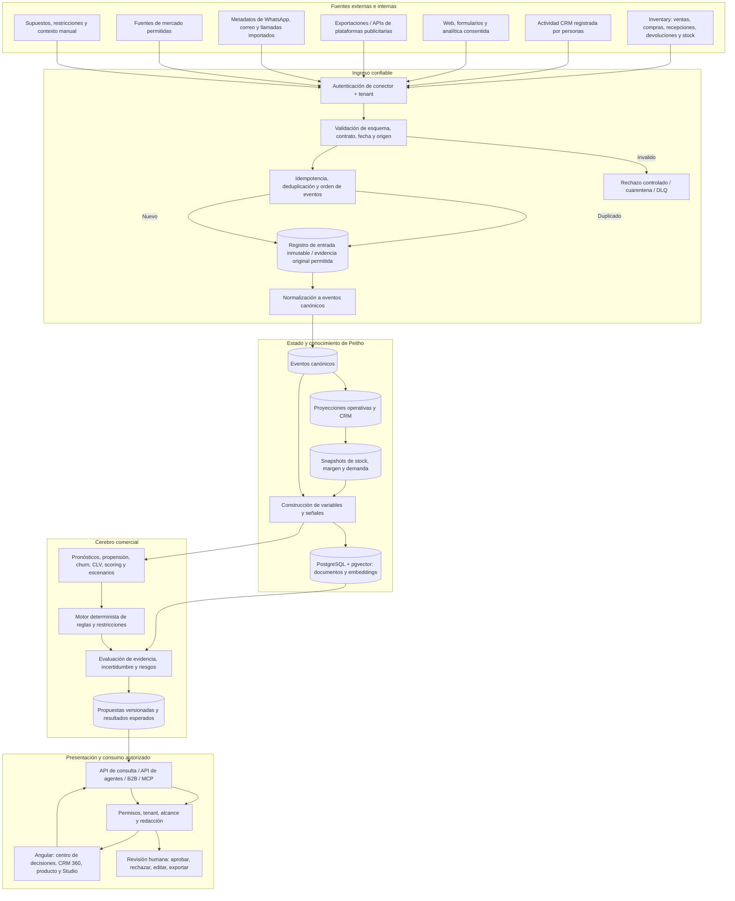

### Resultado obligatorio

Cada tarjeta o dato mostrado en Angular debe poder responder: **qué significa, cuándo se actualizó, de qué fuente procede, qué reglas/modelo lo generaron, qué nivel de confianza tiene y qué permiso autoriza verlo**.

---

## 2. Fuentes e ingreso de datos

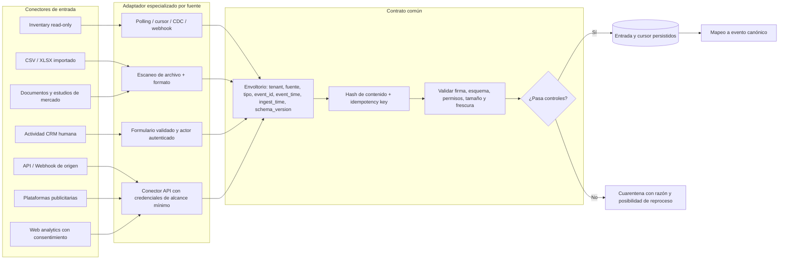

### Paso a paso

1. Un conector obtiene un lote o recibe un evento; conserva cursor/offset o el identificador externo para poder reanudar.
2. Determina la empresa (tenant) desde una credencial o contexto firmado; nunca confía en un `tenant_id` arbitrario del cuerpo.
3. Envuelve el hecho con fuente, versión de esquema, hora del origen, hora de recepción, identificador externo y correlación.
4. Comprueba tamaño, tipo, integridad, firma cuando corresponda, permisos del conector y límites de frecuencia.
5. Normaliza tiempos a UTC y conserva la zona horaria empresarial para análisis locales.
6. Calcula una clave de idempotencia determinista. Duplicados no producen doble contabilización ni doble aprendizaje.
7. Registra la evidencia original estrictamente necesaria y permitida; los secretos y datos sensibles se excluyen o redactan.
8. Traduce el registro a un evento canónico. Si no puede hacerlo con seguridad, lo coloca en cuarentena en lugar de inventar campos.
9. Publica la unidad de trabajo mediante una tabla outbox o cola duradera; actualiza el cursor solo cuando el lote queda aceptado de forma recuperable.
10. Un panel de salud muestra registros recibidos, aceptados, duplicados, retrasados, rechazados y pendientes.

---

## 3. Ingesta común, validación, deduplicación y cuarentena

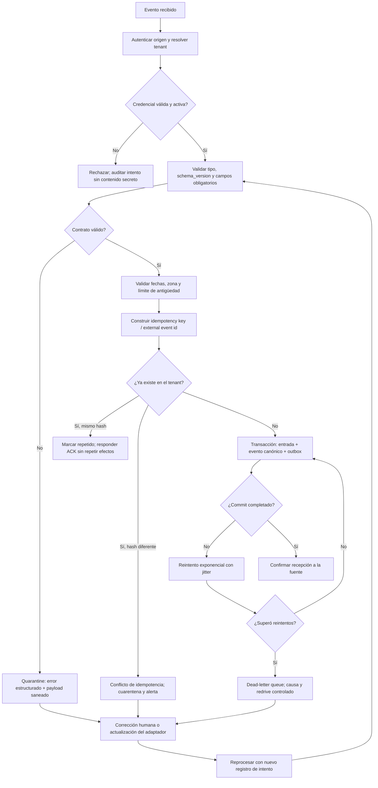

### Garantías y límites

- Objetivo: entrega **al menos una vez** con efectos idempotentes, no prometer “exactamente una vez” de extremo a extremo sin definir el ámbito transaccional.
- La clave de idempotencia debe incluir tenant, sistema de origen, entidad y clave externa.
- Un error de datos no se resuelve silenciosamente con un valor por defecto que cambie el significado comercial.
- Un redrive conserva el intento anterior y su causa; no borra el rastro de error.

---

## 4. Inventary en modo exclusivamente lectura

**Mecanismo principal:** replicación lógica dedicada desde Inventary hacia PostgreSQL de Peitho. **Complemento:** API interna de solo lectura para validar puntualmente disponibilidad/precio antes de etiquetar una propuesta como confirmada. No ejecutar analítica intensiva contra la base transaccional ni considerar una réplica de lectura transaccional como almacén analítico principal.

~~~mermaid
flowchart TD
  INV[Inventary PostgreSQL transaccional] --> PUB[Publicación lógica de tablas acordadas]
  PUB --> SUB[Suscripción de replicación]
  SUB --> PEI[(PostgreSQL dedicado de Peitho)]
  PEI --> EXTRACT[Actualizar proyecciones y eventos canónicos]
  EXTRACT --> META[Guardar origen actualizado, recibido/aplicado, watermark, lag, esquema y snapshot]
  META --> CHECK[Conciliar conteos, cantidades, importes y saldos]
  CHECK --> OK{¿Replicación sana, esquema compatible y datos conciliados?}
  OK -- No --> STALE[Marcar STALE/DEGRADED; bloquear propuestas sensibles al stock/margen]
  OK -- Sí --> READ[Usar la proyección más reciente para el análisis]
  READ --> NEED{¿La propuesta depende de disponibilidad/precio en este instante?}
  NEED -- Sí --> API[Consultar API interna de Inventary de solo lectura]
  API --> APIOK{¿La validación actual fue satisfactoria?}
  APIOK -- No / sin respuesta --> UNCONF[Mostrar propuesta no confirmada; no afirmar disponibilidad]
  APIOK -- Sí --> CONF[Marcar verificación con fecha/hora y fuente]
  NEED -- No --> PROPOSAL[Crear propuesta con watermark y limitaciones visibles]
  CONF --> PROPOSAL
  STALE --> OPS[Alerta operativa y recuperación controlada]
~~~

### Operación de la replicación

1. Inicializar la suscripción y carga base con lista explícita de tablas/columnas, claves estables y contrato de esquema versionado.
2. La replicación lógica no replica por sí misma DDL. Coordinar migraciones de publicador/suscriptor; validar compatibilidad antes de desplegarlas y recuperar tablas cuando el procedimiento lo requiera.
3. Registrar source_updated_at, received_at, applied_at, watermark/posición, lag_seconds, schema_version, snapshot_id y reconciliation_status por conjunto. UNKNOWN no equivale a HEALTHY.
4. Supervisar posición de envío/aplicación, lag, estado de suscripción, errores del apply worker, slots de replicación, crecimiento/retención de WAL, disco y capacidad de recuperación. Un slot cuyo consumidor está detenido puede retener WAL y llenar el disco.
5. Un desacuerdo, esquema incompatible o lag fuera del umbral del entorno deja las proyecciones afectadas no aptas para decisiones dependientes de stock/margen.
6. Los umbrales warning/block deben configurarse antes de producción y calibrarse con SLA reales. Los objetivos indicativos no sustituyen medición ni prueba de recuperación.
7. La API interna se limita a endpoints tipados con identidad de servicio, alcance mínimo, límites y auditoría. No se entrega SQL libre a agentes/LLM.
8. La identidad de integración no puede escribir en Inventary. Peitho no contabiliza ventas ni modifica existencias, compras, precios, reservas, productos o movimientos.

### Obligaciones de seguridad

- Verificar en CI que INSERT, UPDATE, DELETE, TRUNCATE, DDL y funciones de escritura se rechazan desde la identidad de Peitho contra Inventary.
- No confiar en que el snapshot sea actual solo porque la suscripción aparece activa; mostrar última actualización, lag y conciliación.
- Si la API de verificación está caída, no afirmar stock actual: conservar el resultado como borrador o propuesta no confirmada.
- Inventary sigue siendo fuente de verdad; Peitho conserva proyecciones analíticas versionadas.

---
## 5. Actualizar la verdad operacional del inventario

Este flujo no calcula un único campo “stock” sin contexto. Conserva por separado existencias físicas, disponibles, reservadas, en tránsito, dañadas/bloqueadas, comprometidas, recepciones pendientes y frescura de datos, según las entidades que exponga Inventary.

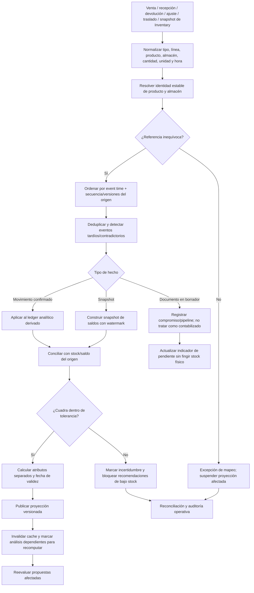

### Controles necesarios

- No asumir que crear una orden de compra incrementa existencias: hacerlo solo cuando la recepción/contabilización correspondiente lo confirme en la fuente.
- Las devoluciones tienen estado y destino; no inferir que todo producto devuelto vuelve a estar disponible para venta.
- No mezclar productos equivalentes sin reglas explícitas de SKU/variante/unidad de medida.
- Si el origen corrige hechos históricos, registrar una corrección versionada y recalcular la ventana afectada; no sobrescribir el pasado analítico de forma invisible.

---

## 6. CRM: capturar, resolver identidad y calificar un lead

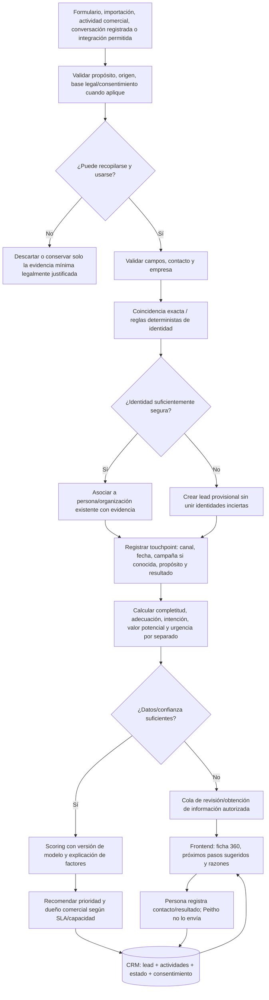

### Separaciones obligatorias

- “Adecuación” (fit), “intención”, “valor potencial” y “prioridad de atención” son señales distintas.
- Un lead sin actividad reciente no es automáticamente un lead perdido; se debe mostrar fecha de última interacción, canal observado, calidad de tracking y explicación.
- Una identidad no se fusiona solo porque dos registros compartan nombre. Se requiere evidencia suficientemente fuerte y una opción de deshacer la fusión con auditoría.
- El frontend no debe afirmar que el cliente “no escribió” si el canal no está conectado o la captura es incompleta; mostrará “sin eventos observados desde…”.

---

## 7. Ciclo preventa → venta → postventa

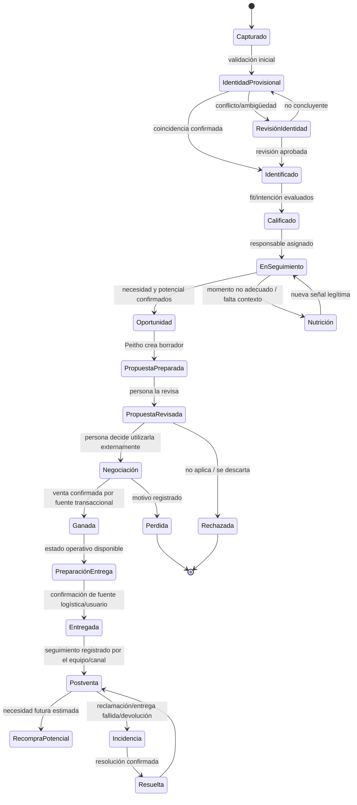

### Ciclo por etapas

**Preventa:** identificar el origen, respetar el consentimiento, detectar duplicados, comprender necesidad/objeción, conocer disponibilidad y preparar preguntas o propuesta que ayude al vendedor.  
**Venta:** verificar disponibilidad y precio actual antes de presentar una recomendación, separar cotización de venta confirmada, registrar descuentos reales y el resultado de la oportunidad.  
**Postventa:** importar/registrar envío y entrega, incidencias, devoluciones, satisfacción y reclamaciones; identificar posibles causas del problema y preparar una acción de servicio o recompra para revisión humana.  
**Cierre de aprendizaje:** los resultados confirmados regresan al almacén analítico con su fuente, fecha y calidad. Un borrador visto o exportado no equivale a una venta causada por Peitho.

---

## 8. Procesamiento continuo del cerebro comercial

“Continuo” significa que las decisiones se recalculan por eventos relevantes y por trabajos programados, no que un LLM quede en un bucle infinito consumiendo datos o coste.

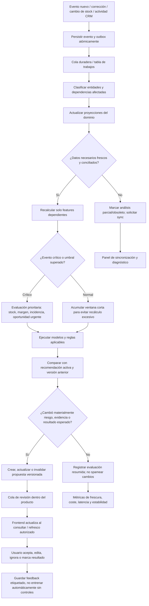

### Reglas de ritmo

- Cambios de stock, precio/coste observado, disponibilidad, venta completada, devolución y cierre de campaña pueden invalidar análisis dependientes inmediatamente.
- Datos de mercado y señales de tendencia pueden recalcularse de forma programada según su frecuencia y licencia.
- Procesos costosos se agrupan por ventana y se paralelizan con límites por tenant.
- Cada cálculo tiene `run_id`, `tenant_id`, `input_watermark`, `model_version`, `rule_version`, hora de inicio/fin y estado.
- Los cambios de recomendación se deduplican y se presentan como una nueva versión, no como una colección de mensajes repetidos.

---

## 9. Modelos predictivos y señales de confianza

```mermaid
flowchart LR
  DATA[(Eventos verificados + snapshots + outcomes)] --> QUALITY[Pruebas de calidad, cobertura, drift y leakage]
  QUALITY --> SPLIT[Ventanas temporales train / validation / test]
  SPLIT --> BASE[Baselines simples y reglas de referencia]
  SPLIT --> CAND[Modelos candidatos según tarea]
  BASE --> METRIC[Métricas técnicas y de negocio]
  CAND --> METRIC
  METRIC --> SEGMENT[Evaluación por producto, segmento, canal y horizonte]
  SEGMENT --> DECISION{¿Mejora real y no perjudica segmentos críticos?}
  DECISION -- No --> HOLD[Rechazar modelo; mantener baseline]
  DECISION -- Sí --> SHADOW[Modo shadow / predicción sin afectar recomendación]
  SHADOW --> LIVECHK[Comparar predicción con resultados reales]
  LIVECHK --> APPROVAL{¿Responsable de modelo aprueba?}
  APPROVAL -- No --> HOLD
  APPROVAL -- Sí --> REGISTRY[Registrar versión, métricas, datos y artefacto]
  REGISTRY --> SERVE[Servicio de inferencia con fallback]
  SERVE --> OUTPUT[Predicción + intervalo/incertidumbre + explicación]
  OUTPUT --> RULES[Motor de decisión utiliza salida bajo guardas]
  HOLD --> MON[Registrar causa y monitorizar drift]
```

### Salida mínima de cualquier modelo

- Predicción, horizonte, unidad y fecha de corte.
- Intervalo de predicción o incertidumbre calibrada cuando sea aplicable.
- Baseline de comparación y métrica usada para evaluar fiabilidad.
- Cobertura del conjunto de datos; advertencia si el segmento tiene pocas observaciones.
- Versión del modelo y transformación de features.
- Factores explicativos disponibles, sin presentar correlación como causalidad.
- Estado: `VALID`, `LOW_CONFIDENCE`, `STALE`, `OUT_OF_DISTRIBUTION` o `UNAVAILABLE`.

---

## 10. Motor de decisión y restricciones de negocio

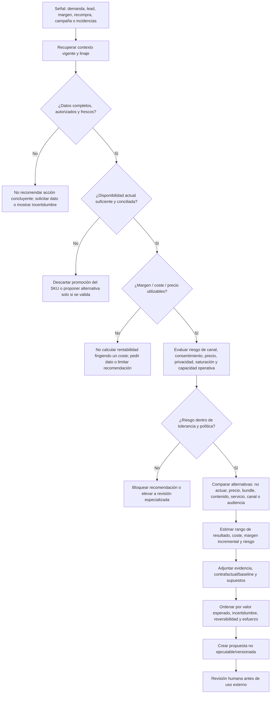

### Guardas de seguridad comercial

- No proponer vender o promocionar productos si el snapshot está obsoleto, el SKU no está mapeado o la disponibilidad no es confiable.
- No asumir margen positivo con coste desconocido. La falta de datos es una condición visible, no un cero implícito.
- Presentar impacto incremental esperado como rango cuando la evidencia no soporte una cifra puntual.
- Mostrar escenario base “no hacer nada” y coste de oportunidad de cada alternativa cuando sea estimable.
- Distinguir asociación, predicción y estimación causal. No llamar “impacto de campaña” a ventas que solo ocurrieron durante la campaña.
- Incluir riesgos de canibalización, adelanto de compras, descuentos a clientes que habrían comprado igual, agotamiento, devoluciones, saturación y capacidad de entrega.

---

## 11. Creación y aprobación de una propuesta comercial

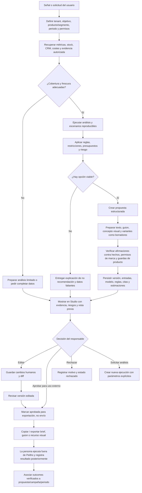

### Estructura de una propuesta

1. Objetivo y destinatario de negocio.
2. Diagnóstico con fecha de corte y calidad de datos.
3. Evidencia observada y métricas base.
4. Hipótesis comercial y nivel de evidencia.
5. Alternativas comparadas, incluida la opción de no actuar.
6. Recomendación, productos/clientes elegibles y exclusiones.
7. Disponibilidad/margen, riesgos y condiciones para volver a validarlos.
8. Rango de resultados esperados, supuestos, coste y criterio de éxito.
9. Copy, guion, brief de arte y variantes para adaptar por canal.
10. Vista previa visual, checklist de legalidad/consentimiento y aprobación humana.
11. Versiones, responsable, fecha, exportaciones y outcomes posteriores.

---

## 12. Riesgo de campaña y evaluación de canales

Peitho **no envía campañas ni notificaciones a clientes**. Solo evalúa riesgos y propone un plan/recurso para revisión y uso externo. El motor debe utilizar configuración versionada de los canales y guardar fuente/fecha de validación; nunca codificar como verdad permanente una tarifa o ventana que pueda cambiar.

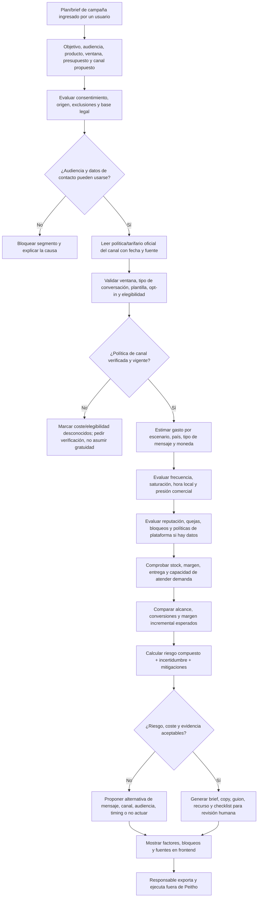

### Ejemplo específico para WhatsApp

- Registrar si el origen tiene evidencia de anuncio Click-to-WhatsApp o CTA elegible, el timestamp de entrada, ventana aplicable, país del destinatario, categoría/tipo de mensaje y versión de tarifas/política.
- La ventana gratuita de entrada de 72 horas, cuando sea aplicable, no se interpreta como “mensajes gratis después de 72 h”; tiene condiciones y debe comprobarse con documentación oficial vigente.
- La ventana de atención estándar y la ventana gratuita ampliada son conceptos distintos.
- Cuando no pueda verificar el origen/tarifa/plantilla o la fecha de validez, mostrar `COSTE_NO_VERIFICADO` y no prometer coste cero.
- El resultado de Peitho es una evaluación, brief y borrador. No se conecta a endpoints de envío.

---

## 13. Generación de texto, guion y concepto visual con IA

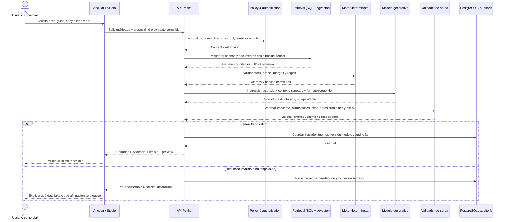

### Bloqueos para la IA generativa

- No SQL arbitrario ni acceso directo a credenciales.
- No inventar stock, precios, costes, tasas, resultados ni citas.
- No transformar una previsión en una garantía.
- No recomendar tratamiento de datos sin permiso o uso de segmentos sensibles.
- No ejecutar acciones externas, llamadas, envíos ni publicaciones.
- Los resultados pasan validación de esquema, políticas, tenant, contenido, citas y hechos actuales antes de mostrarse.
- Si hay conflicto entre generación y datos estructurados autorizados, prevalecen los datos estructurados y se bloquea el claim inconsistente.

---

### Pasarela de IA autogestionada: generación de lenguaje y embeddings

~~~mermaid
flowchart LR
  REQ[Solicitud autorizada] --> POLICY[Gateway IA: tenant, scopes, límites, redacción y auditoría]
  POLICY --> LLM[vLLM: modelo de lenguaje local]
  LLM --> VALID[Validar salida con esquema y evidencia]
  VALID --> AUD[Guardar versión de modelo/reglas y resultado]
  AUD --> HUMAN[Propuesta para revisión humana]
  DOC[Texto autorizado] --> JOB[Cola de embeddings]
  JOB --> PY[Microservicio Python: Sentence Transformers]
  PY --> VEC[(PostgreSQL + pgvector con versiones/dimensiones)]
  Q[Consulta autorizada] --> EMB[Embedding de consulta con la misma versión]
  EMB --> VEC
  VEC --> RET[Recuperación híbrida: filtros SQL + vector + texto]
  RET --> POLICY
  DEV[Ollama] -. solo desarrollo local .-> LLM
~~~

#### Contrato operativo de la pasarela

- Producción: vLLM sirve el LLM en infraestructura propia con API compatible con OpenAI; esta compatibilidad es un protocolo, no una llamada a OpenAI API.
- Embeddings: un servicio independiente Python/Sentence Transformers genera vectores localmente y los persiste en pgvector. LLM y encoder tienen versiones independientes.
- No se habilitan OpenAI API, Azure OpenAI, Anthropic, Google Vertex AI ni proveedores de inferencia de pago en la configuración inicial; no enviar contenido empresarial a endpoints públicos de inferencia.
- Elegir modelos después de benchmarks en español/vocabulario comercial ecuatoriano, calidad de recuperación, latencia, memoria, rendimiento y licencia. Registrar IDs/revisiones, dimensiones y métricas.
- Un cambio de encoder requiere nueva versión del índice, re-embeddings controlados, evaluación y cutover solo después de validar calidad y latencia. Nunca mezclar vectores incompatibles.
- Ollama se permite para desarrollo local; vLLM es la referencia de producción cuando la infraestructura lo permita. Se evitan tarifas por token, no costes de hardware, energía, almacenamiento y mantenimiento.

## 14. Frontend Angular: abrir pantalla y representar resultados

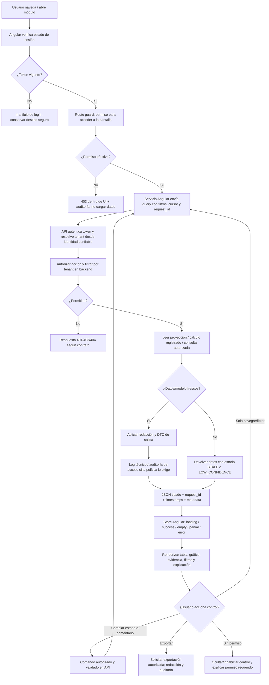

### Estados de interfaz obligatorios

- **Carga:** mostrar esqueleto/progreso y qué se está calculando.
- **Éxito:** cifras, unidad, periodo, fecha de actualización y fuente.
- **Vacío:** distinguir “no hay resultados” de “no hay datos conectados”.
- **Parcial/obsoleto:** advertencia visible; bloquear acciones sensibles si la política lo exige.
- **Falta de permiso:** explicar el permiso requerido sin revelar que existe un registro sensible.
- **Error:** mensaje accionable y `request_id` para soporte, nunca stack trace.
- **Predicción:** separar observado/estimado/escenario, incluir incertidumbre y fecha de corte.

---

## 15. Autenticación local, sesión y autorización

El lanzamiento inicial usa autenticación local de Peitho; no necesita Microsoft Entra, Google Workspace, Keycloak ni otro proveedor de identidad externo. La interfaz queda preparada para OIDC/SAML como extensión futura, sin activarlos en el primer despliegue.

~~~mermaid
sequenceDiagram
  actor U as Usuario
  participant FE as Angular
  participant AUTH as Servicio local de autenticación
  participant DB as PostgreSQL de Peitho
  participant AUD as Auditoría
  U->>FE: Abre pantalla de inicio de sesión
  FE->>AUTH: Solicita challenge de un solo uso
  AUTH-->>FE: challenge_id, nonce, expiración y algoritmo permitido
  U->>FE: Usa contraseña + MFA o passkey
  alt Intercambio protegido por cifrado de aplicación
    FE->>FE: Protege material de autenticación con perfil criptográfico revisado
    FE->>AUTH: ciphertext + challenge_id
    AUTH->>AUTH: Valida nonce, expiración, uso único y origen; impide replay
  else Passkey/WebAuthn
    FE->>AUTH: Verificación WebAuthn con challenge
    AUTH->>AUTH: Valida assertion y origen autorizado
  end
  AUTH->>DB: Verifica usuario, estado, tenant, hash Argon2id, MFA y roles
  DB-->>AUTH: Identidad y permisos vigentes
  AUTH->>AUTH: Crea sesión limitada y protegida
  AUTH->>AUD: Registra éxito/fallo sin contraseña, secreto MFA ni token
  AUTH-->>FE: Cookie/sesión segura y expiración
  FE->>AUTH: Solicitud posterior
  AUTH->>DB: Revalida sesión, tenant y permiso en cada operación sensible
  AUTH-->>FE: Solo DTO autorizado
~~~

### Reglas obligatorias

- TLS/HTTPS es obligatorio; el cifrado de aplicación, cuando corresponda, es una capa adicional y no sustituye TLS.
- Contraseñas con Argon2id y salt único; no almacenarlas reversiblemente ni registrar secretos.
- MFA mediante TOTP y passkeys/WebAuthn; exigirlo como mínimo a administradores y para operaciones sensibles. Proteger recuperación y revocación de sesiones.
- Usar cookies HttpOnly, Secure y SameSite cuando la topología lo permita; protección CSRF, CSP, Trusted Types y límites progresivos. Evitar refresh tokens en localStorage.
- Gestión de usuarios, roles y permisos por tenant. El backend autoriza cada acción; los guards y menús Angular solo mejoran la UX.
- Auditar cambios de rol, MFA, recuperación, sesiones y accesos sensibles sin registrar contraseñas, códigos MFA, tokens ni ciphertext sensible.
- OIDC/SAML pueden agregarse después mediante ADR y pruebas de tenant/roles, issuer/audience, revocación y recuperación. No son dependencia del lanzamiento inicial.

---
## 16. Multiempresa y aislamiento de datos

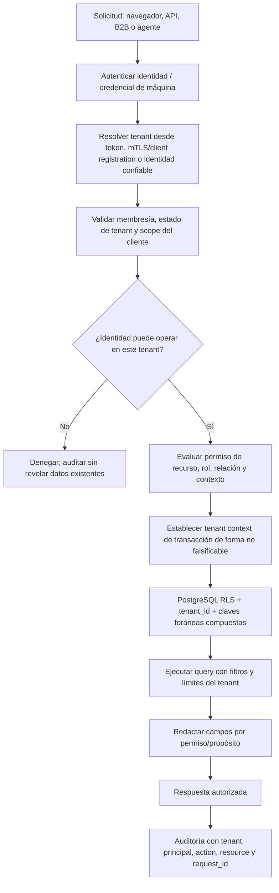

### Controles técnicos a imponer

- `tenant_id` obligatorio en toda entidad de negocio, propuesta, evento, feature, embedding, tarea y artefacto que pertenezca a una empresa.
- PostgreSQL Row-Level Security como defensa en profundidad; usar una identidad de base no propietaria y validar configuración de conexión/pooling para no mezclar contexto entre tenants.
- Claves únicas, índices, cache keys, jobs, idempotency keys y rutas de objetos incluyen tenant.
- Los identificadores UUID no sustituyen autorización de objeto; prevenir IDOR/BOLA.
- Embeddings, retrieval y caches filtran tenant antes de calcular similitud, no solo después de recuperar.
- Exportaciones y logs incluyen tenant; no hay búsqueda global entre empresas salvo función administrativa explícita, autorizada y auditada.
- Los roles pueden combinarse con scopes por región, unidad de negocio, producto, almacén, cartera o campo, si el modelo lo requiere.

---

## 17. PostgreSQL + pgvector: búsqueda híbrida y recuperación contextual

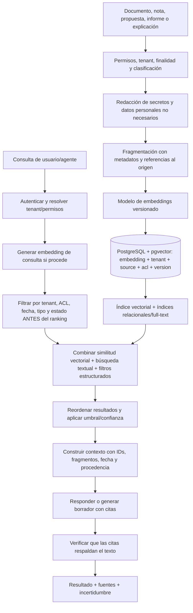

### Principios

- `pgvector` amplía PostgreSQL; no convierte automáticamente todas las tablas en una “base de datos inteligente”.
- Datos numéricos transaccionales y estados actuales se consultan por SQL estructurado, no por similitud vectorial.
- Los documentos vectorizados deben tener `tenant_id`, permisos, versión, origen, fecha, política de retención y estado de indexación.
- Cuando un documento se elimina, cambia permiso o se reemplaza por una versión nueva, invalidar/reindexar su embedding y caches.
- Búsqueda híbrida permite exactitud de SKU/fecha/código junto a similitud semántica. Umbrales se prueban por caso de uso.
- Si no hay fragmentos suficientes o el ranking es débil, el sistema debe decir que no encontró evidencia adecuada.

---

## 18. API para agentes de IA: consultar y mostrar resultados

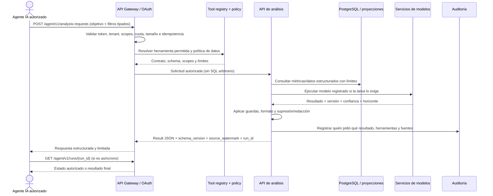

### Esquema de respuesta recomendado

```json
{
  "run_id": "uuid",
  "tenant_id": "uuid-no-controlado-por-el-cuerpo",
  "status": "COMPLETED",
  "as_of": "2026-01-01T12:00:00Z",
  "input_watermark": "source-cursor-or-snapshot-id",
  "result_type": "demand_forecast",
  "data": {},
  "uncertainty": {},
  "model": {"name": "model-name", "version": "x.y"},
  "sources": [{"source_id": "opaque-id", "observed_at": "timestamp"}],
  "warnings": [],
  "permissions_applied": ["analytics:read"],
  "request_id": "uuid"
}
```

Los campos son ilustrativos; los IDs y valores deben generarse en servidor. Un agente nunca puede definir libremente el tenant que quiere consultar ni elevar sus scopes a partir de una instrucción en texto.

---

## 19. MCP para conectar herramientas y otros agentes

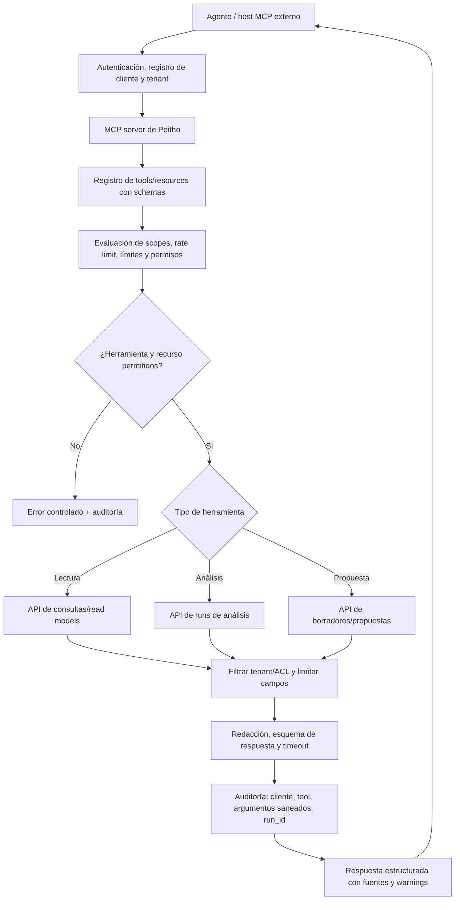

### Reglas de diseño MCP

- Exponer pocas herramientas con intención clara, p. ej. `get_inventory_snapshot`, `forecast_demand`, `analyze_customer_cohort`, `list_proposals`, `create_proposal_draft`; no exponer “ejecutar cualquier SQL”.
- Separar capacidades de lectura y creación de borradores. Nunca exponer herramientas para enviar comunicaciones, publicar contenido o cambiar el inventario de Inventary.
- Validar cada argumento con esquema, tamaño, rango de fechas y coste máximo.
- El servidor autentica por identidad de cliente y autoriza cada tool por tenant/scope; no confiar en metadatos declarados por el cliente MCP.
- Aplicar límites de ejecución, timeout, cancelación, rate limit y presupuestos por cliente.
- No tratar contenido recuperado ni instrucciones en documentos como instrucciones de sistema: defenderse contra prompt injection y exfiltración.
- Las respuestas incluyen fuentes, watermark de datos, estado, advertencias y `run_id` para reproducibilidad.

---

## 20. APIs B2B sin frontend Peitho

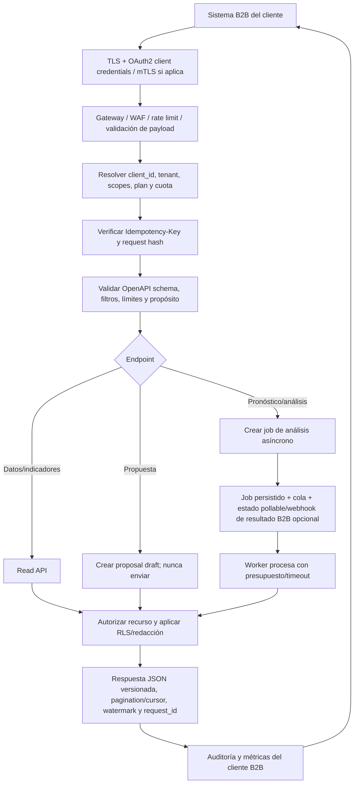

### Contratos B2B

- OpenAPI versionado, esquema de compatibilidad, deprecación y fechas de retiro de versiones.
- OAuth2 scopes mínimos por cliente; rotación y revocación de credenciales; nunca credenciales compartidas entre clientes.
- Cuotas por tenant/cliente y endpoint, tamaño máximo, timeout, paginación, circuit breaker y límites de exportación.
- `Idempotency-Key` para acciones que crean runs/propuestas; repetir mismo key + payload devuelve el mismo resultado; mismo key con payload distinto da conflicto.
- Análisis largos usan `202 Accepted`, `run_id`, estado, polling controlado y resultado final; no mantener HTTP abierto indefinidamente.
- Firmar/validar webhooks de resultados si se activan; recordar que son salidas de API B2B, no mensajes comerciales a clientes finales.
- Aislar sandbox, datos sintéticos y credenciales de producción.

---

## 21. Auditoría, trazabilidad y linaje de una decisión

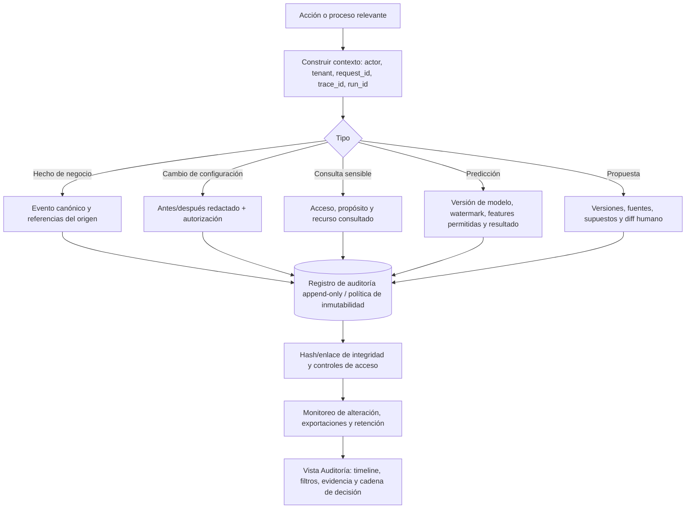

Cada decisión debe conservar el linaje suficiente para reconstruirse:

`source_event(s) → canonical_event_id(s) → projection_version → feature_snapshot_id → model_version/rule_version → analysis_run_id → proposal_version → human_decision → exported_artifact_id → measured_outcome_id`.

Nunca registrar contraseñas, refresh tokens, API keys, claves criptográficas, datos de tarjetas o cuerpos íntegros de conversación por defecto. El historial de auditoría no debe ser editable por los usuarios auditados; las correcciones se agregan como nuevos eventos. Para detectar alteración se pueden usar hashes encadenados/manifiestos firmados y copias independientes; un hash guardado en la misma base, por sí solo, no impide que un administrador privilegiado modifique ambos.

---

## 22. Aprendizaje a partir de resultados reales y experimentos

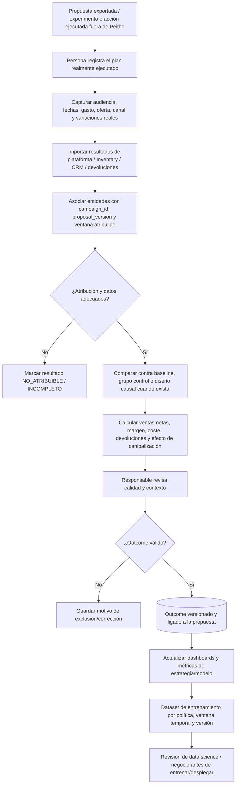

### Reglas contra aprendizaje equivocado

- Una campaña exportada no equivale a campaña lanzada; una campaña lanzada no equivale a una venta atribuida.
- Guardar gasto efectivo y resultado real, no solo presupuesto y pronóstico.
- Ajustar por estacionalidad, disponibilidad, cambio de precio, promociones simultáneas, tendencia, canal y retraso de conversión cuando los datos lo permitan.
- Cuando no exista grupo de control o método causal razonable, etiquetar el resultado como descriptivo/observacional.
- No entrenar automáticamente en feedback humano sin evaluar sesgo, calidad de etiqueta, representatividad y datos personales.

---

## 23. Entrenamiento, validación y despliegue de modelos

```mermaid
flowchart TD
  DATA[(Snapshots históricos versionados)] --> GATE[Revisión de permisos, retención y finalidad]
  GATE --> LABEL[Definir target y evitar leakage temporal]
  LABEL --> SPLIT[Split temporal por fecha y entidad/grupo cuando aplique]
  SPLIT --> BASE[Baseline ingenuo y reglas actuales]
  SPLIT --> TRAIN[Entrenamiento reproducible]
  TRAIN --> EVAL[Backtesting, calibración, intervalos y métricas de negocio]
  BASE --> EVAL
  EVAL --> SEG[Evaluar segmentos, sesgo, estabilidad y coste]
  SEG --> GO{¿Cumple umbrales preregistrados?}
  GO -- No --> FAIL[No desplegar; análisis de causa; mantener baseline]
  GO -- Sí --> SHADOW[Desplegar en modo shadow]
  SHADOW --> OBS[Monitorizar predicción vs resultado real y drift]
  OBS --> HUMAN{Aprobación de responsables de ML y dominio}
  HUMAN -- No --> ROLLBACK[Cancelar promoción / rollback]
  HUMAN -- Sí --> REGISTRY[Registrar artefacto, datos, código, métricas y versión]
  REGISTRY --> SERVE[Activar inferencia con canary y fallback]
  SERVE --> MONITOR[Monitorización continua]
  MONITOR --> DRIFT{¿Drift, degradación o fallo de datos?}
  DRIFT -- No --> MONITOR
  DRIFT -- Sí --> DEGRADE[Marcar LOW_CONFIDENCE; baseline o fallback]
  DEGRADE --> REVIEW[Investigación y nuevo ciclo de entrenamiento]
  FAIL --> REVIEW
  ROLLBACK --> REVIEW
```

Ningún modelo debe desplegarse solo porque mejora una métrica agregada. Se establecen umbrales por tarea, horizonte, coste de error y segmentos relevantes; cambios materiales requieren aprobación y reversión posible.

---

## 24. Errores, reintentos, DLQ y recuperación

```mermaid
flowchart TD
  WORK[API o worker inicia trabajo] --> TIME[Timeout / ejecución con límite de recursos]
  TIME --> RESULT{Resultado}
  RESULT -- Éxito --> COMMIT[Commit del resultado, estado y auditoría]
  RESULT -- Error transitorio --> RETRY[Registrar error saneado + contador + backoff con jitter]
  RETRY --> MORE{¿Reintentos restantes?}
  MORE -- Sí --> RETRYQUEUE[Programar reintento idempotente]
  RETRYQUEUE --> WORK
  MORE -- No --> DLQ[DLQ / estado FAILED_REVIEW]
  RESULT -- Error de validación permanente --> INVALID[No reintentar sin corrección; registrar código y campos no sensibles]
  RESULT -- Timeout de proveedor IA --> FALLBACK[Fallback: modelo alternativo aprobado o resultado no disponible]
  RESULT -- Datos stale --> STOP[No producir decisión concluyente]
  INVALID --> UI[Mostrar error accionable y request_id]
  DLQ --> UI
  FALLBACK --> COMMIT
  STOP --> UI
  COMMIT --> UI
  DLQ --> OPS[Operaciones revisa, corrige y hace redrive explícito]
  OPS --> REPLAY[Crear intento nuevo vinculado al anterior]
  REPLAY --> WORK
```

- Los reintentos no duplican eventos, propuestas ni resultados gracias a idempotencia y claves únicas.
- El backoff tiene jitter y máximo de intentos; un servicio caído no debe provocar tormenta de reintentos.
- Los errores incluyen código estable, severidad, `request_id` y pasos de recuperación; no exponen stack trace ni secretos al navegador.
- La interfaz distingue error parcial, dato obsoleto, falta de permiso y fallo de proveedor de IA.
- El sistema ofrece una alternativa segura: consultar el último resultado válido, mostrar `STALE` o no recomendar.

---

## 25. Privacidad, retención, rectificación y eliminación

```mermaid
flowchart TD
  DATA[Dato personal/comercial entra] --> PURPOSE[Declarar finalidad, base legal/consentimiento y sistema de origen]
  PURPOSE --> MIN[Minimizar campos, retención y accesos]
  MIN --> STORE[(Almacenar con tenant, clasificación, origen y políticas)]
  STORE --> USE[Usar para CRM/analítica según permiso y finalidad]
  USE --> REQUEST{Solicitud de acceso, rectificación, oposición o eliminación aplicable?}
  REQUEST -- No --> RETENTION[Ejecutar revisión automática de retención]
  REQUEST -- Sí --> VERIFY[Verificar identidad, alcance y requisitos legales/contractuales]
  VERIFY --> DECIDE{¿Solicitud procedente?}
  DECIDE -- No / excepción legal --> RESPONSE[Explicar motivo y registrar decisión]
  DECIDE -- Sí --> FIND[Localizar copias, índices, embeddings, caches y exportaciones controladas]
  FIND --> ACTION[Rectificar / restringir / eliminar o anonimizar según obligación]
  ACTION --> REINDEX[Invalidar vectors, caches, features y datasets derivados cuando corresponda]
  REINDEX --> PROOF[Registrar tarea y verificar completitud]
  PROOF --> RESPONSE
  RETENTION --> ACTIONRET[Expurgar/anonimizar conforme a política y legal hold]
  ACTIONRET --> AUDIT[Conservar evidencia mínima permitida de cumplimiento]
  AUDIT --> STORE
```

### Requisitos

- Registrar base legal, propósito, consentimiento, fuente y fecha cuando corresponda.
- Separar datos necesarios para cumplir obligaciones comerciales/legales de datos opcionales de marketing.
- No asumir que la eliminación del registro fuente elimina embeddings, caches, exports y datasets derivados: la solicitud debe atravesar el linaje de datos.
- La política final de retención depende del tipo de información, contrato, regulación y asesoría legal aplicable en cada jurisdicción.
- La auditoría no se usa como pretexto para conservar indefinidamente todo dato personal. Retener un mínimo justificable y protegerlo de acceso no autorizado.

---

## 26. Observabilidad y operación

```mermaid
flowchart LR
  API[API FastAPI] --> TELE[OpenTelemetry: traces, métricas y logs estructurados]
  WORK[Workers] --> TELE
  CONN[Conectores] --> TELE
  ML[Modelos] --> TELE
  MCP[MCP / B2B] --> TELE
  TELE --> COLLECT[Collector y filtros de redacción]
  COLLECT --> MET[(Métricas)]
  COLLECT --> LOG[(Logs)]
  COLLECT --> TRACE[(Trazas)]
  MET --> DASH[Paneles SRE / negocio]
  LOG --> DASH
  TRACE --> DASH
  DASH --> ALERT[Umbrales de guardia: disponibilidad, latencia, freshness, DLQ, drift, presupuesto]
  ALERT --> RUNBOOK[Runbook + responsable + severidad + procedimiento]
```

### Indicadores mínimos

- **Datos:** retraso por fuente, última extracción, conteos, duplicados, errores, cuarentena y conciliación.
- **Operación:** disponibilidad, latencia p50/p95/p99, errores 4xx/5xx, saturación, colas, workers y DLQ.
- **IA/modelos:** tasa de fallback, latencia/coste por run, inferencias por tenant, drift, calibración y desempeño por segmento.
- **Producto comercial:** recomendaciones vistas, editadas, exportadas, rechazadas, tiempo hasta decisión y resultados medidos; no interpretar clics en UI como incremento causal de ventas.
- **Seguridad:** intentos fallidos, cambios de roles, acceso denegado, anomalías B2B/MCP, exportaciones y eventos de aislamiento entre tenants.
- Los logs son operativos; los eventos de auditoría y el ledger del dominio son persistencia de negocio. No tratarlos como una sola fuente.

---

## 27. Roles y responsabilidades RACI

| Proceso | Responsable de negocio | Data/ML | Backend / datos | Seguridad / privacidad | Usuario comercial |
|---|---|---|---|---|---|
| Definir objetivo comercial y restricciones | A/R | C | C | C | C |
| Conector y contrato de datos | C | C | A/R | C | I |
| Calcular disponibilidad derivada | C | I | A/R | I | I |
| Calidad/conciliación de origen Inventary | C | C | A/R junto al responsable de Inventary | I | I |
| Definir targets y validar modelo | A/C | R | C | C | C |
| Promover modelo a producción | A | R | C | C | I |
| Guardas comerciales de una propuesta | A/R | C | C | C | C |
| Generar borrador de contenido | A (política) | C | R (plataforma) | C | R (revisión/edición) |
| Aprobar/exportar propuesta | A/R | I | I | C | R |
| Enviar/publicar campaña externa | **Fuera del alcance de Peitho** | — | — | — | Responsable en sistema externo |
| Gestionar incidentes | C | C | R | A/R según tipo | I |
| Solicitud de derechos de datos | C | I | R | A/R | I |

**Leyenda:** R = ejecuta; A = autoridad final/responsable del resultado; C = consultado; I = informado. Ajustar por organización, sin dejar procesos críticos sin responsable.

---

## 28. Secuencia de una solicitud frontend de extremo a extremo

```mermaid
sequenceDiagram
  actor USER as Usuario
  participant NG as Angular
  participant API as FastAPI
  participant SEC as AuthZ / tenant policy
  participant CACHE as Cache opcional
  participant DB as PostgreSQL
  participant ANA as Analytics service
  participant AUD as Audit
  USER->>NG: Abre “Demanda por producto” y define filtros
  NG->>API: GET /api/v1/analytics/demand?product=...&from=...&to=...
  API->>SEC: Valida token, permisos, tenant y límites
  SEC-->>API: Autorización + tenant context
  API->>CACHE: Consultar cache versionada por tenant+filtros+watermark
  alt Cache vigente
    CACHE-->>API: Resultado + metadata
  else Cache ausente/obsoleta
    API->>DB: Leer proyección, snapshots y estado de frescura
    DB-->>API: Datos estructurados
    API->>ANA: Ejecutar cálculo/modelo autorizado si hace falta
    ANA-->>API: Serie temporal + baseline + incertidumbre + run_id
    API->>DB: Guardar resultado reproducible y metadata
  end
  API->>AUD: Registrar acceso/ejecución según política
  API-->>NG: DTO tipado, watermark, estado y request_id
  NG-->>USER: Gráfico con observados vs pronóstico y advertencias
  USER->>NG: Abre “¿Por qué?”
  NG->>API: GET /api/v1/analytics/runs/{run_id}/explanation
  API->>SEC: Reautorizar objeto y tenant
  API->>DB: Leer factores, fuentes y versión del modelo
  DB-->>API: Evidencia
  API-->>NG: Explicación con factores/limitaciones
  NG-->>USER: Evidencia, incertidumbre y advertencias
```

El frontend nunca ejecuta fórmulas comerciales sensibles en el navegador como autoridad final ni decide permisos a partir de datos visuales. Puede renderizar gráficos y realizar interacciones; el backend es autoritativo para cifras, reglas, tenant, permisos y estados.

---

## 29. Secuencia completa de una recomendación, desde evento hasta propuesta

```mermaid
sequenceDiagram
  participant INV as Inventary read-only
  participant ING as Ingesta
  participant DB as PostgreSQL Peitho
  participant Q as Cola / Outbox
  participant WORK as Workers
  participant FEAT as Feature builder
  participant ML as Model service
  participant RULE as Decision engine
  participant GEN as Generación controlada
  participant API as FastAPI
  participant UI as Angular Studio
  actor HUM as Responsable comercial
  INV->>ING: Venta/recepción/devolución o snapshot nuevo
  ING->>ING: Validar, deduplicar y comprobar tenant/contrato
  ING->>DB: Guardar evento + watermark + outbox en transacción
  DB-->>ING: Commit
  ING->>Q: Liberar trabajo duradero tras commit
  Q->>WORK: Entregar trabajo recuperable
  WORK->>DB: Leer eventos y dependencias afectadas
  WORK->>FEAT: Recalcular features relevantes
  FEAT->>DB: Guardar snapshot versionado
  FEAT->>ML: Pedir pronóstico/propensión con input_watermark
  ML-->>FEAT: Resultado + incertidumbre + model_version
  FEAT->>DB: Persistir resultado
  FEAT->>RULE: Solicitar evaluación de escenarios
  RULE->>DB: Verificar políticas, stock, margen, riesgos y propuesta activa
  DB-->>RULE: Datos frescos/estado de restricciones
  RULE-->>WORK: Opción viable o explicación de bloqueo
  opt Existe opción justificable
    WORK->>GEN: Solicitar borrador con contexto permitido
    GEN-->>WORK: Texto/brief estructurado
    WORK->>DB: Guardar propuesta, evidencia, fuentes, versiones y auditoría
  end
  UI->>API: GET /proposals/{id} con sesión
  API->>DB: Autorizar tenant/permisos y leer resultado
  DB-->>API: Propuesta + fuentes + estado
  API-->>UI: DTO autorizado, run_id y freshness
  UI-->>HUM: Mostrar oportunidad, evidencia, riesgos y preview
  HUM->>UI: Edita/aprueba/rechaza/exporta borrador
  UI->>API: Comando con versionado optimista
  API->>DB: Guardar decisión humana y diff auditado
  DB-->>API: Estado actualizado
  API-->>UI: Confirmación
```

**Nota de implementación:** Angular no se conecta directamente a PostgreSQL ni a workers. Todas las consultas y comandos pasan por API FastAPI y su capa de aplicación. La forma física se resume aquí:

```mermaid
flowchart LR
  ANG[Angular] -->|HTTPS / DTO| API[FastAPI]
  API --> APP[Servicios de aplicación / autorización]
  APP --> DB[(PostgreSQL)]
  APP --> QUEUE[Cola/Outbox]
  QUEUE --> WORK[Workers]
  WORK --> APPDB[(PostgreSQL vía servicios/repositorios)]
  WORK --> MODEL[Modelos / reglas / generación]
  MODEL --> WORK
  WORK --> DB
  API --> ANG
```

---

## 30. Estados de negocio que la interfaz debe mostrar

### Estado de fuente / sincronización

```mermaid
stateDiagram-v2
  [*] --> NOT_CONFIGURED
  NOT_CONFIGURED --> CONNECTING: alta de conector
  CONNECTING --> HEALTHY: primera carga y conciliación OK
  CONNECTING --> DEGRADED: carga parcial / errores recuperables
  HEALTHY --> DELAYED: lag supera umbral
  HEALTHY --> DEGRADED: errores de esquema, discrepancia o límite
  DELAYED --> HEALTHY: se recupera watermark y conciliación
  DEGRADED --> HEALTHY: incidente resuelto y reprocesado
  DEGRADED --> DISABLED: desconexión autorizada
  DISABLED --> CONNECTING: reactivar conector
```

### Estado de ejecución analítica

```mermaid
stateDiagram-v2
  [*] --> QUEUED
  QUEUED --> RUNNING
  RUNNING --> COMPLETED
  RUNNING --> RETRY_WAIT: error transitorio
  RETRY_WAIT --> RUNNING
  RUNNING --> FAILED_REVIEW: se agotan reintentos
  RUNNING --> PARTIAL: una fuente o segmento no disponible
  COMPLETED --> STALE: cambia un input relevante
  PARTIAL --> QUEUED: se completa fuente faltante
  STALE --> QUEUED: recomputar
  FAILED_REVIEW --> QUEUED: redrive autorizado
```

### Estado de una propuesta

```mermaid
stateDiagram-v2
  [*] --> DRAFT
  DRAFT --> VALIDATING
  VALIDATING --> READY_FOR_REVIEW: guardas OK
  VALIDATING --> BLOCKED: política / falta de datos / riesgo
  BLOCKED --> DRAFT: corregir supuesto o fuente
  READY_FOR_REVIEW --> IN_REVIEW
  IN_REVIEW --> NEEDS_CHANGES
  NEEDS_CHANGES --> DRAFT
  IN_REVIEW --> APPROVED_FOR_EXPORT
  IN_REVIEW --> REJECTED
  APPROVED_FOR_EXPORT --> EXPORTED
  EXPORTED --> OUTCOME_PENDING
  OUTCOME_PENDING --> MEASURED
  OUTCOME_PENDING --> NOT_ATTRIBUTABLE
  APPROVED_FOR_EXPORT --> SUPERSEDED: inputs relevantes cambiaron
  READY_FOR_REVIEW --> SUPERSEDED: inputs relevantes cambiaron
```

`APPROVED_FOR_EXPORT` no significa “publicada” ni “enviada”. `EXPORTED` tampoco prueba que se usó externamente. El sistema solo cambia a resultado medido al recibir/registrar evidencia posterior.

---

## 31. Invariantes no negociables

1. **PostgreSQL de Inventary es read-only para Peitho.** Las pruebas de despliegue deben demostrar que ningún usuario/conector de Peitho puede escribir allí.
2. **Angular no accede directamente a la base de datos.** Toda lectura y mutación de Peitho pasa por API autenticada y autorizada.
3. **No hay envío externo.** No existen herramientas, endpoints, permisos ni integraciones de salida para campañas, correo, WhatsApp, llamadas o publicaciones sociales. Se pueden generar borradores, briefs, previews y exportaciones manuales.
4. **Todo dato tiene fuente y frescura.** El frontend no pinta una cifra importante sin fecha de corte, unidad y calidad/estado.
5. **Idempotencia en la ingesta y en comandos.** Repetir un webhook, lote o solicitud no duplica efectos.
6. **Aislamiento multiempresa en todas las capas.** API, DB/RLS, retrieval vectorial, caches, jobs, métricas sensibles, exportaciones, MCP y B2B.
7. **No hay SQL arbitrario de agentes.** Los agentes utilizan herramientas tipadas, limitadas y auditadas.
8. **Los embeddings no son autoridad transaccional.** Stock, precio, coste, ventas y fechas se consultan de fuentes estructuradas con watermark.
9. **La IA generativa no inventa hechos.** Sus afirmaciones se validan contra fuentes o se muestran como hipótesis/escenarios.
10. **Una correlación no es causalidad.** Los resultados observacionales y las pruebas causales se etiquetan por separado.
11. **Toda propuesta puede reconstruirse.** Se guardan inputs, versiones, restricciones, evidencias, salida, revisiones y outcomes.
12. **Los modelos pueden fallar con seguridad.** Si no están disponibles o los datos están obsoletos, se ofrece último resultado válido con etiqueta de frescura, baseline aprobado o “no se puede recomendar”.
13. **Los permisos del frontend son UX, no seguridad.** El backend vuelve a autorizar cada acceso y acción.
14. **Los datos sensibles se minimizan.** Los logs no guardan passwords, tokens, claves, cuerpos innecesarios ni mensajes privados completos por defecto.
15. **Las reglas de canal son configurables y fechadas.** Elegibilidad y coste deben referenciar fuente vigente; jamás prometer gratuidad permanente por una regla codificada.
16. **Inventario, CRM y analítica no se contradicen en silencio.** Si el dato no concilia, se marca excepción, se evita la decisión dependiente y se muestra la razón.
17. **El humano decide la acción comercial externa.** Peitho prepara la propuesta; la organización la revisa, la ejecuta fuera de Peitho y registra el resultado real.
18. **Las migrations son versionadas y reversibles en la medida técnicamente posible.** Los cambios de esquema incluyen backfill, índices, concurrencia y plan de recuperación.
19. **Los jobs largos son asíncronos y trazables.** Cada run tiene `run_id`, propietario, tenant, estado, timestamps, límites, versión y resultado.
20. **El “cerebro continuo” tiene presupuesto y límites.** Actualiza dependencias afectadas y agrupa trabajo; no ejecuta un agente sin control en un bucle infinito.

---

## Anexo A. Mapa resumido de eventos canónicos

| Evento canónico | Fuente de autoridad típica | Dependencias que se recalculan | Pantallas afectadas |
|---|---|---|---|
| `inventory.snapshot.updated` | Réplica/API de lectura de Inventary | Disponibilidad, riesgos de stock, propuestas vinculadas a SKU | Productos, demanda, propuestas |
| `inventory.movement.observed` | Ledger/movimiento de Inventary | Kardex analítico, stock proyectado, conciliación | Productos, auditoría, decisiones |
| `purchase.received` | Recepción confirmada de Inventary | Tendencia de oferta, stock, quiebres evitados | Productos, demanda, propuestas |
| `sale.completed` | Venta confirmada de Inventary | Ventas netas, conversión, demanda, CLV y cohortes | Dashboard, CRM 360, forecast |
| `sale.returned` | Devolución confirmada de Inventary | Ventas netas, calidad/fit, margen, propuesta afectada | Ventas, producto, postventa |
| `customer.touchpoint.recorded` | CRM/ingestión autorizada | Timeline, lead scoring, SLA, siguiente paso sugerido | CRM 360, leads |
| `lead.identity.resolved` | Reglas de identidad + revisión permitida | Deduplicación, agregación de touchpoints y scoring | CRM 360 |
| `ad.metrics.imported` | Plataforma publicitaria/exportación | Gasto, CTR/CVR según contrato, atribución descriptiva | Marketing analytics |
| `proposal.created` | Peitho | Revisión, versionado, expiración de supuestos | Studio |
| `proposal.reviewed` | Usuario humano | Métricas de aceptación/edición, no causalidad de venta | Studio, auditoría |
| `proposal.outcome.recorded` | Resultado contrastado | Aprendizaje y medición de estrategia | Experimentos, modelos |
| `connector.health.changed` | Servicio de integración | Frescura y guardas de decisión | Data health, operaciones |

Los nombres son sugeridos. Antes de implementarlos, versionar cada esquema y especificar productores, consumidores, retención, claves idempotentes y contrato de compatibilidad.

## Anexo B. Contrato mínimo que debe acompañar una cifra

```json
{
  "value": 0,
  "unit": "currency|units|percent|orders",
  "metric": "metric_name",
  "period": {"from": "ISO-8601", "to": "ISO-8601"},
  "as_of": "ISO-8601",
  "freshness": "FRESH|DELAYED|STALE|UNKNOWN",
  "quality": "VALID|PARTIAL|LOW_CONFIDENCE|INVALID",
  "source_ids": [],
  "run_id": "uuid",
  "model_version": null,
  "warnings": [],
  "tenant_id": "resolved-server-side"
}
```

Los valores son ilustrativos. Los tipos de métrica y los estados se enumeran en un contrato compartido para evitar que cada pantalla interprete la cifra de manera distinta.

## Anexo C. Orden recomendado de implementación de los flujos

1. Identidad, multiempresa, autorización, auditoría y contratos.
2. Conector read-only de Inventary, frescura, conciliación y snapshots de estado actual.
3. Ingesta idempotente, canónica y recuperable.
4. CRM con timeline de actividades y fuente/consentimiento.
5. Métricas observadas y baselines reproducibles.
6. Workers y motor de decisiones con restricciones deterministas.
7. Studio de propuestas, versionado, revisión y exportación manual.
8. API para agentes, pgvector y MCP bajo permisos.
9. APIs B2B, cuotas y sandbox.
10. Modelos avanzados, experimentos y aprendizaje por outcomes medidos.
11. Resiliencia, pruebas de carga, recuperación, observabilidad y auditoría independiente.

Este orden no reduce el alcance final: establece dependencias para evitar construir predicciones encima de datos desactualizados, permisos incompletos o una fuente de inventario no conciliada.
